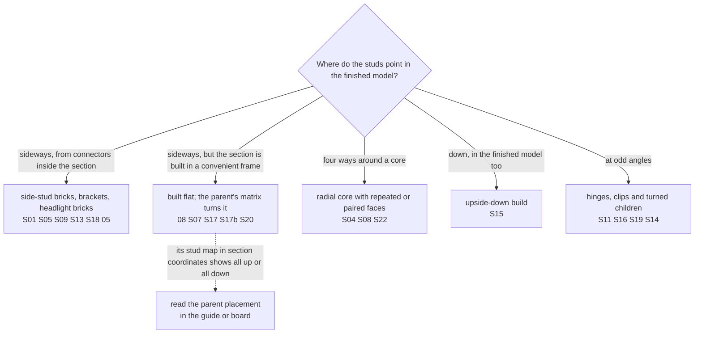

# SNOT construction

SNOT (studs not on top) builds surfaces sideways: a part with studs on its side carries plates, tiles or whole panels that face outward. It is the default for new models. You choose the support, the stud and the part; the tool computes the rotation and position. Plan fields in general: [write-plans](../write-plans/SKILL.md).

## 1. Choose a support with side studs

| Part | Side studs (in the part's own frame) |
|---|---|
| `87087` brick 1 x 1 with stud on 1 side | 1 facing -Z |
| `30414` brick 1 x 4 with studs on side | 4 facing -Z |
| `52107` brick 1 x 2 with studs on sides | 2 facing -Z, 2 facing +Z |
| `67329` brick 1 x 2 x 1.667, 8 studs on 3 sides | 2 +X, 2 -X, 4 -Z |
| `99780` bracket 1 x 2 - 1 x 2 up | 2 facing -Z |
| `4070` headlight brick | 1 facing -Z, recessed 4 LDU |

More supports are in the [interface table](#snot-interface-table) below. `./ldraw-agent part CODE` lists any part's studs and sockets by face, in the order `on` counts them.

**Start from a real connection.** Rotating an ordinary part next to a wall does not attach it: a sideways part needs studs behind it. Locate the support's actual mating face before adding the visible surface.

## 2. Seat parts on its studs

```json
{"id": "core", "ref": "30414.dat", "colour": 71, "at": [0, -24, 0], "yaw": 90},
{"id": "panel", "ref": "3710.dat", "colour": 15, "on": {"to": "core", "face": "-Z", "stud": 0}}
```

- `face` and `stud` pick the support's stud. Faces are the support part's own faces as `part` lists them, so they stay correct however the support is turned. Without `face`, the part goes on top.
- `socket` picks the new part's socket (default 0). The tool turns the new part so that socket faces the stud and computes the origin `t - R*q` from the real connector positions.
- By default it uses the quarter turn that covers the most studs; `"roll": 90` overrides that. `--report` lists each seat with `mated`, the number of studs covered.
- When a part bridges two supports, the best quarter turn on one support is ambiguous: state `roll`.

Workflow: run `part` on the support and the attached part, seat it, then build and review this small connection before repeating it or covering it with decoration.

## 3. Build surfaces as modules

Build a panel flat, studs up, in its own section. Then seat the whole section by the point that touches the stud:

```json
{"id": "flank", "ref": "flank.ldr", "colour": 15, "on": {"to": "core", "face": "-Z", "stud": 0, "socket_at": [-30, 8, 0], "roll": 90}}
```

`socket_at` is in the section's frame, and its underside faces +Y as with any part built upright. A module has no socket list, so give `roll` or `orient` explicitly. The Halcyon's starboard flank, for example, is seated with `"on": {"to": "hull/flank-mount-0-s", "face": "-Z", "stud": 0, "socket_at": [-110, 0, 10], "roll": -90}` ([spacecraft](../design-models/spacecraft/SKILL.md)).

## 4. Hang parts underneath

Studs that point down, or parts built downward from a surface, use `under`: the placed part's stud goes into a socket of the part above.

```json
{"id": "chin", "ref": "3665a.dat", "colour": 15, "under": {"to": "deck", "socket": 0}}
```

`socket` and `socket_face` pick the support's socket (default its underside); `stud` and `face` pick the placed part's stud (default its top). The default turn again covers the most studs.

## 5. Round off blocky edges

Curved parts seat on side studs like any other part, which is how SNOT softens a boxy outline. **Every vehicle must get this pass** (procedure and parts table: the silhouette pass in [design-models](../design-models/SKILL.md)).

```json
{"id": "core", "ref": "30414.dat", "colour": 71, "on": {"to": "base"}},
{"id": "edge", "ref": "61678.dat", "colour": 15, "on": {"to": "core", "face": "-Z", "stud": 0, "socket": 2}}
```

- A curved slope's sockets sit only under its flat end; the curve overhangs. `part 61678` lists sockets at different heights: socket 0 is inside the curve, so seating by default covers 1 stud, while `"socket": 2` (on the bottom face) covers 2. Always name the socket and check `mated` in the `--report` seats.
- Choose `roll` so the curve faces outward and confirm it in a render.
- Long rounded edges: brackets studs-out along the edge carrying curved-top bricks (`6081`, `6091`) laid on their sides, with their flat studs tiled (`10258-rounded-roof`).
- Noses: triple-curved wedges (`43712`) hung on side-stud bricks around a core one stud narrower than the body (`5892-snot-nose`).
- Undersides: inverted curved slopes (`32803`) hang with `under`.

## Finish

- Cover studs that face outward with tiles unless they are a deliberate texture; review warns with `appearance.exposed_side_studs`.
- Five plates (40 LDU) equal two studs (`5 × 8 = 2 × 20`): use this to line up sideways and upright grids. Each connector's own offset still matters.
- The [snap workflow](../reference/connectors-and-snapping/SKILL.md) covers interfaces other than studs.

## Worked reference: the parrot head

Start with the 14-piece parrot head (`examples/parrot/head.plan.json`), then the 66-piece complete bird (`examples/parrot/parrot.plan.json`, which includes the head). Origin at the turntable top; -Y up, +X toward the beak, ±Z toward the eyes.

```sh
./ldraw-agent review examples/parrot/head.plan.json --outdir output/snot-head
./ldraw-agent manual prepare output/snot-head/model.mpd \
  --section parrot-head.ldr --outdir output/snot-head-steps --views home back
```

Open the previews and `output/snot-head-steps/index.html` to see the core before it is covered. Two opposing `67329` bricks form a core with studs up and toward four sides; each is 40 LDU high.

| Stage | Added construction |
|---|---|
| 1 | Turntable top, `3679` |
| 2 | Two opposing `67329` side-stud bricks |
| 3 | Rear plate and staggered beak supports |
| 4 | Two rear slopes |
| 5 | Eyes on opposite side faces |
| 6 | Crown and rear crown slope |
| 7 | Curved beak on the two jumper studs |

**A concrete offset.** The lower beak jumper as an explicit placement:

```json
{
  "id": "beak-lower-jumper",
  "ref": "15573.dat",
  "colour": 0,
  "at": [28, -10, 0],
  "matrix": [[0, -1, 0], [0, 0, -1], [1, 0, 0]]
}
```

Its underside sockets at local `[±10,8,0]` land on the core's front studs at `[20,-10,±10]`; its top stud sits at `[28,-10,0]`, centred between them. The 8 LDU offset is plate thickness; stud height adds no gap. The same placement as a seat builds byte-identical output:

```json
{"id": "beak-lower-jumper", "ref": "15573.dat", "colour": 0,
 "on": {"to": "core-left", "face": "+X", "stud": 1, "socket": 0, "roll": -90}}
```

| Head interface | Core stud-base plane | Attached part origin |
|---|---|---|
| Right eye | Z = 20 | `[0,-20,28]` |
| Left eye | Z = -20 | `[0,-20,-28]` |
| Lower beak jumper | X = 20 | `[28,-10,0]` |
| Rear plate | X = -20 | `[-28,-10,0]` |

These coordinates belong to these parts; do not turn them into universal offsets. `85984`, for instance, has its origin at its underside and extends toward negative local Y.

## Angle a detail around one stud

A part attached at one socket may turn in-plane, so its free end leaves the grid: diagonal trim, ears, markings, small curves. In the cat face (`examples/cat/head.plan.json`) the left ear is `"on": {"to": "face-base", "stud": 1, "socket": 1, "roll": 45}`, which yields the fractional origin `[-37.071067812,-8,17.071067812]`. On a top stud `roll` turns the same way as `yaw`. Never round such coordinates; and do not use this freedom on an assembly attached at two separate studs. More in [animals-and-objects](../design-models/animals-and-objects/SKILL.md).

## Keep articulation separate

Study ball joints, clips, hinges and turntables separately from fixed SNOT connections. Pose a child at its own joint when its orientation must stay independent of its parent. When cleaning a rounded export, recover the module's local grid, re-seat the joint at the pivot, then apply a proper rotation to the whole module; never round an angled assembly's world coordinates.

## Learn from real-set submodels

```sh
./ldraw-agent examples --family submodel --details snot
```

Entries marked inspiration (S14, S15, 04) need `--scope inspiration`. Choose by where the studs end up:



The parent often supplies the orientation or missing parts. Several database descriptions are wrong: read each guide's *Description check* first. Subject references: [vehicles](../design-models/vehicles/SKILL.md) (Ferrari F40 bodywork), [spacecraft](../design-models/spacecraft/SKILL.md) (B-Wing, Halcyon; also `examples/10283-oms-pod/` side-stud core under a hinged shell, `examples/10030-micro-tantive/` lengthwise sideways hull).

## Read the evidence honestly

The parrot head passes checks with one connection group; the full parrot passes checks and BOM comparison but reports ten automatic groups because recessed sockets (`22885`, `67329`, `47457` are handled; others are not) escape the checker. Evidence `heuristic` in the table below marks inspected deep or square sockets: check those seats in a render. Do not raise global tolerances to make a model pass.

## SNOT interface table

Faces are the part's own directions (-Y is up). Indices count from 0 within a face in the order `part` lists them; use them as `on: {"to": ID, "face": F, "stud": N}` for the support and `socket` for the placed part. Coordinates of each stud are in the verbatim copy below.

| Part | Description | Origin | Studs by face | Sockets |
|---|---|---|---|---|
| 87087 | Brick 1 x 1 stud on 1 side | body top, centred | -Y 1; -Z 1 | +Y 1 |
| 4070 | Brick 1 x 1 headlight | body top, centred | -Y 1; -Z 1 (at z -6) | +Y 1 |
| 30414 | Brick 1 x 4 studs on side | body top, centred | -Y 4; -Z 4 | +Y 4 |
| 11211 | Brick 1 x 2 two studs on one side | body top, centred | -Y 2; -Z 2 | +Y 2 |
| 52107 | Brick 1 x 2 studs on sides | body top, centred | +Z 2; -Y 2; -Z 2 | +Y 2 |
| 22885 | Brick 1 x 2 x 1.667 studs on 1 side | body top, centred | -Y 2; -Z 4 | +Y 3 |
| 67329 | Brick 1 x 2 x 1.667 8 studs on 3 sides | body top, centred | +X 2; -X 2; -Y 2; -Z 4 | +Y 3 |
| 32952 | Brick 1 x 1 x 1.667 studs on 1 side | body top, centred | -Y 1; -Z 2 | +Y 1 |
| 4733 | Brick 1 x 1 studs on four sides | body top, centred | +X 1; +Z 1; -X 1; -Y 1; -Z 1 | — |
| 26604 | Brick 1 x 1 studs on two adjacent sides | body top, centred | +X 1; -Y 1; -Z 1 | +Y 1 |
| 47905 | Brick 1 x 1 studs on two opposite sides | body top, centred | +Z 1; -Y 1; -Z 1 | +Y 1 |
| 99780 | Bracket 1 x 2 - 1 x 2 up | 12 below body top, offset z -2 | -Y 2; -Z 2 | +Y 2 |
| 99781 | Bracket 1 x 2 - 1 x 2 down | body top, offset z -2 | -Y 2; -Z 2 | +Y 2 |
| 99206 | Plate 2 x 2 x 0.667 two studs on side | body top, offset z 10 | -Y 4; -Z 2 | +Y 5 |
| 99207 | Bracket 1 x 2 - 2 x 2 up | 32 below body top, offset z -2 | -Y 2; -Z 4 | +Y 2 |
| 44728 | Bracket 1 x 2 - 2 x 2 down | body top, offset z -2 | -Y 2; -Z 4 | +Y 2 |
| 36840 | Bracket 1 x 1 - 1 x 1 up | 12 below body top, offset z -2 | -Y 1; -Z 1 | +Y 1 |
| 36841 | Bracket 1 x 1 - 1 x 1 down | body top, offset z -2 | -Y 1; -Z 1 | +Y 1 |
| 2436b | Bracket 1 x 2 - 1 x 4 rounded corners | body top, offset z -2 | -Y 2; -Z 4 | +Y 2 |
| 28802 | Bracket 1 x 2 - 1 x 4 rounded bottom corners | body top, offset z -2 | -Y 2; -Z 4 | +Y 2 |
| 3794b | Plate 1 x 2 jumper (1 centre stud) | body top, centred | -Y 1 | +Y 2 |
| 15573 | Plate 1 x 2 jumper, no understud | body top, centred | -Y 1 | +Y 3 |
| 87580 | Plate 2 x 2 jumper | body top, centred | -Y 1 | +Y 5 |
| 2921 | Brick 1 x 1 with handle | body top, offset z -7 | -Y 1 | +Y 1 |
| 4081b | Plate 1 x 1 clip light type 2 | 6 below body top, offset z -9 | +X 1; -X 1; -Y 1 | +Y 1 |
| 61252 | Plate 1 x 1 clip horizontal (thick) | 5.448 below body top | -Y 1 | +Y 1 |
| 60470b | Plate 1 x 2 with 2 clips horizontal | 5.448 below body top | -Y 2 | +Y 2 |
| 11476 | Plate 1 x 2 clip horizontal on side | 5.448 below body top | -Y 2 | +Y 2 |
| 32028 | Plate 1 x 2 with door rail | body top, offset z -4.5 | -Y 2 | +Y 2 |
| 3024, 3023b, 3022, 3710 | Plates 1x1, 1x2, 2x2, 1x4 | body top, centred | -Y 1/2/4/4 | +Y 1/2/4/4 |
| 3070b, 3069b, 2431, 3068b | Tiles 1x1, 1x2, 1x4, 2x2 | body top, centred | — | +Y 1/2/4/5 |
| 2412b | Tile 1 x 2 grille | body top, centred | — | +Y 2 |
| 98138 | Tile 1 x 1 round | body top, centred | — | +Y 1; -Y 1 |
| 11477, 85984, 54200 | Curved slope 2x1, slope 31 1x2, 1x1 | **body bottom**, centred | — | +Y 2/2/1 |
| 4589 | Cone 1 x 1 | -9.5 below body top | -Y 1 | — |

`4085d` is not in the installed library.

## Source docs

Verbatim copies, for details not covered above:

- [docs/agent/cards/snot.md](references/docs-agent-cards-snot.md)
- [docs/agent/guides/snot.md](references/docs-agent-guides-snot.md)
- [docs/agent/reference/snot-interfaces.md](references/docs-agent-reference-snot-interfaces.md)
- [examples/parrot/README.md](references/examples-parrot-README.md)
