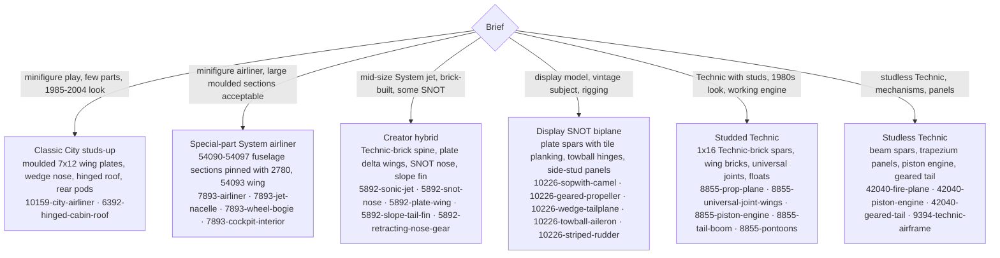
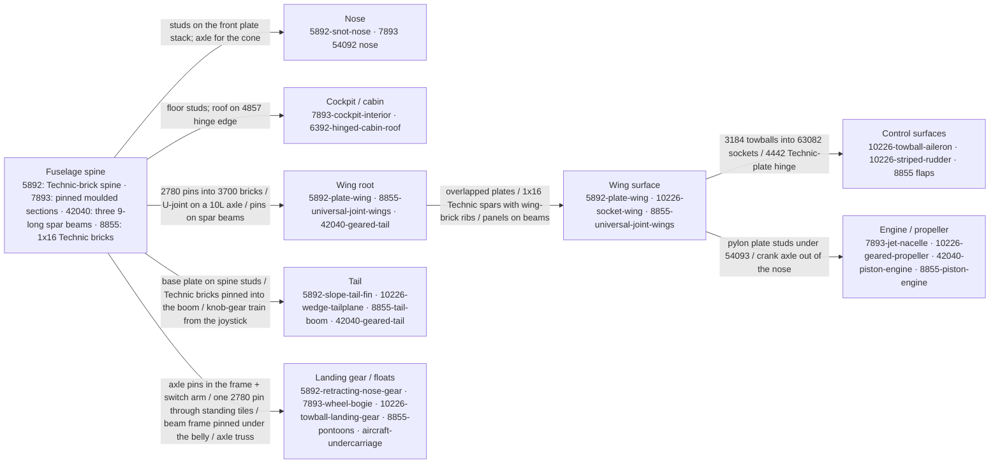
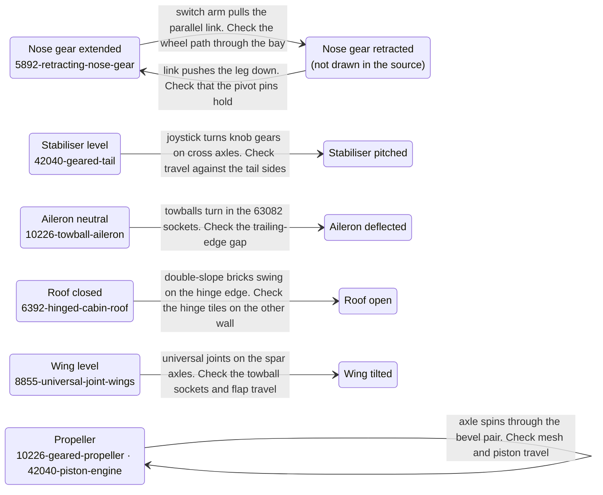
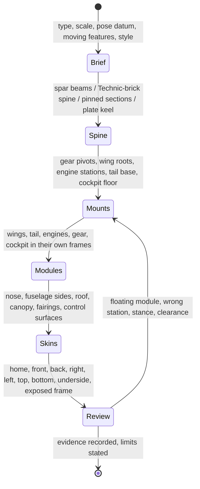

# Build aircraft in any style

Aircraft lessons come from eight real sets reviewed into the `aircraft` family: seven whole-aircraft studies that show proportions and module layout, and twenty-one detail packages with build pages and inspection boards. Retrieve them by role, then open the package `GUIDE.md` before copying anything:

```sh
./ldraw-agent examples --family aircraft                     # whole-aircraft studies
./ldraw-agent examples --family aircraft --details 'wing'    # detail packages
./ldraw-agent knowledge search 'retracting nose gear' --family aircraft
./ldraw-agent knowledge show aircraft:7893-jet-nacelle
```

Default retrieval returns the reusable (`construction`) packages. Whole-aircraft studies whose sources keep LDCad strings, LSynth segments, skewed parts or unclassified embedded parts are `inspiration`: read them for proportions and module split, then rebuild the technique with the detail packages and your own interfaces (`--scope inspiration`).

## Brief and datums

| Decision | Establish before placing parts |
|---|---|
| Type | Airliner, business jet, fighter, general-aviation prop plane, biplane, floatplane, trainer. The type fixes wing position (low, mid, high, biplane), engine count and placement, tail form (conventional, T-tail, twin fin) and gear (tricycle, taildragger, floats). |
| Scale | Minifigure cabin (one window per two studs, 4–6 wide), display (10226 is 59 studs span at about 1:30), Technic (studless or studded frame, no interior scale). |
| Pose and datum | X across, −Z forward, −Y up. Parked: Y=0 is the ground and the gear height is part of the brief. In-flight display: Y=0 is the nose floor and the stand is a separate module. |
| Moving features | None, propeller spin, retracting gear, hinged control surfaces, opening roof or doors, tilting wings. Each needs its own package precedent and its own check (see below). |
| Style | One of the six styles below; mixing is normal (5892 is a Technic spine under a System skin with a SNOT nose). |

The source models do not share the Nova frame: 10226 and 5892 run their fuselage along X, 10159 and 8855 point the nose to +Z. Every package records its parent matrix; LeoCAD's `front` and `right` views are named for the model's axes, not the aircraft's, so read the board captions before trusting a view.

## Choose a style



Measured from the sources (`examples/aircraft-atlas/measure.py`; studs, parts as placed, Technic share by part-name prefix):

| Source | Style | Parts | Technic | Span × length × height | Studs up / sideways / down (angled) | Stations from the nose |
|---|---|---:|---:|---|---|---|
| 10159 airplane | classic City | 121 | 0% | 25 × 29 × 14 | 117 / 4 / 0 (0) | nose gear 3, mains 16, rear pods 18–19 |
| 7893 plane | special-part airliner | 358 | 12% | 70 × 64 × 23 | 272 / 72 / 0 (14) | engines 22–28 at ±11 and ±19 across; outer wing 35–40 |
| 5892 Airplane | Creator hybrid | 524 | 16% | 41 × 50 × 17 | 429 / 84 / 4 (7) | nose gear 24, engines 45 at ±2 across, outer wing 33–40 |
| 42040 Fire Plane | studless Technic | 570 | 94% | 53 × 42 × 23 | 0 / 172 / 0 (398) | pistons 6, mains 24 at 14 track, outer wing 15–23 |
| 8855 Prop Plane | studded Technic | 598 | 66% | 72 × 50 × 26 | 327 / 62 / 11 (198) | float wheels 26 and 40 at 17 track, outer wing 27–37 |
| 9394 airframe (B model) | studless Technic | 583 | 66% | 54 × 60 × 16 | 201 / 137 / 27 (218) | mains 21 at 6 track, tail wheel 54, outer wing 19–27 |
| 10226 Sopwith Camel | display SNOT biplane | 811 + 400 segments | 8% | 59 × 50 × 23 | 722 / 117 / 10 (362) | upper wing 5–18, dish wheels under the nose |

Read the ratios, not the numbers: an airliner's span is about 1.1× its length and its engines sit at a third and a half of the semi-span; a jet is 1.2× longer than its span with the engines at the tail; a floatplane or biplane is wider than long; a Technic trainer puts the propeller on the nose and the wheels at a third of the length.

## Airframe topology

Every package fits one of these roles. Edge labels name the actual connector the source uses, with the package that shows it.



| Role | Pattern | Package (scope) | What the parent must supply |
|---|---|---|---|
| Nose | Studs-up core one stud narrower than the fuselage, curved wedges hung sideways on 1×4 side-stud bricks, cone pair on an axle | `5892-snot-nose` | front plate stack, canopy behind the instrument slope |
| Fuselage skin | One-stud brick wall on a plate strip, hinge plates at the ends for a plan taper, reinforced panel where thin | `10226-cowling-side` (inspiration) | floor, neighbouring walls, rigging anchor |
| Cabin roof | Four 4×4 double-slope hinge bricks on a window-brick wall; the other wall carries the hinge | `6392-hinged-cabin-roof` | opposite wall with hinge tiles, floor, end walls |
| Flight deck | Seats, printed instrument slopes, bar control columns, grille tiles on side-stud bricks as consoles, on one plate | `7893-cockpit-interior` | moulded nose glazing and floor sockets |
| Wing, plate-built | Corner-cut plates overlapped two deep, tiles on the trailing edge, curved bricks on the leading edge, 1×2 Technic bricks at the root | `5892-plate-wing` | pins and bars at the root |
| Wing, Technic spar | Two 1×16 Technic bricks as spars, wing-front/back bricks as ribs, 1×8 plates as skin | `8855-universal-joint-wings` | cabane with towball sockets, drive gears |
| Wing, planked display | 2×16 plate spars, 1×3 tile rows with gaps as fabric ribs, socket plates for control surfaces, suspension arms as struts | `10226-socket-wing` (inspiration) | lower wing and cabane, ailerons, rigging anchors |
| Wing, studless | 5×11 trapezium panels on a beam pinned to continuous spar beams | `42040-geared-tail` | the front frame the spars pin into |
| Tailplane | 6×12 plate core, 3×12 wing plates as tapered halves, 1×8 curved slopes as tips, turned 90° by the parent | `10226-wedge-tailplane` | rear fuselage, elevator rigging |
| Fin | One-stud brick stack, 45° slopes stepping the leading edge, inverted 75° slopes as the rudder strip, 18° root fillet | `5892-slope-tail-fin` | spine studs |
| Empennage, studded Technic | 7×12 wing plates as one-part tailplane halves, jumper-plate fin, control axle with toggle joints along the boom | `8855-tail-boom` | rear fuselage, control lever |
| Tail with control | Liftarm fin, stabiliser on an axle pitched by knob gears from the joystick | `42040-geared-tail` | floor, seats, front frame |
| Control surface | Two-plate strip with a rounded tip, two 1×4 towball plates on the hinge edge | `10226-towball-aileron` | two 63082 sockets at matching spacing |
| Striped rudder | Side-stud column with handle bricks, stripes as plates on the side studs | `10226-striped-rudder` | clips on the fin |
| Jet nacelle | 43121 shell, 46667 fan on its pin, 3942c cone exhaust, 2×8 plate pylon with a curved-slope fairing | `7893-jet-nacelle` | wing underside anti-studs |
| Radial engine and propeller | Eight clip-plate cylinders around an octagonal rod frame, bevel gears and belt wheel on a 6L axle, 2-blade rotor with wedge-plate blades | `10226-geared-propeller` | nose bearing, crank drive, cowling |
| Piston engine, studless | Two pistons on rods and a crank between cross blocks, bevel pair to the propeller axle, bent-liftarm cradle, red panel hood | `42040-piston-engine` | propeller axle and rotor, nose frame |
| Engine block, studded | Plate H, 1×8 Technic bricks as crank bearings, red crankcase, standing 1×3 bricks as cylinder banks | `8855-piston-engine` | propeller axle, piston and gear sections |
| Nose gear, retracting | Bent liftarm with the wheel on a 2L axle, thin liftarms as a parallel link, axle pins as the pivot | `5892-retracting-nose-gear` | pivot holes, switch arm, bay opening |
| Main gear, bogie | Two 2×2 wheel-pin plates under a 2×4 plate, standing 1×2 tiles with holes, one 2780 pin as the mount | `7893-wheel-bogie` | one pin hole under each wing root |
| Main gear, strut | Short axle with two angle connectors between a fuselage pin and a free wheel pin | `aircraft-undercarriage` | Technic receiving bricks in the fuselage |
| Gear, vintage | 7×5 open-centre beam frame, suspension-arm V struts, shock absorbers, 12L axle with pulley-and-dish wheels | `10226-towball-landing-gear` (inspiration) | belly pin holes, cowling |
| Floats | 1×16 Technic-brick floats with stepped plates and inverted-slope bows, wheels inside, axle truss on steering arms and toggle joints | `8855-pontoons` (inspiration) | fuselage underside for the truss apexes |
| Ground equipment | 30134 staircase on a 4×6 plate with wheel-pin plates and a 4×4 landing | `7893-boarding-stairs` | the door sill height |

Cockpit fittings for System aircraft (`vehicle-fittings#pilot-cockpit`, `vehicle-fittings#jet-engine-pod`) and the enclosed `canopy-cockpit` also carry the `aircraft` family. Database descriptions were checked against the images for every package; the GUIDE's *Description check* says where the source description was wrong (the 10226 "radial engine" section is the rudder; the 10226 landing gear was described as a beam frame; the 42040 tail section also carries both wings).

## Moving features

Each package draws one pose. A pose is not travel: before claiming that a feature moves, draw the second pose, check the swept path against the airframe with the [mechanism workflow](mechanisms.md), and record what was not checked.



## Build order and review



Open the images and answer these before delivery:

- Silhouette: does it read as the type at thumbnail size? Is the span-to-length ratio in the measured range for the style, and does the wing sit at the station the type needs (a third of the length for a jet, mid-fuselage for a high-wing prop plane)?
- Symmetry: are the two wings, engines, gear legs and tailplane halves mirrored by placement, not by reflected parts? Do paired engines sit at the same station and height?
- Stance: on the ground, do all tyres meet Y=0, is the nose level or slightly nose-up, and is there clearance between the propeller or nacelles and the ground?
- Interfaces: does every module touch a real connector (pin, stud, towball, hinge) and not just a bounding box? Render the bare spine with the mounts before closing the skins.
- Seams: is the fuselage closed between nose, cabin and tail, with the canopy sitting on a rim and the fin base on studs or pins?
- Tail: is the tail arm long enough (tailplane behind the wing by at least the wing chord), and do the fin and tailplane have a real root?
- Underside: inspect the belly, gear bays and pylons from below; the three-quarter view hides them.

`./ldraw-agent vehicle check MODEL.mpd --profile aircraft` runs the generic geometry checks and reports `vehicle.interfaces_unreviewed`; without `--recipe` it does not know which parts you used. The [review workflow](review-models.md) and `bin/ldraw-xray` boards supply the evidence; a passing check and a pleasing render are different things.

## Evidence and limits

Each package carries its source hash, extraction record, source checks, Python and LeoCAD BOM comparison, build pages or completed views, an inspection board and a review that lists every image opened. That proves what the source looks like and how it is organised. It does not prove clutch, fit, clearance, travel, strength, flight balance or part availability. Inspiration packages keep source errors on purpose; rebuild their technique instead of exporting them. Three reusable Technic packages (`42040-geared-tail`, `8855-universal-joint-wings`, `8855-tail-boom`) pass export, rebuild and BOM checks but `./ldraw-agent build` reports `technic.invalid_seating` for a few source interfaces drawn partly seated; each package's limits name them, and a new model must seat those pins and axles properly. The 2026-11-10 retirement of the An-225 and courier-jet precedents is recorded in the [implementation record](../../plans/knowledge-base-overhaul/implementation.md).
