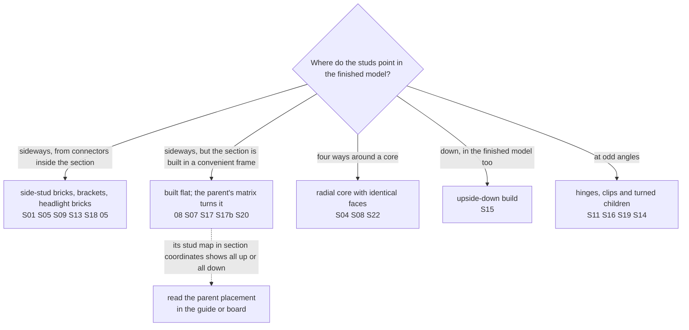

# Build with studs facing sideways

Start with the [14-piece parrot head](../../examples/snot/parrot/README.md). Its seven stages expose a small SNOT core, sideways eyes, jumper offsets and a shaped beak. The [complete parrot](../../examples/snot/parrot/parrot.plan.json) supplies the surrounding body and articulated connections. Both use ordinary JSON plans and the existing builder.

Then use the [cat studies](../../examples/snot/cat/README.md) for single-stud diagonal details and a repeated three-piece limb. The cat's face is a flat panel posed on a ball joint; its brow bracket's sideways studs remain exposed. It broadens the shaping and articulation vocabulary without supplying another fixed perpendicular stud interface.

For vehicle bodywork, use the [Ferrari F40 reference](../../examples/snot/ferrari-f40/README.md): a searchable map of 74 sections and five small build studies covering body mounts, door trim, lamp/grille corners, window louvers and fascia supports. Its flattened main car and saved callouts differ; use the checked small studies and their parent notes when adapting a construction.

For spacecraft, use the [6208 B-Wing study](../../examples/snot/b-wing-6208/README.md). Its exposed bracket core, opposing curved skins and wing-root carrier show how to combine System surfaces with Technic attachments. This is a source-and-image learning reference; geometry and flexible-part verification were deferred for this study.

The [Halcyon interceptor](../../examples/snot/halcyon/README.md) is the default model to follow for all new spaceships, which use SNOT by default. Fifteen `30414` side-stud bricks in one hull course expose stud faces to port, starboard, forward and aft. Flank panels, pod stripes, intakes, nozzles and cannons are each built upright in their own section and seated with `stud - R * socket`. The 195-piece model forms one automatic connection group, and its test checks every SNOT interface's contact count.

```sh
./ldraw-agent review examples/snot/parrot/head.plan.json --outdir output/snot-head
```

Open the previews. To see the core before it is covered:

```sh
./ldraw-agent manual prepare output/snot-head/model.mpd \
  --section parrot-head.ldr --outdir output/snot-head-steps --views home back
```

Read the source plan alongside the steps; the placement IDs name the construction roles. Preserve the source credit when adapting it.

## Start from a real connection

SNOT changes which face carries the next assembly. Rotating an ordinary part does not create a connection to the neighbouring wall. Choose a side-stud brick, bracket, headlight brick or another inspected connector; locate its actual mating face before adding the visible surface.

The parrot's two `67329` bricks form a core with studs facing up and toward four sides. Each is 40 LDU high: five plate heights equal two stud pitches (`5 × 8 = 2 × 20`). That equality helps plan perpendicular grids, but each connector's offset still matters. The [mini truck cab](../../examples/reference-atlas/mini-truck-cab/README.md) provides a further example using headlight bricks and brackets.

1. Inspect the support and attached part with `part`, then inspect their connector frames with `connectors` in a small assembly.
2. Choose the attached part's orientation. LDraw's local up direction is `[0,-1,0]`; multiply it by the placement matrix to see where its studs point. Use proper rotations, never mirrored parts.
3. Align the actual socket entry with the target stud base. For rotation `R`, local socket position `q` and target position `t`, the part origin is `t - R*q`.
4. Build and review this small connection before repeating it or covering it with decoration. Use the existing [snap workflow](snapping.md) when its reported coverage supports the interface.

The plan's `on` placement is for upright rectangular parts. For sideways work use `at` with a proper `matrix`, or an inspected `snap`. A submodel keeps an entire surface in one local frame; rotate and translate the submodel when placing it on another face.

## A concrete offset from the head

The head's local origin is at the turntable top, with the beak toward +X. The lower black jumper is:

```json
{
  "id": "beak-lower-jumper",
  "ref": "15573.dat",
  "colour": 0,
  "at": [28, -10, 0],
  "matrix": [[0, -1, 0], [0, 0, -1], [1, 0, 0]]
}
```

Its local up maps to +X. Its underside sockets at local `[±10,8,0]` become `[20,-10,±10]`, exactly on the core's front studs. Its single top stud becomes `[28,-10,0]`, centred between those two stud columns. The 8 LDU offset is plate thickness; the 4 LDU stud height adds no gap.

| Head interface | Core stud-base plane | Attached part origin |
|---|---|---|
| Right eye | Z = 20 | `[0,-20,28]` |
| Left eye | Z = -20 | `[0,-20,-28]` |
| Lower beak jumper | X = 20 | `[28,-10,0]` |
| Rear plate | X = -20 | `[-28,-10,0]` |

These coordinates belong to these inspected parts. Do not turn them into universal offsets for all slopes or tiles. For example, `85984` uses its underside as its origin and extends toward negative local Y. A slope and supporting plate can therefore share an origin without their bodies intersecting. Full bounding-box height is not a stacking dimension.

## Angle a detail around its engaged stud

The cat's round-ended `35480` ears attach to the face at one socket each. This allows an in-plane angle while the free end leaves the rectangular grid. The quarter-round nose uses the same principle on a jumper stud. This is a useful way to form diagonal trim, markings and small curved silhouettes.

Use the same `origin = target - R*socket` calculation. In the flat [cat face plan](../../examples/snot/cat/head.plan.json), the left ear's socket `[10,8,0]` meets the support at `[-30,0,10]`. With `yaw: 45`, the required origin is `[-37.071067812,-8,17.071067812]`. Those fractional coordinates express a real diagonal; independently rounding them would break the seating. A two-stud connection usually fixes the in-plane angle, so do not apply this freedom to an assembly attached at two separate studs.

Build the attachment before covering it with decoration. The [cat's eight stages](../../examples/snot/cat/README.md#read-the-face-before-the-eyes-cover-it) reveal the ear pivots before the eyes hide them. Inspect neighbouring material and rear support as well as the visible outline; coincident connectors alone do not establish clearance or strength.

## Keep articulation separate

The parrot's wing panels have exact local stud grids. Their ball centres define the module origins; a rigid placement supplies the pose. The tail rotates around handle/clip axes and the neck uses a turntable. Study these joints separately from the fixed SNOT connections in the head. A plausible pose or coincident joint centre does not establish the permitted movement range.

The [cat leg](../../examples/snot/cat/leg.plan.json) is a second small example: a socket plate, clip plate and curved cover form one rigid module with its origin at the hip socket. The full model repeats that module four times, then places each paw at its ankle bar. Pose a child at its own joint when its orientation must stay independent of its parent: turning an entire leg-and-paw copy around would also turn the paw backward.

When cleaning a rounded export, recover the module's local grid first. Re-seat its joint at the intended pivot, then apply a proper rotation to the whole module. Do not round an angled assembly's world coordinates to the nearest stud or integer. The retained [preparation record](../../examples/snot/parrot/preparation.json) accounts for every source placement and correction.

## Learn from real-set submodels

The [submodel atlas](../../examples/submodel-atlas/README.md#pick-an-entry-by-technique) holds 25 reviewed SNOT constructions from real sets, each with build pages, a stud-direction map and a guide. Find them with `./ldraw-agent examples --family submodel --details snot`. Ask where the studs end up and who turns them:



The parent often supplies the orientation or missing parts: 04's lamp cluster is unreadable until the parent's axis permutation turns it, and S04's hub carries eight panels placed by its parent. Several database descriptions are wrong; read each guide's *Description check* before choosing an entry.

## Read the evidence

The head passes source/geometry error checks, has one optimistic connection group and matches LeoCAD's BOM. The complete 66-piece parrot also passes the error checks and BOM comparison, but its automatic graph still has ten groups. The [reference review](../../examples/snot/parrot/visual-review.md) identifies the recessed sockets omitted by the dependency's whole-box entry-face test. Explicit interface evidence accompanies the model; it does not override the checker.

The adapter handles the inspected deep underside sockets of `22885`, `67329` and `47457` as potential stud evidence. Reported source metadata is unchanged. Other unsupported interfaces require their own inspection; do not increase global tolerances to make a model pass.

The cat's head and leg each have one optimistic group, while its complete model has four. Its [review](../../examples/snot/cat/visual-review.md) documents recessed `14417` sockets and the tail axle's mixed reviewed/unreviewed Technic ports. Reference-specific evidence accompanies those interfaces; the general checker is unchanged.

The torus is useful later for larger shapes, orientation variety and repetition. Its flat export does not supply a construction sequence or verified physical structure. Start new SNOT constructions from the small reviewed connections, then check the combined model's clearances and support.
