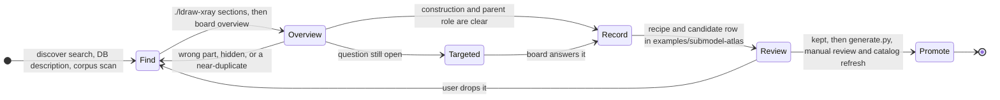
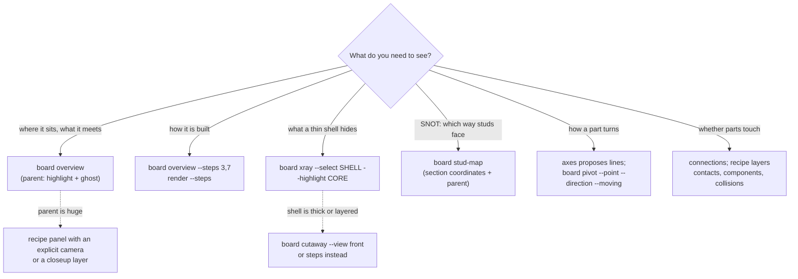
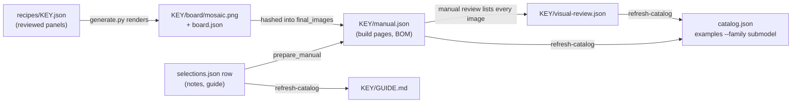

# Inspect submodels with ldraw-xray

[ldraw-xray](https://github.com/anteloc/ldraw-xray) renders a source section with
LeoCAD:

- isolated, or highlighted inside its parent;
- step by step;
- see-through or cut away;
- coloured by stud direction;
- posed about an axis.

It then composes the views into a labelled board. Nova installs it as a core
dependency. `./ldraw-xray` runs it from the project environment, with the same
`LDRAW_DIR`, `LDRAW_SHADOW` and `LEOCAD` settings as `./ldraw-agent`. Like
`./ldraw-agent`, it defaults to the bundled `data/offLibShadow`.

xray only shows synthetic copies; it never judges a model, and it never changes
a source or the library. You decide what a picture means, and you check the
source before claiming a fit.

```sh
./ldraw-xray doctor        # library, shadow, LeoCAD and the available layers
```

## Workflow



Start from the [discovery guide](reference-discovery.md) or a direct DB/corpus
query. Then list the sections, and render an overview of the candidate:

```sh
./ldraw-agent discover search submodels 'rear axle differential' --engine fts --limit 8
./ldraw-xray sections data/models-annotated/42075-1.mpd
./ldraw-xray board overview data/models-annotated/42075-1.mpd \
  --section '42075 - rearaxle.ldr' --steps 3,5 --output output/inspect/42075-rearaxle
```

The overview board shows:

- the section highlighted in its unique parent, with the rest ghosted;
- an isolated view;
- the requested source steps.

Open `mosaic.png` first, then the full-size `panels/*.png` for small connections.
The command prints each image with what it shows. `manifest.json` records:

- the source hash and the parent placements;
- each panel's camera, layers and LeoCAD arguments.

## Which board answers which question



Every board writes a replayable `recipe.json`. Edit a copy to choose panels,
labels, layers or cameras, then render it with `./ldraw-xray board run
RECIPE --output DIR`. The [xray reference](https://github.com/anteloc/ldraw-xray/blob/master/docs/reference.md)
lists every layer and option. The `./ldraw-xray --help` and
`./ldraw-xray board TASK --help` outputs list the flags.

Selectors pick parts:

| Selector | Picks |
|---|---|
| `section` | the inspected section's placements inside its parent |
| `step:3-5` | source steps, numbered over every `0 STEP` and `0 ROTSTEP` |
| `line:12,15` | source-file line numbers |
| `part:3001*` | part references, by glob |
| `colour:15,4` | colour codes on placement lines |

`|` adds a term and `!` excludes one. For example, `'!part:3894'` picks
everything except the bearing bricks.

## Reading the images

| You see | It means |
|---|---|
| Magenta edges | Highlighted: new in this step, or selected. The fill keeps the part's colour |
| Pale grey, see-through parts | Ghosted context |
| Neon-green rod `#39FF14` | Synthetic axis marker, not a part |
| Lilac, rose, vermilion, electric blue, aqua, lime, violet | Stud map: up, +X, −X, +Z, −Z, down, odd angle |
| Small green / olive spheres | Detected contacts: confirmed / heuristic |
| Raspberry parts | Overlap candidates (box overlap without a detected contact) |
| Dark 2 px outline | Traced silhouette, added after rendering |

Every swatch is deliberately ΔE ≥ 16 from every `LDConfig.ldr` colour, so a
recoloured part is never mistaken for a real colour. LDraw −Y is up, and the
front view looks toward +Z. View names follow LeoCAD: `right` shows the model's
right side, from −X.

## What the candidate reviews taught

These come from the 30 reviewed entries of the [submodel atlas](../../examples/submodel-atlas/README.md):

- **Check the parent before trusting a description.**
  - Four of five DB descriptions were wrong in the second batch, and many SNOT
    descriptions were wrong or empty.
  - For example, "dashboard and headlight nacelle" is a motorcycle drive cover,
    and "radial engine" is a tail rudder.
- **The parent may supply parts.** The 8081 front axle's rack meets an 8T pinion
  that is placed in the frame, not in the axle.
- **Many walls and silhouettes are built flat and stood up by the parent's
  matrix.** A stud map in section coordinates then shows "all up". Read
  `parent_placements` in the manifest, or show the section in its parent.
- **Prefer steps to x-ray when a shell is thick or layered.** X-ray paid off for a
  thin shell over a few distinctively coloured parts: the V8 crank under its
  cylinder banks.
- **Pick panels that differ.** The last source step usually looks like the
  finished isolated view. Boards report near-identical pairs as
  `duplicate_panels`.
- **Moving parts get the three-pose sweep.** Mark the axis, and render 0°, 45°
  and 90° with one fixed camera in `analysis` mode.

## Record and promote a candidate

The [submodel atlas](../../examples/submodel-atlas/README.md) holds both stages.
Its `selections.json` is the single source of truth, and agents find promoted
entries with `./ldraw-agent examples --family submodel [--details] QUERY`.

**Record** a candidate you inspected:

1. Copy the board's `recipe.json` to `examples/submodel-atlas/recipes/<key>.json`.
   - Make `source` relative to the recipe, e.g.
     `../../../data/models-annotated/42075-1.mpd`.
   - Keep only the panels that taught something.
   - Write labels that say what to look at.
2. Add a `selections.json` row with `status: "candidate"` and its `key`,
   basename `model`, `section`, SHA-256, `parent`, family tag (`category`),
   `discovery` id and `recipes`.

**Promote** it once the user keeps it:

1. Write its five study notes (`lesson`, `construction`, `interfaces`,
   `parent_context`, `reuse_notes`) and guide fields (`parent_supplies`,
   `corrected_description`, `board_reading`, `limits`). Check every step number
   against the build pages; board labels count `0 ROTSTEP` as a step.
2. Set `status: "promoted"`, then run `generate.py --probe`. Use `adapt` when
   the source checks pass and `inspiration` when they do not.
3. Run `generate.py --name KEY`. It writes the build pages, renders the board
   into `board/`, and hashes the board as a final image.
4. Open every step page and board, then record `./ldraw-agent manual review`
   with every image `manual.json` names.
5. Run `generate.py --refresh-catalog`, then `pytest tests/test_submodel_atlas.py`.



`tests/test_submodel_atlas.py` checks each source hash, parent, discovery id
and recipe. It also checks catalog paths, board provenance and review status, and
rebuilds every `adapt` plan against its LeoCAD BOM.

xray boards supplement the build-page review; they do not replace it. For other
atlases, follow [build manuals §4](build-manuals.md#4-review-export-and-add-to-an-atlas).

## Limits

- Renders show geometry. They do not prove clutch, clearance, travel or stability.
- xray's contact overlays use pyldraw3 with a subset of nova's connector adapter.
  - Technic pin/axle mating is not paired, so a pin-mounted part can appear as
    its own "floating" group.
  - Nova's fixes for 6014 wheel axes and deep stud sockets are missing.
  - Overlap candidates come from axis-aligned boxes.
  - Use nova's [validation](validation.md) for physical claims.
- Poses are rigid re-placements: clearance is not checked.
- A recipe cannot remove arbitrary parent placements. Show a selection in a
  ghosted parent with a close-up instead.
