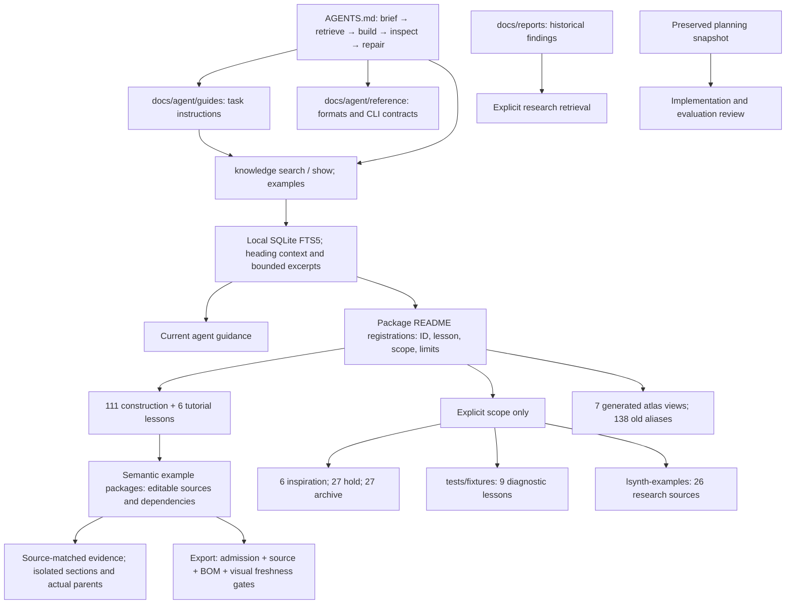

# Implementation record

Updated 2026-11-03. Retrieval, documentation, package relocation and export integration are implemented. Conditional sources remain held. **Improved Terra/Luna generation performance has not yet been demonstrated.** The preserved planning snapshot remains the review baseline; its statements that implementation is unstarted are historical.

## Implemented structure

Each package README owns its registered lessons. Models, plans, measured reports and visual evidence retain their separate roles. Default retrieval includes current guidance and construction/tutorial lessons; it never fills an empty result with held, archived or raw sources. Changed model identities cause a runtime hold. Search works without parts initialization, Jev or network access.

The entry point is shorter; 21 maintained guide/reference documents replace the mixed agent documentation. Historical verification and source-specific inventories moved to reports. Subject guidance no longer requires one vehicle recipe, one spaceship silhouette or SNOT everywhere. Aircraft recipe checks are explicit; general classification does not prove interfaces or physical validity.

## Packages and compatibility

- Applied 157 package moves with 4,701 file identities in [package-relocations.json](package-relocations.json). All 5,089 originally inventoried paths are accounted for. All 2,431 relocated model/image files retain their original hashes.
- Promoted editable boombox and An-225 packages with reviewed child/parent evidence, generators and required helper inputs. Both generators reproduced the recorded plans and MPDs byte-for-byte; see [promotion checks](promotion-checks.json).
- Consolidated grouped fittings, hull panels and classical arch lessons under parent README owners. F40 and B-wing retain selected child lesson owners alongside parent provenance; unselected sections are not indexed as construction lessons.
- Moved retired templates to archive and failure laboratories to diagnostic fixtures. Raw LSynth examples remain research sources. Selected cathedral glazing is separate from the archived whole cathedral.
- Preserved all 138 old catalog aliases, including 27 retired identities that resolve to archive. Seven atlas directories provide compatibility routers and generated views. Historical generators cannot overwrite the curated corpus in place.
- Corrected the planned Y-wing destination to **10134**, matching the actual source; the mistaken 75181 identity remains an alias. Renamed the gear-reduction lesson to **gear-and-axle-module**, matching its observed construction.
- The pneumatic press lesson uses the named canonical plan. Its old generator is not advertised as reproducing that plan; the compatibility variant is retained separately.

## Export and evidence checks

Exports resolve canonical package locations, including grouped lessons and direct reference-card packages. Exported manual READMEs carry the current corrected lesson and limits. Historical hashed notes remain evidence and are identified as such. Explicit source directories cannot bypass a registered hold.

The [export check](export-checks.json) exercised 50 eligible package exports into temporary external directories, rebuilt their copied plans and compared preserved renderer BOMs where present. Another 33 candidates remained blocked: 27 held/inspiration sources and six construction manuals without a complete-page review. This checks export integrity; it does not establish new assembly quality or motion.

Twelve existing manual reviews were stale after the earlier `ldraw-astra` → `ldraw-nova` rename. The [history audit](manual-history-audit.json) preserves the original reviews and exact historical commit/manual identities. Every changed artifact was verified as an exact branding substitution in plan author text or diagnostic paths. All other manifest fields and artifact hashes—including geometry, images, BOM and notes—were identical. Current reviews carry that reconciliation proof. No new image inspection or physical verification is claimed, and the runtime freshness gate is unchanged.

Six packages still need complete-page manual reviews before manual export: cam-follower-engine, double-cardan-shaft, four-bar-lift, four-cylinder-bank, four-speed-gearbox and paired-suspension-axles. Their prior package/section audits support the scoped construction lessons, but do not replace the separate manual-page gate. This limit is explicit in their searchable README metadata.

## Validation and preservation

- Full implementation suite: **587 passed**. After the final export fixes and added exported-lesson regression: **39 focused tests passed** (`test_discovery`, `test_knowledge`, `test_manuals`). The full suite was not repeated after those final changes.
- Resolver checks cover all legacy aliases and retired scopes. Tests cover confined paths, stale identities, no-parts search, heading context, grouped export locations and unchanged model/image hashes.
- All 42 saved planning files match their snapshot hashes. Four Markdown files had links rebased when initially copied, with both original and saved hashes recorded. No snapshot content changed during implementation.
- All relocation and promotion manifests match current files. Original hashes remain separate where maintained prose, code or review identity changed.
- Maintained Markdown paths and agent anchors pass. Two pre-existing links in the third-party `docs/pyldraw3-README.md` remain missing (`CONTRIBUTING.md`, `COPYING`). Historical An-225 research/iteration links explicitly refer to the original local output run.

Counts and preservation results are in [implementation-checks.json](implementation-checks.json). Original visual artifacts remain under `output/kb-visual-audit/`; promoted packages carry their required evidence. Unchanged geometry was not rerendered.

## Entry point and stage closure

The root [AGENTS.md](../../../AGENTS.md) now owns repository instructions: setup,
local retrieval, plan authoring, visual inspection, delivery and conditional
tooling/KB maintenance. Task-specific guides remain linked rather than required
reading for every task. `instructions.md` is a compatibility pointer. README,
CLI help and the maintained generative-tooling prompt point to the new owner;
obsolete README claims that spaceships default to SNOT/Halcyon were removed.
This follows the official [AGENTS.md discovery guidance](https://learn.chatgpt.com/docs/agent-configuration/agents-md)
and [task-specific instruction guidance](https://developers.openai.com/blog/rethinking-skills-and-prompts-for-gpt-6-astra).

Entry-point verification: all five documented CLI examples parse, the example
alias resolves to construction scope, links and anchors in the changed documents
resolve, and all 13 knowledge tests pass. All 42 planning snapshot hashes remain
unchanged. No model regeneration or additional agent trial was needed.

Terra and Luna each received the same airport maintenance truck brief and a
30-minute allowance in `output/kb-agent-trial-20261103T200238Z/`. Both reported
completion; neither requested assistance. At the user's request, the supervisor
did not inspect, score or correct their artifacts. The user judged the results
not very good but sufficient for this stage and requested closure. This was one
generation trial per model, not a controlled before/after evaluation. The
planning snapshot and trial artifacts remain preserved.

## Follow-up work

1. **Measure improvement in a future evaluation.** The planned retrieval comparison, broader construction pilots and larger matrix remain unperformed. Use identical tasks/budgets and a usable baseline before claiming a before/after result; preserve independent outputs and failures.
2. **Keep conditional sources held.** Twenty-one reference origins still differ from their recorded upstream source hashes; unchanged frozen extracts do not waive that provenance gate. Cottage tree/bench repairs, conservatory shell extraction and the three Atlas derivatives remain uncompleted. The lean corpus does not depend on promoting them.
3. **Complete missing manual-page reviews when needed.** Open every actual manual image, record observations and preserve source identity before exporting the six packages listed above. Use global `ldraw-xray` for new isolated/actual-parent inspection; new geometry requires fresh matching evidence.

This overhaul stage is closed with the user's acceptance of the limited trial.
Conditional holds and the follow-up items above remain explicit; test and export
success alone do not demonstrate better generated models.
