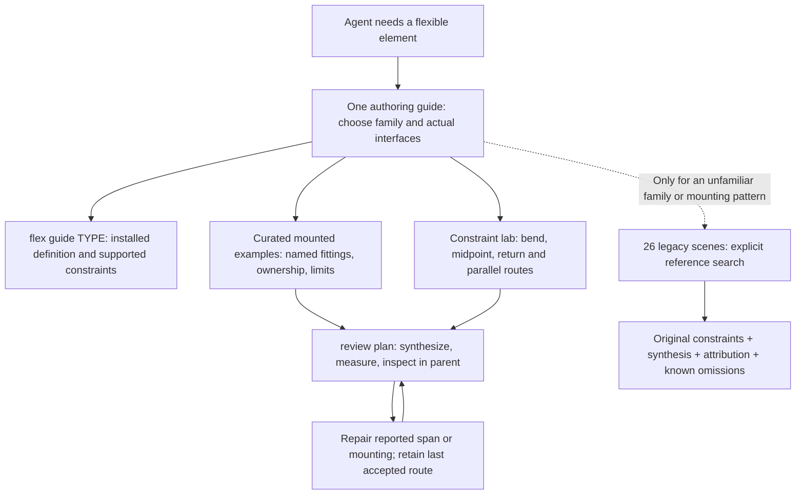

# LSynth legacy scenes: disposition and learning path

Planning evidence, 2026-11-02. All 26 supplied synthesis scenes were visually reviewed using the existing five original sheets, three opaque sheets and three supplemental views. All 52 constraint/synthesis hashes and all 11 preview hashes match the prior source-bound review. No LSynth rendering or synthesis was repeated. No nested FILE sections occur in these scenes. Later unsynthesized STRING_BAND studies are explicitly outside visual coverage.

The useful outcome is a short route-authoring path with measured examples and real fittings. Keep raw legacy scenes outside default construction retrieval. They broaden parts and mounting vocabulary, but often combine unrelated studies, omit supports or include known failures. Their existing annotations are useful; copying all of them into another authored atlas would duplicate information.

## Target routing

Keep a short procedural guide under `docs/agent/guides`, exact command/API behavior under `reference`, and small semantic packages under `examples`. Classify tutorial/diagnostic/reference purpose independently from technique/family. Search excerpts must expose missing dependencies, unsupported behavior and check scope before an agent chooses a source. Link to original blocks rather than copying 26 scene summaries across multiple indexes.

## Individual treatment

| Source family | Treatment | Visual finding and scope |
|---|---|---|
| BRICK_ARC | shape-only | Four coloured curled fingers emerge from a stepped cylindrical wrist. Treat as silhouette demonstration; no articulated or legal-brick-joint claim. Installed engine reflection failure remains blocking for derived construction. |
| ELECTRIC_CABLE | distill | Tall girder workshop lamp with side arm, broad dish shade and coiled lead. Distill mounting and cable-entry lesson, preserving lead-family roll and access. |
| ELECTRIC_NXT_CABLE | legacy-blocked | Controller surrounded by sensors and two motors, coloured cables and slack loops. x933c01 plug geometry is missing; no complete connector-fit lesson until resolved. |
| ELECTRIC_POWER_FUNCTION_CABLE | legacy-reference | Battery box, receivers and four separate motors form a component bench. Useful for plug/control/output access; lacks a shared mounting chassis. |
| ELECTRIC_POWER_FUNCTION_CABLE_HALF | distill | Plug connects through middle junction to two small lamp heads. Distill explicit branching at actual hardware; two separate routes cannot substitute for missing junction. |
| ELECTRIC_RCX_CABLE | legacy-reference | RCX controller with peripheral sensors/motors on a bench. Keep as legacy interface reference, not default current-part palette. |
| FIBER_OPTICS_CABLE | legacy-reference | Four-cylinder V engine with curved optical fan-out, separate distributor assembly and loose guide samples. Front view confirms two cylinder banks; preserve distinction between inlined distributor geometry and assembly BOM. |
| FIBER_OPTICS_CABLE_WIDE | legacy-blocked | Two broad guides around compact mirrored cross-block/lever frame. Missing 4173497 parent prevents identifying a complete device or certifying its mounts. |
| HOSE_FLEXIBLE_12L | distill-after-dependency-repair | Three-wheel rover with clear bubble canopy, Technic wheel supports and System body. Missing 3020a remains explicit; retain as mixed-construction composition candidate, not a ready hose-generation recipe. |
| HOSE_FLEXIBLE_19L | legacy-blocked | Raised cylindrical equipment turret and separate curved barrier/straight samples. Missing 57539a and 57539b leave some hose geometry absent; no complete hose path acceptance. |
| HOSE_FLEXIBLE_8.5L | distill | Pipe mounting board with upright loop, broad arch and straight samples. Distill end fitting orientations and coherent single route; whole board is a comparison fixture. |
| MINIFIG_CHAIN_16L | legacy-reference | Many coloured chain poses on square board, with visible eye/end fittings. Useful end-link vocabulary; gravity, tautness and legal spans not established. |
| RUBBER_BAND | legacy-reference-needs-repair | Triangular, crossed and two-wheel/micromotor arrangements. Preserve known tangent warnings and visibly questionable routes; prefer mounted tested starter for generation. |
| RUBBER_BELT | legacy-reference-needs-repair | Two-wheel and multi-wheel flat belt wraps. Rim/pulley family compatibility and tangent warnings need per-route repair; do not copy arbitrary wheels. |
| STRING_HOSE | legacy-reference | Wound shafts, large reel and two suspended hook arrangements. Drums and hook blocks are identifiable but bearing frame/anchors are incomplete. Do not infer winding dynamics or tension. |
| STRING_xxL | legacy-reference-partial | Measuring-board strings include straight and curved spans with ends. Only first three of six source studies are represented by supplied synthesis; later STRING_BAND blocks have no visual approval here. |
| TECHNIC_AXLE_FLEXIBLE | distill | Swept open frame with angular upper rails and curved blue/yellow lower edges. Distill joiner/angle-connector interfaces and envelope; not a verified rotating transmission. |
| TECHNIC_CHAIN_LINK | legacy-reference-needs-repair | Supported long small-link chain route plus gear-pair, triangular and single-wheel comparisons. Preserve tangent-warning scope and distinguish support rail from unsupported wrap samples. |
| TECHNIC_CHAIN_LINK_WITH_TWO_STUDS | legacy-reference | Studded rigid-link loops around coarse-toothed wheels; potential conveyor-flight vocabulary. Retain exact wheel/link family, closure and support checks as prerequisites. |
| TECHNIC_CHAIN_TREAD | distill | Two separate hinged-tread sizes on carrier blocks. Distill compatible wheel/link and axle support layout; they are not a single vehicle or interchangeable track family. |
| TECHNIC_CHAIN_TREAD_38 | distill | Long beam carrier with four large middle wheels, small end wheels and spring detail. Repeated route-wheel records must not create duplicate physical wheels. |
| TECHNIC_FLEX-SYSTEM | distill | Tall frame has crossed inner cables, broad outer sleeve and lower clip/lever samples. Distinguish cable ends, fixed sleeve supports and pivots; no demonstrated actuation. |
| TECHNIC_PNEUMATIC_HOSE | distill-via-mounted-press | Pump, lever valve and two-port cylinder with three working-layout hoses plus loose material samples. Prefer modern mounted press lesson; preserve hardware-before-routing principle. |
| TECHNIC_RIBBED_HOSE | distill | Broad arch, low return and straight ribbed spans seated on support bricks. Distill correct supports and broad curvature; touching segments do not establish a joint. |
| TECHNIC_TREAD | distill | Three continuous rubber-track carriers; supplemental view reveals all nine wheels omitted by hidden synthesis controls. One owner per physical wheel, separate from route constraints. |
| TECHNIC_TREAD_CRAWLER | legacy-reference-needs-repair | Vintage low, stepped and upright crawler layouts plus isolated wheel wraps. Dedicated cylindrical-axle wheel/bearing family; tangent warnings and support gaps remain. |

## What to change during implementation

- Make named mounted examples the first result for generation tasks; keep raw scenes behind explicit reference intent. A family name alone should not route an agent to an unsupported wheel wrap.
- Distill one coherent assembly or route per lesson. Record endpoint/port frames, straight leads, coordinate frame, wheel plane, route order, physical-item ownership and exact family pairing. Preserve source attribution and original constraints.
- Reuse the existing constraint lab and pneumatic press rather than writing another abstract spline tutorial. The present guide already contains a bounded local repair loop and warns that an extra marker can worsen a bend; shorten navigation around those useful instructions.
- Preserve failures as diagnostic lessons. Missing geometry, tangent warnings, reflected bricks, hidden wheels, repeated routing constraints and incomplete string synthesis need explicit status. Rendering a scene is not a passed fit check.
- Keep procedural input and generated geometry separate, bind evidence to source/output/definition hashes, and reuse unchanged synthesis. Give agents a focused report with the failing route/span and next repair action, not an undifferentiated full-scene dump.

Whether these changes help Terra/Luna remains an evaluation question. Use the previously agreed unseen rotated-fitting, changed-passage and nearby-second-route tasks with fixed budgets and no expert rescue; compare completion, repair count, visual quality and time. No new agent trials were run in this batch.

[Per-source observations and hashes](lsynth-legacy-audit.json). Newly distilled excerpts require their own visual review after extraction or adaptation; this audit does not pre-approve future geometry.
