# Spaceship atlas: complete visual audit

Planning evidence, 2026-11-01. No tracked knowledge-base files have changed.

All 8 entries and all 48 model sections were inspected from home and underside views, plus every declared immediate parent. The five assembly extracts were also inspected in their original source parents; nacelle-2 was checked in both wing parents. All 26 contact sheets were opened. Supplementary right/back views resolved the cockpit closure and engine-armour placement. All 94 main render jobs and both supplementary jobs completed successfully. Every authored artifact hash matches, with no missing artifacts; fresh render hashes match their manifests.

## Selection and correction decisions

| Entry | Coverage | Planned treatment |
|---|---:|---|
| 75050 B-wing | 2 sections | Retain a scoped whole-airframe construction study, distinct from set 6208. Root places one detailed airframe; correct prose inventing separate wing/fuselage/engine submodels. Preserve the three tiny recorded position corrections and source provenance. Do not claim tested articulation. |
| Enclosed canopy cockpit | 4 sections | Retain enclosure, hinged closure and pilot-envelope study. Correct rear-glazing wording: the shaped central door spans the top/front between octagonal side halves. Include pilot and helmet as nested context, not independent construction recommendations. |
| Falcon service cluster | 1 section | Retain a localized 15-part upper-hull greeble composition. The parent confirms its position in a small right-side bay; do not propagate unsupported whole-Falcon descriptions. |
| X-wing nacelle-2 | 1 section | Retain the concentric engine and transverse mounts. Preserve both actual wing contexts. Do not collapse it into nacelle-1: the mounting details differ. |
| X-wing lower port wing | 4 sections | Retain thin plate wing, nacelle-1, projecting tip cannon and root trim. Correct the parent description identifying the whole X-wing as a single dish. Distinguish the engine from the separate laser cannon. |
| Y-wing armour panel | 1 section | Retain as starboard engine-nacelle armour/detail panel. Replace wedge/curved-panel wording with rectangular plate backing, straight sloped borders, grille regions and central hose detail. Preserve its actual hinge interface. |
| Star Destroyer | 2 sections | Retain opt-in shape inspiration only: triangular hull, recessed band and layered bridge. Existing 416 non-rigid-transform errors and 39 body overlaps remain. No default retrieval or checked-construction export. |
| UCS Y-wing | 33 sections | Retain opt-in shape inspiration only. Correct the substantial child-role errors below. Existing 37 body overlaps remain; nested appearances do not independently qualify parts as reusable constructions. |

All eight saved diagnostic reports have `contacts_checked: false` and `physical_validity: not_proven`. Six pass their recorded source/geometry checks; that must not be summarized as verified connectivity. Preserve these scopes in search results and detail pages. This audit adds visual evidence, not new contact, motion, balance or fit certification.

## Corrected UCS Y-wing hierarchy

The source contains real child placements, but many generated names assign the wrong functional role. These corrections must reach cards, Markdown, JSON, manuals and generated pages while preserving attributed original source.

```mermaid
flowchart TD
    Ship["10134 whole Y-wing: inspiration only"]
    Ship --> Cheek["1: forward hull cheek"]
    Ship --> Detail["2–7: central body mounts and details"]
    Ship --> Droid["R5-D4: astromech"]
    Ship --> Outrigger["8 + 9: opposite connecting outriggers"]
    Ship --> Engine["10 ×2: main engine bodies"]
    Engine --> Axle["11 ×4 per body: transverse axle mounts"]
    Engine --> Nozzle["12: rear engine nozzle"]
    Engine --> Strip["13 ×2: engine-side pipe and grille strips"]
    Ship --> Trim["14: outer engine trim"]
    Ship --> Cage["15 ×2: long rear engine cages"]
    Cage --> Brace["16: end-ring brace"]
    Brace --> Crosspiece["17: nested axle crosspiece"]
    Cage --> Strut["18 ×4: ribbed longitudinal struts"]
    Ship --> Front["20 ×2: rounded forward nacelle housings"]
    Front --> Core["19: substantial housing core"]
    Front --> Rods["21 ×4: decorative side struts"]
    Ship --> Cockpit["22: cockpit and forward hull"]
    Cockpit --> Rail["23 ×2: side cheek rails"]
    Cockpit --> Hinge["24: canopy hinge support"]
    Cockpit --> Cannon["25: dorsal twin cannon"]
    Ship --> Stand["26: display stand"]
    Stand --> Upright["27: tall support upright"]
    Stand --> StandBrace["28: angled brace"]
    StandBrace --> Joint["29: nested liftarm joint"]
    Stand --> PlaqueMount["30 ×2: plaque hinges"]
    Stand --> Plaque["31: blank tiled plaque"]
```

| Existing description | Visually established correction |
|---|---|
| 8 / 9: rear engine nacelles | Connecting outriggers between central fuselage and engines |
| 10: hull/strut with sensor dome and mast | Main engine body with rear nozzle and side strips |
| 12: dorsal rotating sensor/weapon turret | Rear engine nozzle; no rotation claim |
| 13: antenna/sensor mast | Long engine-side pipe/grille strip |
| 15: engine front/cowling | Rear open strut cage and end ring |
| 18: ribbed armour/hose run | Longitudinal strut of that rear cage |
| 19: hinged access panel | Box-shaped structural core inside forward nacelle housing |
| 24: hinged detail/barrel | Canopy hinge support |
| 25: twin nose cannon/antenna | Dorsal twin cannon behind canopy |
| 30: cradle holding model | Hinged support for the plaque |
| Whole model: bubble cockpit | Tapered tinted canopy on shaped forward hull |
| Plaque/info panel | Blank tiled display surface; no information graphic in this source |

## Evidence and limitations

[spaceship-audit.json](spaceship-audit.json) records each section, its original name, old description, visual observation, source hash, views and parent evidence. [Image hashes](../../../../output/kb-visual-audit/spaceship-inspected-image-hashes.json) pin 146 fresh rendered views and 26 inspection sheets. Inspection sheets crop background and frame each panel independently; they must not be used to compare dimensions.

[Renderer notes](../../../../output/kb-visual-audit/spaceship-render-notes.json) preserve 27 camera-bounds notes involving custom embedded parts. The render manifests record materialized embedded geometry separately; a camera-bounds omission is not equivalent to a missing rendered part. No render process failed. Static images cannot clear the source's geometric errors or establish elastic, hinge or load-bearing behavior.

The complete 33-section UCS Y-wing observation list follows. All remain subordinate to the inspiration-only package; this list does not promote 32 new reusable lessons.

| Source section | Observation |
|---|---|
| 10134 - main.ldr | Whole ship has a narrow detailed spine, long twin nacelles and rear strut cages, white/yellow forward shell and black display stand. Inspiration only; 37 recorded overlaps remain. Tapered canopy is not a bubble enclosure. |
| 10134 - subModel-1.ldr | Flat tiled hull cheek with shaped underside sits beside forward cockpit; preserve model-local orientation. |
| 10134 - subModel-2.ldr | Small bracket/plate mounting block with round element sits toward aft central machinery; no strength inference. |
| 10134 - subModel-3.ldr | Two Technic bricks with pins carry round cylinder and minifig-head shaped detail on central spine. Do not claim a working swivel or sensor from the decorative shape. |
| 10134 - subModel-4.ldr | Three-part rail presents four sideways studs; two parent instances sit in aft central machinery. |
| 10134 - subModel-5.ldr | Two headlight bricks carry handled tile; parent repeats this handle detail on opposite sides of spine. |
| 10134 - subModel-6.ldr | Headlight brick plus clip tile; four instances around central spine. Retain as dependency with no new connectivity certification. |
| 10134 - subModel-7.ldr | Two-piece wing-shaped plate and printed round grille detail, repeated on aft central spine; not a complete wing assembly. |
| 10134 - subModel-R5-D4.ldr | Patterned white/red astromech body, rounded head and two legs; seated behind cockpit in the main body. Preserve source identity rather than using it as a generic mechanism. |
| 10134 - subModel-8.ldr | Detailed rectangular outrigger between central fuselage and one engine, with copper-coloured hoses, pins and side-stud faces. Source description incorrectly calls this a rear engine nacelle. |
| 10134 - subModel-9.ldr | Opposite outrigger with similar hose/grille detailing and different handed layout. Source description incorrectly calls this a rear engine nacelle. |
| 10134 - subModel-10.ldr | Main rectangular engine body with long surface hoses, side panels and conical rear nozzle; two instances in whole ship. Correct generic hull/strut and sensor-mast wording. |
| 10134 - subModel-11.ldr | Short transverse axle through paired Technic bricks with bushes; four placements on engine body provide lateral attachment features. |
| 10134 - subModel-12.ldr | Conical engine nozzle and surrounding clips/arms mounted at rear of engine body. Source description falsely calls it a dorsal rotating sensor/weapon turret. |
| 10134 - subModel-13.ldr | Long thin engine-side surface strip with lance-shaped pipe and grille tiles, repeated on opposite engine-body faces. Not an upright antenna mast array. |
| 10134 - subModel-14.ldr | Thin vented strip with underside pins and central handled detail, placed on outer engine sides; scope label to nacelle trim. |
| 10134 - subModel-15.ldr | Long open rear engine cage: four ribbed struts terminate in a round wheel-like end ring. Two instances extend aft from nacelles. Source incorrectly calls it engine front/cowling. |
| 10134 - subModel-16.ldr | Paired transverse axle/angle-connector brace located at the cage end ring. Static geometry does not establish moving linkage behavior. |
| 10134 - subModel-17.ldr | Axle and paired angle connectors with bushes, nested as one crosspiece of end-ring brace. |
| 10134 - subModel-18.ldr | Long ribbed strut assembled along an axle line; four copies form the cage. Clarify rear cage strut rather than armour/hose run. |
| 10134 - subModel-20.ldr | Rounded white forward nacelle housing with yellow stripe, internal core and four decorative side struts; two instances at forward engine ends. |
| 10134 - subModel-19.ldr | Substantial box-shaped core inside forward nacelle housing, with pin interfaces, side studs, handles and hinged faces. Not merely a hinged access panel. |
| 10134 - subModel-21.ldr | Two-rod decorative side strut with mechanical-figure pieces at one end; four copies wrap forward nacelle housing. No functional actuator claim. |
| 10134 - subModel-22.ldr | White/yellow forward hull and tapered tinted cockpit canopy, side cheek strips, nose projections and raised dorsal twin cannon. Retain as part of inspiration package pending repairs. |
| 10134 - subModel-23.ldr | Slim curved/sloped white/yellow cheek rail, repeated along both cockpit sides with local frame transformed into parent. |
| 10134 - subModel-24.ldr | Small plate-and-locking-hinge construction at rear edge of canopy; describe canopy mounting/hinge support rather than a barrel. |
| 10134 - subModel-25.ldr | Paired bar-and-cone cannon detail on roof behind canopy. Source calls it twin nose cannon/antenna, but parent proves dorsal position. |
| 10134 - subModel-26.ldr | Complete black display stand with crossed feet, tall Technic upright, diagonal brace and angled blank tiled plaque. Stability remains unproven. |
| 10134 - subModel-27.ldr | Tall Technic-brick upright placed vertically in stand; top pins form model-support region. |
| 10134 - subModel-28.ldr | Bent liftarm brace connects low portion of upright to stand base; static bracing, no demonstrated mechanism. |
| 10134 - subModel-29.ldr | Paired short angled liftarms and axle form nested top joint of stand brace. |
| 10134 - subModel-30.ldr | Small hinged plates appear twice at plaque location on stand base. Correct metadata claiming these directly hold the model: they support the plaque. |
| 10134 - subModel-31.ldr | Broad black tiled plaque panel on front of stand. No printed information is present in this source; label blank plaque surface. |
