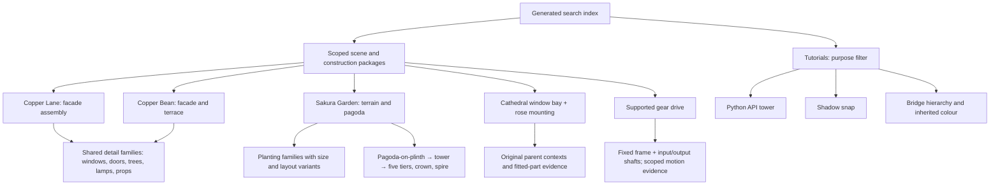

# Standalone examples: visual audit

Planning evidence, 2026-11-02. Nine packages and all 89 model sections reviewed in isolation and in their immediate parent contexts. Five additional original-cathedral contexts were reviewed without admitting the whole cathedral. No tracked knowledge-base files were changed.

| Package | Sections | Planned treatment |
|---|---:|---|
| Copper Lane | 19 | Retain parameterized facade/scene assembly and selected detail lessons. Interiors are repeated bookcase/table reading rooms without stairs or partitions, not complete dwellings. Rename the searchable `detail-flower-planter` identity to planted tree. Preserve open upper arches, awning socket offsets and inherited colours. |
| Copper Bean | 24 | Retain facade stacking, fitted glazing, terrace seating and scene detail recipes. Correct three apartment storeys to two above the cafe. Both flats are empty shells without stairs. Cafe counter, abstract espresso prop, two tables and four stools are visible in the supplementary top view. Consolidate tree, planter and guest variants. |
| Sakura Garden | 33 | Retain terrain composition, pagoda tiers, humped bridge, torii and planting families. `temple-plinth` includes the whole nested pagoda, not only a foundation. Five tier variants, three cherries, seven bamboo culms and three people remain contextual variants, not separate recommendations. Preserve branch omissions, rotations, measured clearances and resting-support limits. |
| Cathedral window fit | 2 | Retain one six-stud pointed-arch bay with two rectangular glazed frames. The upper arch is OPEN. The same type-1 geometry appears in nave clerestory, tower and both aisle variants; preserve all four contexts under one lesson. |
| Cathedral rose fit | 2 | Retain side-stud mounting and circular facade motif. Transparent blue backing, white radial dish, amber centre; actual west-front placement confirmed. Do not imply a through-wall glazed opening. |
| Supported gear drive | 4 | Retain supported 8:24 starter: one fixed frame and two shafts. Current source hash matches existing motion evidence. Preserve skipped source-contact discovery and sampled-motion limits; this visual audit did not rerun Mecha. |
| Bridge tutorial | 2 | Retain only hierarchy, step, transform and inherited-colour instruction. Minimal deck on two pillars is unsuitable as an aesthetic bridge exemplar. |
| Python API | 1 | Retain minimal API tutorial. Fresh build succeeded; four-brick alternating-colour tower is not a design recommendation. |
| Shadow snap | 2 | Retain nested snapping tutorial. Fresh build succeeded; simple base/cap stack is not a design recommendation. |

## Proposed organization for this batch

These are semantic packages and lesson families, not a requirement for a directory per child.

Keep original provenance and model-local identities even when grouping equivalent lessons. Different dimensions, sockets, mounting transforms or poses must remain explicit variants. A reused construction method is not proof that two sources are byte-identical.

## Reproduction and documentation work

Copper Lane, Copper Bean and Sakura Garden were regenerated and built into ignored audit output. All three MPDs are byte-identical to their maintained sources: [results](../../../../output/kb-visual-audit/reproduction/results.json). Correct Copper Bean and Sakura rebuild commands to invoke maintained `examples/` generators with explicit output destinations. Sakura's `--map` writes beside the generator; change that behavior or document an explicit safe destination during implementation.

The scene packages should retain editable generators/plans, one concise lesson README, selected evidence and provenance. Move iteration histories, part-search traces and old review artifacts out of default retrieval; link them as research history. Keep tutorials discoverable by API/workflow purpose, with no aesthetic fallback.

Existing validation scope matters: Copper Lane's geometry report is hash-bound but skipped contacts. Bean and Sakura have recorded full-contact reports without source hashes; this audit's reproduction check does not retrospectively bind those reports. New image/source hashes bind only the present visual review. Cathedral fit reports are narrow fixtures. Physical validity remains unproven.

## Evidence and cost control

[Per-section observations](standalone-audit.json), [original cathedral contexts](../../../../output/kb-visual-audit/cathedral-original-contexts.json), [image hashes](../../../../output/kb-visual-audit/standalone-inspected-image-hashes.json), and [render notes](../../../../output/kb-visual-audit/standalone-render-notes.json) record the evidence. All 193 recorded main/tutorial/front/cathedral render jobs succeeded; the additional cafe top render also succeeded. No render warnings or notes were emitted. Contact sheets frame each section independently and must not be used for dimension comparison. Colour 16 renders yellow in isolation and inherits the actual parent colour in context.

This batch used more views and repeated contexts than necessary. Following the user's resource concern, future batches should reuse current, source-matched evidence, visually review every selected distinct assembly and its relationship to its parent, and add views only to resolve ambiguity. Identical geometry can share isolation evidence while retaining review of relevant placement/colour differences. Triage candidates before rendering; do not automatically promote all research submodels into the curated scope. Agent generation evaluation remains deferred to the agreed Terra/Luna protocol.
