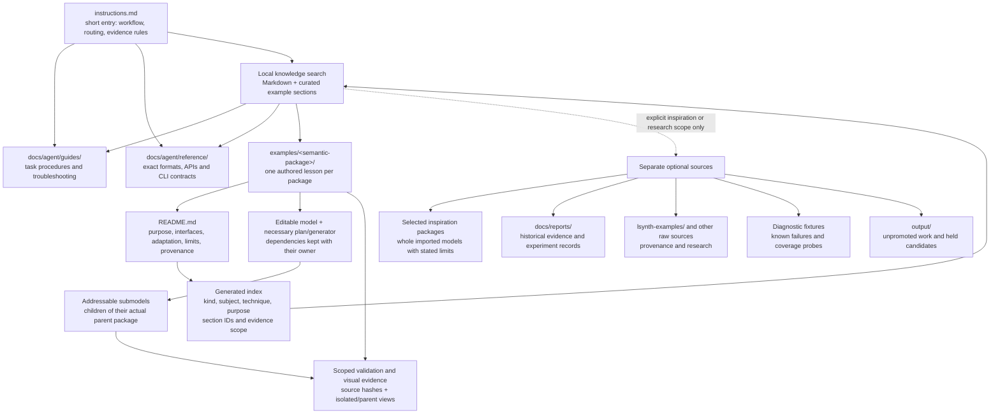
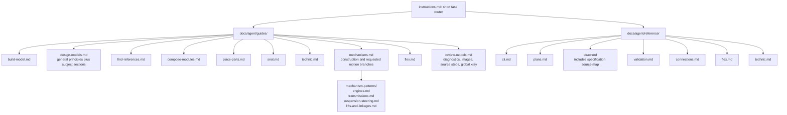
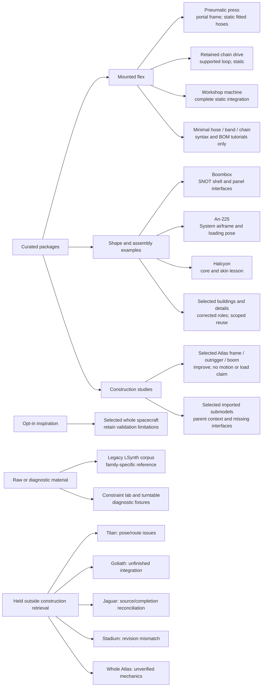

# Target knowledge-base structure after visual audit

Proposed structure, not an implemented migration. This consolidates the earlier planning decisions and the [individual visual findings](README.md). Proposed paths below are destinations; existing sources stay unchanged during planning. The [per-file documentation migration ledger](document-migration-ledger.md) now maps all 103 tracked documentation/evidence sources and records 267 incoming Markdown links. The [example-package ledger](example-migration-ledger.md) now maps all 187 audited entries and 138 legacy catalog aliases. The [catalog/export compatibility plan](catalog-export-migration.md) specifies migration batches and acceptance checks. Planning is ready for implementation; no migration or new agent trials have run.

## Agent-facing path

The directory tree distinguishes procedures, exact reference, executable examples and historical material. Subject and construction technique are independent metadata: a vehicle can use System, SNOT, Technic and flex techniques without inventing a new directory taxonomy for every combination. Keep metadata in the package's authored README; generate search records and browsing indexes from it. Do not require agents to synchronize a second hand-written summary or catalog JSON.

Search returns the matching section with enough parent context to interpret it: intended use, mounting/interface constraints, source path and limitations. Start with the agreed local BM25 approach; optional existing reranking must not be required to find knowledge. Default retrieval includes current guides/reference and admitted construction/tutorial examples. Inspiration is opt-in; raw sources, held work and known failures never become a silent fallback. A no-match result should say what is missing.

## Concrete documentation destinations

These 21 files are the proposed consolidated agent documents. The ledger assigns each current source and identifies the sections to preserve, merge or relocate. Historical verification moves to reports; its evidence is retained.

Each guide answers a task; each reference owns exact contracts. Package-specific coordinates, measurements and visual observations belong with their example. `design-models.md` must keep architecture, vehicle, spacecraft and other subject-specific advice under explicit headings so a retrieved vehicle section does not prescribe building motifs. Mechanism pattern pages remain separate because their construction problems and qualifications differ.

## Concrete mapping from this audit

This is a map of representative decisions, not a replacement for the complete per-candidate findings. All earlier accepted/rejected entries retain their individual dispositions. A selected excerpt does not admit the whole source model, and a retained dependency does not become a curated submodel lesson.

For boombox, describe the rear battery-door motif as decorative and the knob as a printed dial tile. For An-225, describe cockpit glazing/hinges, floor trim, solid cargo placeholders and dorsal posts accurately. For the press, replace C-frame with portal frame. Carry all earlier role corrections into descriptions, tags and generated search excerpts. Merge identical service-platform/named-frame content and colour-only variants rather than emitting duplicate recommendations.

## Minimal package contract

One README needs only: what the example teaches; when to use it; model/section entry points; required interfaces and dependencies; how to reproduce/adapt it; scoped evidence and known limits; provenance. Small fittings can be sections of an existing package, not directories with repeated boilerplate. Keep source-native names stable where possible; use accurate display descriptions and aliases for old catalog names.

Keep the editable source and only the plan/generator needed to reproduce it. Imported examples require provenance and dependencies, not an invented generator. Evidence records distinguish visual inspection, import/BOM checks, geometric checks, confirmed/potential contacts and any tested motion. Use source hashes to invalidate stale evidence. Native `ldraw-xray` recipes and manifests are sufficient for visual records; do not create a new rendering framework.

Every admitted model section needs an opened isolated view and its actual parent context, including each distinct parent where reused. Reuse images only when source/hash evidence applies. Any geometry change invalidates affected visual acceptance and relevant checks. Pure description corrections do not require rendering the unchanged geometry again.

## Migration order and acceptance

1. **Freeze the source-to-destination ledger.** Both source/destination ledgers and the compatibility plan are recorded. At implementation start, verify their source fingerprints and resolve any subsequent changes before applying them. Keep stable aliases for renamed packages/sections. No new candidate-rendering sweep is needed to finish this ledger.
2. **Restructure documentation and routing.** Shorten `instructions.md`; merge overlapping procedures into guides; separate exact API/CLI/format reference. Extract durable lessons from reports with evidence links. Update every internal link and remove obsolete defaults from examples and prose.
3. **Package the selected examples.** Apply visual corrections; preserve provenance and scoped failures; consolidate duplicates; move selected output examples with their editable sources. Keep holds and diagnostic fixtures out of default construction search. Do not silently erase failure reports when extracting a useful lesson.
4. **Connect retrieval and remove tooling bias.** Generate the example index and unified local search from the authored files. Remove building/Halcyon/atlas-only defaults and courier-jet-specific aircraft requirements. Cover those concrete regressions with appropriate tests; no new general geometry solver is part of this overhaul.
5. **Run staged Terra/Luna evaluation.** Repeat the agreed 12 retrieval tasks for each model against before/after snapshots. Then run three construction pilots; expand only after the pilots expose no blocking workflow failures. The agreed expanded matrix is six task families × three repeats × two models × two KB versions = 72 runs. Hold prompts, tool budgets and scoring constant; no expert rescue. Blind visual review and compare completion, brief adherence, shape, joins, diagnostic coverage, repair effort, time/tokens and within-family diversity. Existing retrieval baselines do not establish generation improvement.

Acceptance means agents can retrieve the exact relevant lesson, see its limitations, reproduce its scope and adapt it without inheriting an unrelated model's style. Structural cleanup alone is not evidence that Terra or Luna now builds better models; that claim waits for the controlled generation results.
