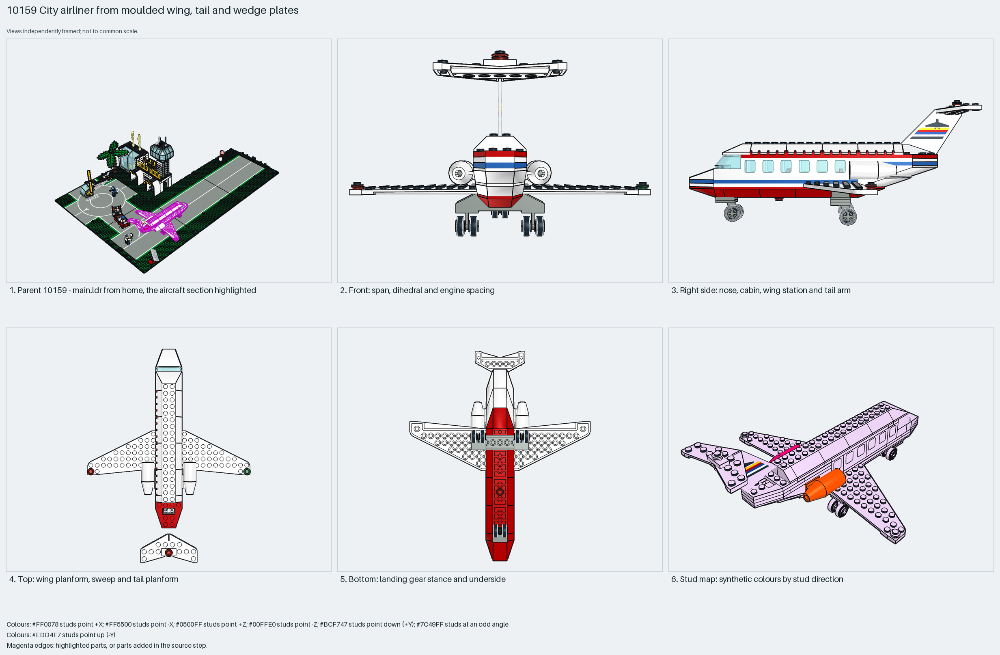

# City airliner from moulded wing, tail and wedge plates

The classic City airliner in one studs-up section: a 4-wide brick fuselage with window bricks under an openable double-slope roof, moulded 7×12 wing plates, a T-tail with the printed 4867 tailplane on a brick fin, two 4868a/4869 engine pods on the rear fuselage sides, a wedge-plate nose with a 2437 windscreen, and wheel-plate landing gear. Measured: span 25 studs, length 29, height 14, 121 parts, no Technic.

Inspiration study: the source keeps errors (`part.missing_classification` ×1). Study the technique and rebuild it; `manual export` is blocked.

Whole aircraft · classic City studs-up · 121 parts · 1 source steps in 1 section

[Completed-model views](index.html) · [Inspection board](board/mosaic.png) · [Source](source.mpd) · [Editable plan](scene.plan.json) · [Checks](source-checks.json) · [Board provenance](board/board.json)

## Read the construction

121 parts in 1 step. Fuselage: 4-wide brick rows with 4862/4863 window bricks and the 4857 double-slope roof on 4625 hinge tiles; nose: 4854–4861 wedge plates and slopes with a 2437 windscreen; wings: 3585/3586 7×12 wing plates; tail: a brick fin carrying the 4867px3 printed tailplane; engines: two 4868a shells with 4869 cones either side of the rear fuselage; gear: 4870 wheel plates with 4624 rims, a nose pair and two mains.

117 studs up; only the two engine pods face sideways. Modules meet on plain studs: the wing plates slide under the fuselage plates, the tailplane sits on the fin, the roof hinges on the cabin walls.

## What the parent supplies

- `10159 - main.ldr` places it at `690 0 380`, matrix `1 0 0 / 0 1 0 / 0 0 1`.

`10159 - main.ldr` places it at (690, 0, 380) with the identity matrix on the apron beside the terminal; the nose points +Z. The same design appears in 6392 (1985), whose copy keeps five plate overlaps.

Only the apron position; the plane is complete in itself.

## Description check

- **Database (accurate):** “Passenger airplane with a red and white fuselage, swept white wings with blue stripes and twin jet engines, a glazed cockpit windscreen and a row of passenger windows, red tail surfaces and a tail plane, wheeled landing gear and red/green navigation lights”
- **What it is:** Accurate: a red and white airliner with twin rear jet engines, a glazed cockpit, a row of passenger windows, red tail surfaces, wheeled gear and navigation lights.

## Read the board

Panel 1: the airport scene with the plane highlighted on the apron. Panel 2: LeoCAD's front view, which is this model's tail-on view because the nose points +Z: the level 7×12 wings, the T-tail above and the rear pods either side. Panel 3: right side, the window row, roof line, wedge nose and fin. Panel 4: top, the straight wing plates and the T-tail. Panel 5: bottom, the nose pair and two main wheel plates. Panel 6: the stud map, everything up except the sideways engine pods.

Magenta edges mark highlighted parts or the parts added in a source step. Pale grey, see-through parts are ghosted context. A neon-green rod (`#39FF14`) is a synthetic axis marker, not a part. Stud maps recolour each part by where its studs point: up lilac, +X rose, −X vermilion, +Z electric blue, −Z aqua, down lime, odd angle violet. These synthetic colours are ΔE ≥ 16 from every LDraw colour. LDraw −Y is up; LeoCAD `right` shows the model's right side, from −X.

Replay a board into `output/`:

    ./ldraw-xray board run examples/aircraft-atlas/recipes/10159-city-airliner.json --output output/boards/10159-city-airliner

## Reuse it

Use it for the proportions of a small City airliner: span about equal to length, rear engines, T-tail, a 4-wide cabin with one window per two studs. Inspiration only: the embedded printed tailplane lacks a part classification; use the library 4867 pattern part when rebuilding.

Rebuild the technique with the new model's own parts and interfaces; the source errors above stay in this copy.

The placement plan preserves source axes. `source_origin` is a positioning frame, not a physical connector.

## Limits

Inspiration only: `part.missing_classification` on the embedded 4867px3 tailplane; geometry passes and the BOM comparison matches. Roof hinge and gear clearance not checked.

The source and renders teach a construction. They do not prove clutch, fit, clearance, travel or stability. Boards are rendered from synthetic inspection copies, and poses are rigid re-placements.

## Source and evidence

Source: `10159-1.mpd` / `10159 - airplane.ldr`, SHA-256 `70f2ca3d46b9c0e4a69f149ca2599e1022a3b367b6718d2121b67d454ae069ab`. Parent: `10159 - main.ldr`. Look it up with `./ldraw-agent discover show submodel-40dcf1a3ca24fc40863a935a`.

Original authors and licences stay in [source.mpd](source.mpd); [extraction.json](extraction.json) records renamed sections and 0 bounded preparation changes. Python and LeoCAD BOMs match. The visual review is recorded separately, after opening the actual images.
