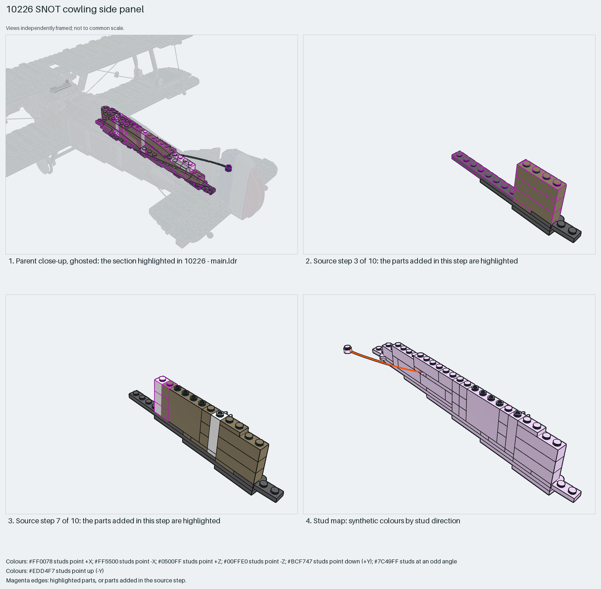

# Biplane fuselage side wall: one-stud brick wall on a plate strip with hinge plates and a reinforced panel

A biplane fuselage side as a one-stud-thick wall: dark-tan 1×4 and 1×1 bricks on a 1×8 plate strip, two 1×4 hinge-plate pairs so the wall folds to the fuselage taper, a reinforced 1×4×3 panel as the cockpit side, and a 1×1×3 clip brick that anchors a rigging string.

Inspiration study: the source keeps errors (`assembly.body_overlap` ×11, `assembly.library_internal` ×26, `assembly.nonrigid` ×26). Study the technique and rebuild it; `manual export` is blocked.

Aircraft fuselage skin · display SNOT biplane · 68 parts · 12 source steps in 3 sections

[Build pages](index.html) · [Inspection board](board/mosaic.png) · [Source](source.mpd) · [Editable plan](scene.plan.json) · [Checks](source-checks.json) · [Board provenance](board/board.json)

## Read the construction

68 parts in 10 root steps and two children. Steps 1–2: a strip of 1×8 and 1×4 plates. Steps 3–7: 1×4 bricks and 1×1 bricks stacked three high with the 60581 reinforced panel and a 1×2 brick in the middle. Steps 8–10: the 2429/2430 hinge plates at each end, plates on top and the 60583b clip brick with a string-end stud; the `string5` child is the rigging string.

All studs up; the string angled. The hinge plates at the ends are the interface to the neighbouring fuselage walls; the plate strip's underside sits on the fuselage floor.

## What the parent supplies

- `10226 - main.ldr` places it at `60 -16 60`, matrix `-1 0 0 / 0 1 0 / 0 0 -1`.

`10226 - main.ldr` places it at (60, −16, 60) with matrix −1 0 0 / 0 1 0 / 0 0 −1, a 180° turn about Y, as the right-hand fuselage side beside the cockpit; `step35` is the mirrored left side.

The fuselage floor, the walls ahead and behind that the hinge plates meet, and the string's far anchor.

## Description check

- **Database (accurate):** “Dark-tan brick-and-plate fuselage/cowling panel with hinge plates, a reinforced side panel and white clip bricks”
- **What it is:** Accurate: a dark-tan brick-and-plate fuselage side panel with hinge plates, a reinforced panel and a clip brick.

## Read the board

Panel 1: the ghosted biplane with the side wall highlighted along the fuselage. Panel 2: source step 3, the first 1×4 bricks on the plate strip. Panel 3: source step 7, the wall three bricks high with the reinforced panel. Panel 4: the stud map, everything up with the string angled.

Magenta edges mark highlighted parts or the parts added in a source step. Pale grey, see-through parts are ghosted context. A neon-green rod (`#39FF14`) is a synthetic axis marker, not a part. Stud maps recolour each part by where its studs point: up lilac, +X rose, −X vermilion, +Z electric blue, −Z aqua, down lime, odd angle violet. These synthetic colours are ΔE ≥ 16 from every LDraw colour. LDraw −Y is up; LeoCAD `right` shows the model's right side, from −X.

Replay a board into `output/`:

    ./ldraw-xray board run examples/aircraft-atlas/recipes/10226-cowling-side.json --output output/boards/10226-cowling-side

## Reuse it

Rebuild the technique: a one-stud wall with hinge plates at the ends lets a plate-built fuselage taper in plan; use a reinforced panel where the wall needs to be thin but stiff.

Rebuild the technique with the new model's own parts and interfaces; the source errors above stay in this copy.

The placement plan preserves source axes. `source_origin` is a positioning frame, not a physical connector.

## Limits

Inspiration only: the rigging-string child is LDCad segments with mirrored matrices and two plates overlap by 0.0001 LDU (assembly.nonrigid, assembly.library_internal, assembly.body_overlap), so source checks fail and export is blocked. The hinge angles were not checked.

The source and renders teach a construction. They do not prove clutch, fit, clearance, travel or stability. Boards are rendered from synthetic inspection copies, and poses are rigid re-placements.

## Source and evidence

Source: `10226-1.mpd` / `10226 - step34.ldr`, SHA-256 `2903c00bd3f1e0af46d47af2e09bd8ccb423eced0588947cc0fb9bd14ac20511`. Parent: `10226 - main.ldr`. Look it up with `./ldraw-agent discover show submodel-32ad4c86bdb0ac328ec1c956`.

Original authors and licences stay in [source.mpd](source.mpd); [extraction.json](extraction.json) records renamed sections and 41 bounded preparation changes. The rendered BOM comparison does not match or is pending. The visual review is recorded separately, after opening the actual images.
