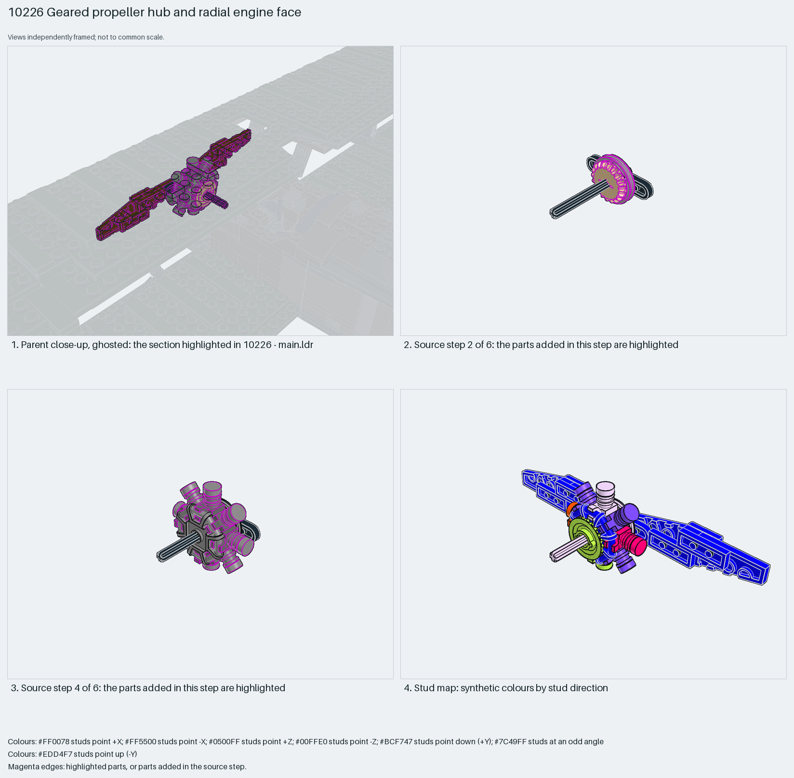

# Radial engine face and two-blade propeller on one geared axle

A radial engine face and propeller on one 6-long axle: eight cylinders, each a clip plate holding a round tile and round plate, clip onto a 2×2 octagonal rod frame; bevel gears and a belt wheel on the axle let the parent's drive spin it; the propeller is a 2-blade Technic rotor with two 2×4 wedge plates per blade for the wooden-prop profile.

Reusable source construction: source checks pass and the Python and LeoCAD BOMs match.

Aircraft propeller · display SNOT biplane · 55 parts · 7 source steps in 2 sections

[Build pages](index.html) · [Inspection board](board/mosaic.png) · [Source](source.mpd) · [Editable plan](scene.plan.json) · [Checks](source-checks.json) · [Board provenance](board/board.json)



## Read the construction

55 parts in 6 steps plus one child. Step 1: the 3706 axle with a 1×3 plate and bush. Step 2: the 4185a belt wheel and a 4032a round plate. Step 3: the 30033 octagonal rod frame with a 32198 bevel gear. Step 4: eight `step69-4` cylinders (6019 clip, 98138 round tile, 6141 round plate) around the frame. Step 5: the second round plate and gear. Step 6: the 32124 rotor with four 41770 wedge plates on its studs.

Stud directions: 55 parts, rotor and blades facing +Z (along the axle), cylinders angled around it. The axle end and the belt wheel are the interfaces to the fuselage's drive; the rotor's studs carry the blade plates.

## What the parent supplies

- `10226 - main.ldr` places it at `-220 -36 0`, matrix `0 0 -1 / 0 1 0 / 1 0 0`.

`10226 - main.ldr` places it at (−220, −36, 0) with matrix 0 0 −1 / 0 1 0 / 1 0 0, turned 90° about Y so the axle points −X out of the nose. The fuselage supplies the front bearing and the crank that drives the gears.

The nose bearing the axle passes through, the crank and gears behind the belt wheel, and the cowling around the cylinders.

## Description check

- **Database (accurate):** “Propeller and drive: a two-blade technic rotor on a geared axle with belt wheel, bush, bevel gears and four reddish-brown wedge wings”
- **What it is:** Accurate for the propeller and drive; it omits the eight radial cylinders (the `step69-4` child) that make up the engine face.

## Read the board

Panel 1: a ghosted close-up of the nose with the propeller and cylinders highlighted. Panel 2: source step 2, the belt wheel on the axle. Panel 3: source step 4, the eight cylinder children around the octagonal frame. Panel 4: the stud map, blades blue (+Z), cylinders violet (angled), hub plates orange.

Magenta edges mark highlighted parts or the parts added in a source step. Pale grey, see-through parts are ghosted context. A neon-green rod (`#39FF14`) is a synthetic axis marker, not a part. Stud maps recolour each part by where its studs point: up lilac, +X rose, −X vermilion, +Z electric blue, −Z aqua, down lime, odd angle violet. These synthetic colours are ΔE ≥ 16 from every LDraw colour. LDraw −Y is up; LeoCAD `right` shows the model's right side, from −X.

Replay a board into `output/`:

    ./ldraw-xray board run examples/aircraft-atlas/recipes/10226-geared-propeller.json --output output/boards/10226-geared-propeller

## Reuse it

Use it for any radial-engined propeller plane: the clip-and-round-tile cylinder is one part trio repeated around an octagonal frame, and the rotor's four studs take wedge plates to shape blades. Keep the engine face one plate ahead of the cowling.

```sh
./ldraw-agent manual export examples/10226-geared-propeller --outdir output/my-10226-geared-propeller
./ldraw-agent build output/my-10226-geared-propeller/scene.plan.json --output output/my-10226-geared-propeller/10226-geared-propeller.mpd
```

Export needs a current visual review. Build the copied plan, then inspect its interfaces in the new model.

The placement plan preserves source axes. `source_origin` is a positioning frame, not a physical connector.

## Limits

Gear meshing with the fuselage drive and the blade plates' clutch on the rotor studs were not checked.

The source and renders teach a construction. They do not prove clutch, fit, clearance, travel or stability. Boards are rendered from synthetic inspection copies, and poses are rigid re-placements.

## Source and evidence

Source: `10226-1.mpd` / `10226 - step69.ldr`, SHA-256 `2903c00bd3f1e0af46d47af2e09bd8ccb423eced0588947cc0fb9bd14ac20511`. Parent: `10226 - main.ldr`. Look it up with `./ldraw-agent discover show submodel-fa14e04fcede3134fe6af5c4`.

Original authors and licences stay in [source.mpd](source.mpd); [extraction.json](extraction.json) records renamed sections and 4 bounded preparation changes. Python and LeoCAD BOMs match. The visual review is recorded separately, after opening the actual images.
