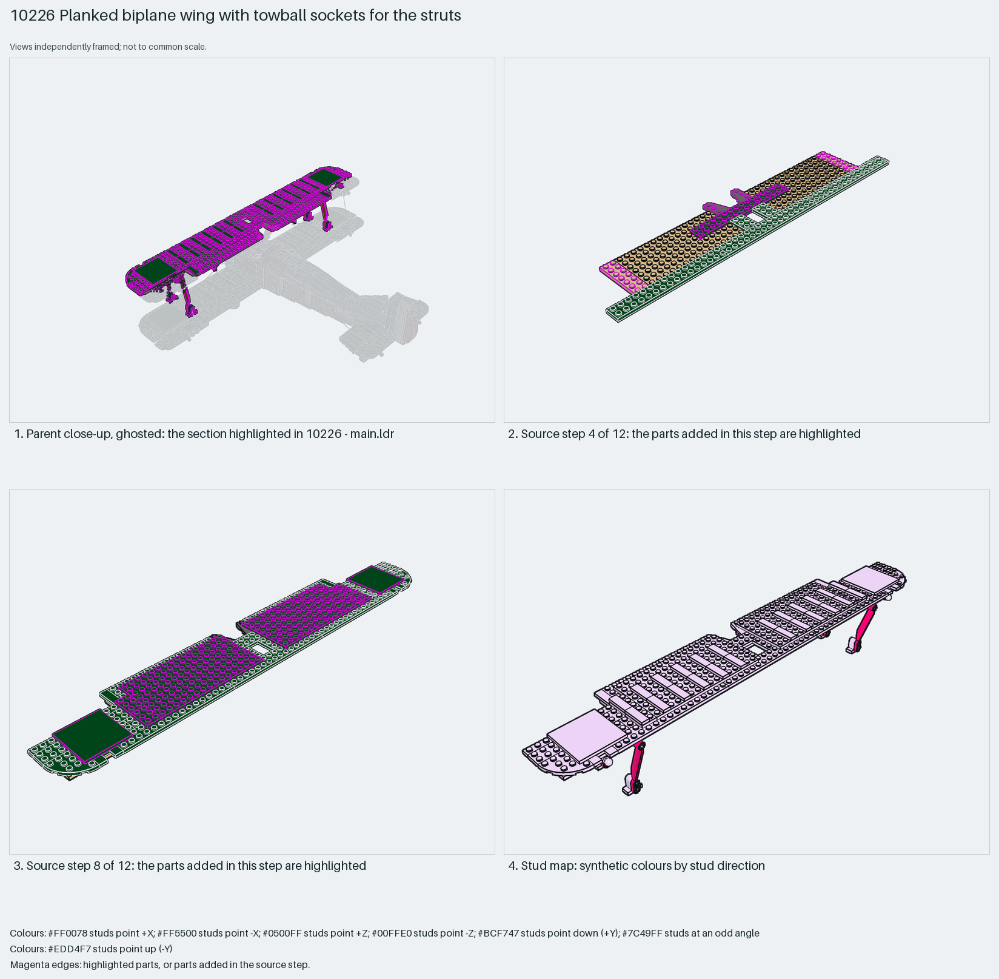

# Biplane upper wing: plate spar, 1×3 tile planking, socket plates for the ailerons and suspension-arm struts

The upper wing of the biplane: a sandwich of 2×16 plates and 6×10 plates as the spar, rows of dark-green 1×3 tiles with gaps as the planked fabric-and-rib surface, 6×6 tiles as the aileron bays, two socket plates per side that take the ailerons' towballs, and four 1×9 suspension arms pinned underneath as the interplane struts.

Inspiration study: the source keeps errors (`assembly.library_internal` ×16, `assembly.nonrigid` ×16). Study the technique and rebuild it; `manual export` is blocked.

Aircraft wing · display SNOT biplane · 136 parts · 18 source steps in 7 sections

[Build pages](index.html) · [Inspection board](board/mosaic.png) · [Source](source.mpd) · [Editable plan](scene.plan.json) · [Checks](source-checks.json) · [Board provenance](board/board.json)

## Read the construction

136 parts in 12 root steps and six children. Steps 1–7: alternating 2×16, 2×8 and 6×10 plate layers with 2×2 plates with holes and Technic tiles with holes at the strut stations. Step 8: two 10202 6×6 tiles as the aileron bays. Steps 9–11: thirty-two 1×3 tiles in rows as the planking and the `step53-11` children (a 63082 socket plate pair) for the aileron balls. Step 12: four `step53-13` children (a 32294 suspension arm on a 2×2 plate with holes) as the struts, plus the `string8` and `string9` rigging children from string-end studs.

All studs up except the angled struts. The struts' lower pin holes meet the lower wing and the cabane; the socket plates take the aileron towballs; the string-end studs anchor the rigging.

## What the parent supplies

- `10226 - main.ldr` places it at `-170 -212 0`, matrix `-1 0 0 / 0 1 0 / 0 0 -1`.

`10226 - main.ldr` places it at (−170, −212, 0) with matrix −1 0 0 / 0 1 0 / 0 0 −1, a 180° turn about Y, above the fuselage; the lower wing, cabane struts and ailerons are separate sections.

The lower wing and cabane the struts land on, the ailerons that snap into the sockets, and the rigging anchors on the fuselage.

## Description check

- **Database (accurate):** “Large dark-green plank-and-tile main wing on a tan plate base with socket joints, towball pins and wedge wings”
- **What it is:** Accurate: a dark-green plank-and-tile main wing on a tan plate base with socket joints, towball pins and wedge wings.

## Read the board

Panel 1: the ghosted biplane with the upper wing highlighted and its struts reaching down. Panel 2: source step 4, the plate layers with the first tan 6×10 plates. Panel 3: source step 8, the two 6×6 aileron-bay tiles. Panel 4: the stud map, everything up with the struts angled (rose).

Magenta edges mark highlighted parts or the parts added in a source step. Pale grey, see-through parts are ghosted context. A neon-green rod (`#39FF14`) is a synthetic axis marker, not a part. Stud maps recolour each part by where its studs point: up lilac, +X rose, −X vermilion, +Z electric blue, −Z aqua, down lime, odd angle violet. These synthetic colours are ΔE ≥ 16 from every LDraw colour. LDraw −Y is up; LeoCAD `right` shows the model's right side, from −X.

Replay a board into `output/`:

    ./ldraw-xray board run examples/aircraft-atlas/recipes/10226-socket-wing.json --output output/boards/10226-socket-wing

## Reuse it

Rebuild the technique: tile rows with one-stud gaps read as ribbed fabric on any vintage wing, socket plates give snap-in control surfaces, and suspension arms make slim interplane struts. The rigging strings are LDCad segments; add them last with the flex workflow.

Rebuild the technique with the new model's own parts and interfaces; the source errors above stay in this copy.

The placement plan preserves source axes. `source_origin` is a positioning frame, not a physical connector.

## Limits

Inspiration only: the two rigging-string children are LDCad segments with mirrored matrices (assembly.nonrigid, assembly.library_internal), so source checks fail and export is blocked. Strut engagement and socket clutch were not checked.

The source and renders teach a construction. They do not prove clutch, fit, clearance, travel or stability. Boards are rendered from synthetic inspection copies, and poses are rigid re-placements.

## Source and evidence

Source: `10226-1.mpd` / `10226 - step53.ldr`, SHA-256 `2903c00bd3f1e0af46d47af2e09bd8ccb423eced0588947cc0fb9bd14ac20511`. Parent: `10226 - main.ldr`. Look it up with `./ldraw-agent discover show submodel-34866be8accf6ba1b07c9f2f`.

Original authors and licences stay in [source.mpd](source.mpd); [extraction.json](extraction.json) records renamed sections and 2 bounded preparation changes. The rendered BOM comparison does not match or is pending. The visual review is recorded separately, after opening the actual images.
