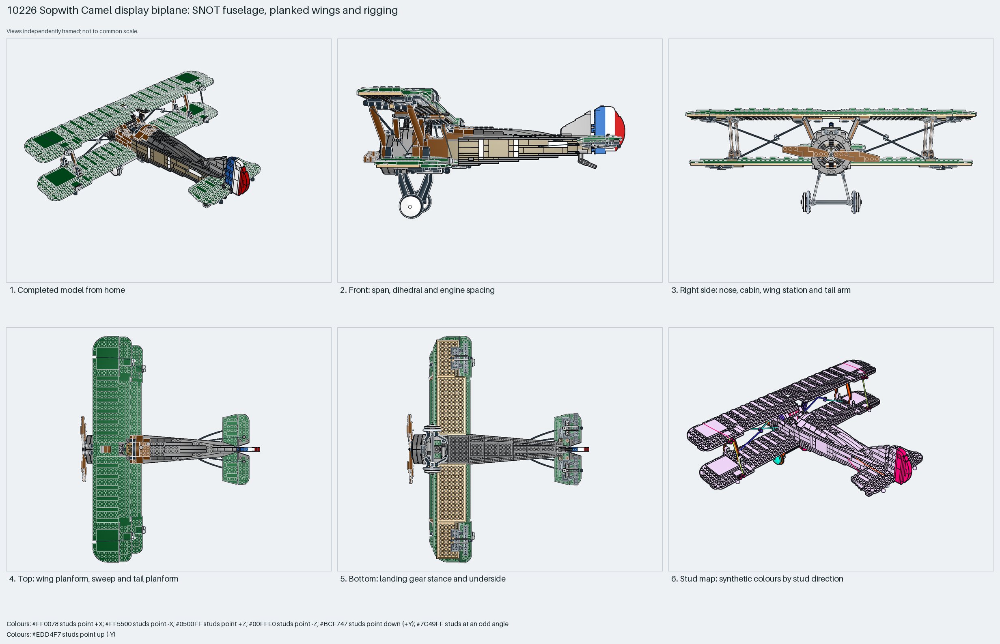

# Sopwith Camel display biplane: SNOT fuselage, planked wings and rigging

The Sopwith Camel display biplane: a fuselage of log bricks, hinge-plate side walls and SNOT panels around a latticed windscreen; two planked wings of 1×3 tile rows on plate spars joined by suspension-arm struts; a radial engine face and geared propeller; a wedge-plate tailplane and striped rudder on handles; towball-hinged ailerons and a shock-absorber landing gear; strings as rigging and rubber bands as tyres. Measured: span 59 studs, length 50, height 23, 811 parts plus string and band segments, 8% Technic.

Inspiration study: the source keeps errors (`assembly.body_overlap` ×31, `assembly.library_internal` ×314, `assembly.nonrigid` ×314, `coverage.raw_geometry` ×8595, `geometry.nonplanar` ×1769). Study the technique and rebuild it; `manual export` is blocked.

Whole aircraft · display SNOT biplane · 1211 parts · 222 source steps in 50 sections

[Completed-model views](index.html) · [Inspection board](board/mosaic.png) · [Source](source.mpd) · [Editable plan](scene.plan.json) · [Checks](source-checks.json) · [Board provenance](board/board.json)

## Read the construction

1211 placements in 222 steps across 50 sections named by source step: `step34`/`step35` side walls, `step40` and `step53` wings with `step53-11` sockets and `step53-13` struts, `step47` tailplane, `step58` landing gear with `shock`, `step59`–`step62` ailerons, `step66` rudder, `step69` propeller and engine, ten `string` rigging sections and four `band` sections from LDCad.

722 studs up, 117 sideways, 362 angled. The wings meet the fuselage through the cabane and the strut arms; control surfaces snap into 63082 sockets; the gear frame pins under the belly; strings run between 572a string-end studs.

## What the parent supplies

- This section is the root of its source model; nothing places it.

Root section; nothing places it. Built with the propeller at −X, so LeoCAD's front view shows the side and its right view the nose.

None; root section.

## Description check

- **Database (accurate):** “Sopwith Camel biplane: tan log-brick, metallic-silver corner-round and dark-green/tan/reddish-brown plate, slope, arch and hinge fuselage around a pearl-gold latticed windscreen, mounting the planked wings, tailplane, geared propeller, radial engine, towball-hinged landing gear with wheels and shock absorbers, and the rigging cables and rubber bands”
- **What it is:** Accurate: a Sopwith Camel biplane with a log-brick and hinge fuselage, latticed windscreen, planked wings, tailplane, geared propeller, radial engine, towball-hinged landing gear with shocks, rigging cables and rubber bands.

## Read the board

Panel 1: home, the green biplane with tan planked panels, the roundel rudder and dish wheels. Panel 2: LeoCAD's front view, which is this model's side: both wings, the shock gear and the rudder. Panel 3: LeoCAD's right view, the nose-on view: equal-span wings, the X rigging, radial engine and dish wheels. Panel 4: top, the two full-span wings and the small tailplane. Panel 5: bottom, the tan underside of the lower wing and the gear frame. Panel 6: the stud map, mostly up with rigging and struts angled.

Magenta edges mark highlighted parts or the parts added in a source step. Pale grey, see-through parts are ghosted context. A neon-green rod (`#39FF14`) is a synthetic axis marker, not a part. Stud maps recolour each part by where its studs point: up lilac, +X rose, −X vermilion, +Z electric blue, −Z aqua, down lime, odd angle violet. These synthetic colours are ΔE ≥ 16 from every LDraw colour. LDraw −Y is up; LeoCAD `right` shows the model's right side, from −X.

Replay a board into `output/`:

    ./ldraw-xray board run examples/aircraft-atlas/recipes/10226-sopwith-camel.json --output output/boards/10226-sopwith-camel

## Reuse it

Use it for the proportions and module split of a display biplane: span 1.2× length, upper wing above the fuselage top, lower wing at the belly, rudder and ailerons as separate hinged sections. Inspiration only: the string and band sections are LDCad segments; the detail packages from this source (propeller, tailplane, aileron, rudder) are reusable on their own.

Rebuild the technique with the new model's own parts and interfaces; the source errors above stay in this copy.

The placement plan preserves source axes. `source_origin` is a positioning frame, not a physical connector.

## Limits

Inspiration only: ten string and four band sections keep LDCad segments (`assembly.nonrigid`, `assembly.library_internal`, `coverage.raw_geometry`, `geometry.nonplanar`) and 31 body overlaps are reported; the BOM comparison does not match because the segments are not physical parts. Hinges, gear and rigging tension not checked.

The source and renders teach a construction. They do not prove clutch, fit, clearance, travel or stability. Boards are rendered from synthetic inspection copies, and poses are rigid re-placements.

## Source and evidence

Source: `10226-1.mpd` / `10226 - main.ldr`, SHA-256 `2903c00bd3f1e0af46d47af2e09bd8ccb423eced0588947cc0fb9bd14ac20511`. Parent: `none (root section)`. Look it up with `./ldraw-agent discover show submodel-2b454b8aeafe1ec99d052a1a`.

Original authors and licences stay in [source.mpd](source.mpd); [extraction.json](extraction.json) records renamed sections and 120 bounded preparation changes. The rendered BOM comparison does not match or is pending. The visual review is recorded separately, after opening the actual images.
