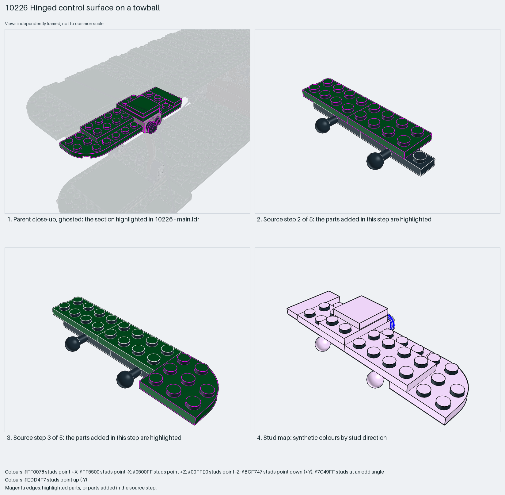

# Aileron strip hinged on two towball plates

An aileron as a two-plate-thick strip with a rounded tip: two 1×4 towball plates along its leading edge snap into the wing's ball sockets and form the hinge; a down bracket and tiles finish the root.

Reusable source construction: source checks pass and the Python and LeoCAD BOMs match.

Aircraft control surface · display SNOT biplane · 12 parts · 5 source steps in 1 section

[Build pages](index.html) · [Inspection board](board/mosaic.png) · [Source](source.mpd) · [Editable plan](scene.plan.json) · [Checks](source-checks.json) · [Board provenance](board/board.json)



## Read the construction

12 parts in 5 steps. Step 1: two 3184 1×4 towball plates side by side. Step 2: 2×4 plates as the strip. Step 3: a 30357 3×3 corner-round plate as the tip. Step 4: a 6141 round plate, a 63864 1×3 tile, a 2×2 tile and a 99781 down bracket at the root. Step 5: a 2×3 plate closing the top.

Stud directions: 12 parts, 11 up, the bracket facing +Z. The two towballs are the only interface; they press into 63082 sockets on the wing.

## What the parent supplies

- `10226 - main.ldr` places it at `-12 -196 -500`, matrix `0 0 1 / 0 1 0 / -1 0 0`.

`10226 - main.ldr` places it at (−12, −196, −500) with matrix 0 0 1 / 0 1 0 / −1 0 0, turned 90° about Y to lie along the wing's trailing edge; the three other ailerons are separate mirrored sections (step60–62).

The wing's two 63082 ball sockets at matching spacing, and the trailing-edge gap the strip sits in.

## Description check

- **Database (accurate):** “Articulated dark-green wing/flap panel on towball plates with a corner-round plate, a down-bracket and grooved tiles”
- **What it is:** Accurate: an articulated dark-green flap panel on towball plates with a corner-round plate, a down bracket and tiles.

## Read the board

Panel 1: a ghosted close-up between the wings with the aileron highlighted on the upper wing's trailing edge. Panel 2: source step 2, the strip plates on the two towball plates. Panel 3: source step 3, the rounded tip plate. Panel 4: the stud map, plates up (lilac), the bracket face +Z (blue).

Magenta edges mark highlighted parts or the parts added in a source step. Pale grey, see-through parts are ghosted context. A neon-green rod (`#39FF14`) is a synthetic axis marker, not a part. Stud maps recolour each part by where its studs point: up lilac, +X rose, −X vermilion, +Z electric blue, −Z aqua, down lime, odd angle violet. These synthetic colours are ΔE ≥ 16 from every LDraw colour. LDraw −Y is up; LeoCAD `right` shows the model's right side, from −X.

Replay a board into `output/`:

    ./ldraw-xray board run examples/aircraft-atlas/recipes/10226-towball-aileron.json --output output/boards/10226-towball-aileron

## Reuse it

Use it for ailerons, elevators or flaps: a plate strip, towball plates on the hinge edge, sockets on the wing. The socket spacing on the wing fixes the towball spacing here.

```sh
./ldraw-agent manual export examples/10226-towball-aileron --outdir output/my-10226-towball-aileron
./ldraw-agent build output/my-10226-towball-aileron/scene.plan.json --output output/my-10226-towball-aileron/10226-towball-aileron.mpd
```

Export needs a current visual review. Build the copied plan, then inspect its interfaces in the new model.

The placement plan preserves source axes. `source_origin` is a positioning frame, not a physical connector.

## Limits

Hinge travel and socket clutch were not checked; the socket side belongs to the wing package.

The source and renders teach a construction. They do not prove clutch, fit, clearance, travel or stability. Boards are rendered from synthetic inspection copies, and poses are rigid re-placements.

## Source and evidence

Source: `10226-1.mpd` / `10226 - step59.ldr`, SHA-256 `2903c00bd3f1e0af46d47af2e09bd8ccb423eced0588947cc0fb9bd14ac20511`. Parent: `10226 - main.ldr`. Look it up with `./ldraw-agent discover show submodel-fe7b3f4607298cabe779f59d`.

Original authors and licences stay in [source.mpd](source.mpd); [extraction.json](extraction.json) records renamed sections and 0 bounded preparation changes. Python and LeoCAD BOMs match. The visual review is recorded separately, after opening the actual images.
