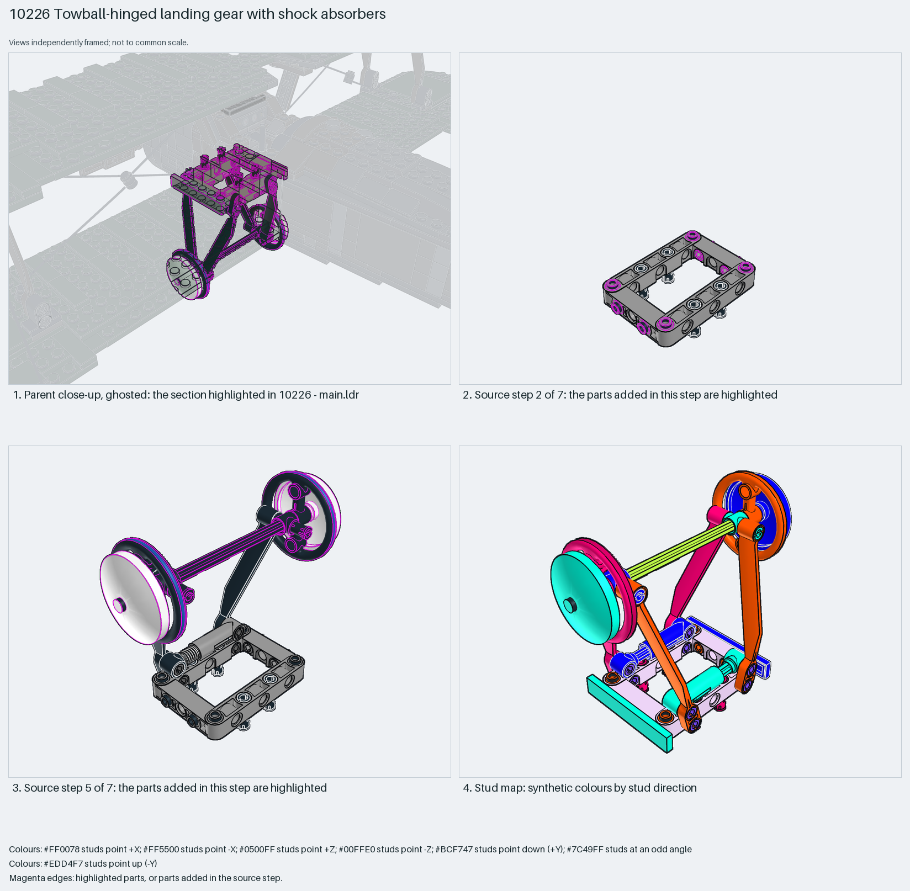

# Biplane landing gear: suspension-arm V struts and shock absorbers on an open beam frame, pulley-and-dish wheels

Biplane landing gear from Technic parts: a 7×5 open-centre beam frame pinned under the fuselage, two V struts of 1×9 suspension arms, two 6.5L shock absorbers as the sprung legs, and a 12-long axle through the V apexes carrying two 5D pulley wheels capped with 4×4 inverted dishes as the wheels.

Inspiration study: the source keeps errors (`coverage.raw_geometry` ×5978, `geometry.nonplanar` ×1456). Study the technique and rebuild it; `manual export` is blocked.

Aircraft landing gear · display SNOT biplane · 38 parts · 10 source steps in 4 sections

[Build pages](index.html) · [Inspection board](board/mosaic.png) · [Source](source.mpd) · [Editable plan](scene.plan.json) · [Checks](source-checks.json) · [Board provenance](board/board.json)

## Read the construction

38 parts in 7 root steps and three children. Steps 1–2: the 64179 7×5 open-centre beam with half pins and 3/4 pins. Steps 3–4: two `step58-3` children (a 32294 suspension arm on a long pin) and the `shock` child (4254 rod in a 4255 cylinder) as the legs. Step 5: the `step58-5` child, a 3708 axle with two 3736 pulley wheels and two 3960 inverted dishes as wheels. Steps 6–7: the second V and two 1×6 tiles closing the frame.

Stud directions: frame tiles up, arms and wheels angled or along the axle. The beam frame's pin holes are the interface to the fuselage underside; the shock cylinders pin to the frame and the arms to the axle.

## What the parent supplies

- `10226 - main.ldr` places it at `-120 12 0`, matrix `-1 0 0 / 0 -1 0 / 0 0 1`.

`10226 - main.ldr` places it at (−120, 12, 0) with matrix −1 0 0 / 0 −1 0 / 0 0 1, a 180° turn about Z: the frame goes against the fuselage belly and the wheels hang below, just behind the engine.

The fuselage belly with the pin holes the frame hangs from, and the engine cowling ahead of it.

## Description check

- **Database (partly accurate):** “Technic beam framework: a 7x5 open-center beam joined by pins with two light-bluish-grey 1x6 tiles”
- **What it is:** Partly accurate: the 7×5 open-centre beam and two tiles are there, but the section is the complete landing gear with V struts, shock absorbers, axle and dish wheels.

## Read the board

Panel 1: a ghosted close-up under the fuselage with the gear highlighted below the lower wing. Panel 2: source step 2, the open beam frame with its pins. Panel 3: source step 5, the axle child with pulley wheels and dishes between the V struts. Panel 4: the stud map, the frame lilac, arms and wheels angled.

Magenta edges mark highlighted parts or the parts added in a source step. Pale grey, see-through parts are ghosted context. A neon-green rod (`#39FF14`) is a synthetic axis marker, not a part. Stud maps recolour each part by where its studs point: up lilac, +X rose, −X vermilion, +Z electric blue, −Z aqua, down lime, odd angle violet. These synthetic colours are ΔE ≥ 16 from every LDraw colour. LDraw −Y is up; LeoCAD `right` shows the model's right side, from −X.

Replay a board into `output/`:

    ./ldraw-xray board run examples/aircraft-atlas/recipes/10226-towball-landing-gear.json --output output/boards/10226-towball-landing-gear

## Reuse it

Rebuild the technique rather than copying: a pinned beam frame as the gear mount, suspension arms as struts, shocks as legs, and pulley-plus-dish wheels for a vintage look. The shock's spring is drawn as raw mesh geometry in the source, which is why this is an inspiration entry.

Rebuild the technique with the new model's own parts and interfaces; the source errors above stay in this copy.

The placement plan preserves source axes. `source_origin` is a positioning frame, not a physical connector.

## Limits

Inspiration only: the shock child's spring is raw mesh geometry (coverage.raw_geometry, geometry.nonplanar), so source checks fail and export is blocked. Suspension travel and wheel rotation were not checked.

The source and renders teach a construction. They do not prove clutch, fit, clearance, travel or stability. Boards are rendered from synthetic inspection copies, and poses are rigid re-placements.

## Source and evidence

Source: `10226-1.mpd` / `10226 - step58.ldr`, SHA-256 `2903c00bd3f1e0af46d47af2e09bd8ccb423eced0588947cc0fb9bd14ac20511`. Parent: `10226 - main.ldr`. Look it up with `./ldraw-agent discover show submodel-4812500ff9de5675fc1965b2`.

Original authors and licences stay in [source.mpd](source.mpd); [extraction.json](extraction.json) records renamed sections and 4 bounded preparation changes. Python and LeoCAD BOMs match. The visual review is recorded separately, after opening the actual images.
