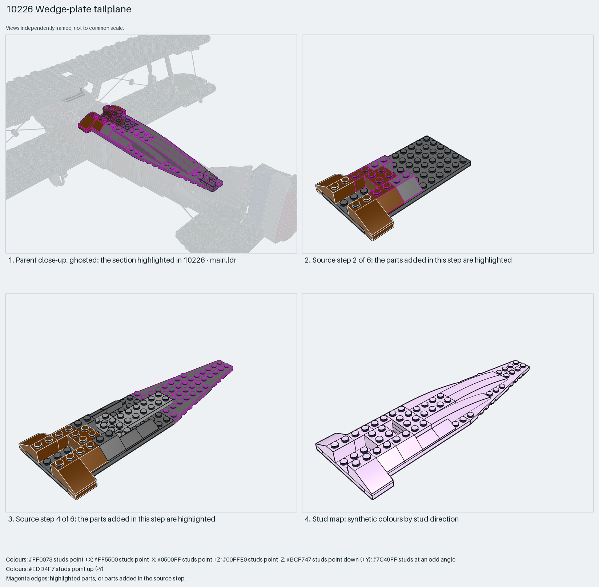

# Tapered tailplane from a plate core and 3×12 wing plates, turned by the parent

A tapered tailplane from a 6×12 plate core, two 3×12 wing plates as the swept halves, four 1×8 curved slopes as rounded tips and 33°/45° slopes at the leading edge; built with its span along X and turned 90° by the parent.

Reusable source construction: source checks pass and the Python and LeoCAD BOMs match.

Aircraft tail · display SNOT biplane · 25 parts · 6 source steps in 1 section

[Build pages](index.html) · [Inspection board](board/mosaic.png) · [Source](source.mpd) · [Editable plan](scene.plan.json) · [Checks](source-checks.json) · [Board provenance](board/board.json)



## Read the construction

25 parts in 6 steps. Steps 1–2: the 6×12 plate with brown 3298 33° and 3039 45° slopes along the leading edge and a 2×2 brick with 2×4 plates as the centre spar. Step 3: a 3709b 2×4 Technic plate and 2×6 plate at the rear. Step 4: the 47397/47398 3×12 wing plates as the tapered halves. Steps 5–6: four 85970 1×8 curved slopes along the tips and four 85984 cheese slopes on the leading edge.

Stud directions: 25 parts, all up. The centre spar's underside meets the fuselage tail; the Technic plate's holes face the elevator rigging.

## What the parent supplies

- `10226 - main.ldr` places it at `160 -112 0`, matrix `0 0 1 / 0 1 0 / -1 0 0`.

`10226 - main.ldr` places it at (160, −112, 0) with matrix 0 0 1 / 0 1 0 / −1 0 0, a 90° turn about Y: the Camel's fuselage runs along X, so the tailplane built span-along-X ends up spanning Z.

The rear fuselage it sits on and the rigging that meets the Technic plate's holes.

## Description check

- **Database (accurate):** “Tailplane/horizontal stabilizer: large 3x12 left and right wings over slopes on a dark-bluish-grey plate base”
- **What it is:** Accurate: a tailplane with 3×12 wing plates over slopes on a dark grey plate base.

## Read the board

Panel 1: a ghosted close-up of the biplane's tail with the tailplane highlighted behind the fuselage. Panel 2: source step 2, the brown leading-edge slopes and the 2×2 brick on the 6×12 plate. Panel 3: source step 4, the two 3×12 wing plates highlighted. Panel 4: the stud map, everything up (lilac).

Magenta edges mark highlighted parts or the parts added in a source step. Pale grey, see-through parts are ghosted context. A neon-green rod (`#39FF14`) is a synthetic axis marker, not a part. Stud maps recolour each part by where its studs point: up lilac, +X rose, −X vermilion, +Z electric blue, −Z aqua, down lime, odd angle violet. These synthetic colours are ΔE ≥ 16 from every LDraw colour. LDraw −Y is up; LeoCAD `right` shows the model's right side, from −X.

Replay a board into `output/`:

    ./ldraw-xray board run examples/aircraft-atlas/recipes/10226-wedge-tailplane.json --output output/boards/10226-wedge-tailplane

## Reuse it

Use it for any tapered stabiliser: a plate core, 3×12 wing plates for the taper, curved slopes for the tips. Build it in its own frame and let the parent place it; add the elevator with towball plates like the aileron package.

```sh
./ldraw-agent manual export examples/10226-wedge-tailplane --outdir output/my-10226-wedge-tailplane
./ldraw-agent build output/my-10226-wedge-tailplane/scene.plan.json --output output/my-10226-wedge-tailplane/10226-wedge-tailplane.mpd
```

Export needs a current visual review. Build the copied plan, then inspect its interfaces in the new model.

The placement plan preserves source axes. `source_origin` is a positioning frame, not a physical connector.

## Limits

The elevator hinge and the rigging attachment were not checked.

The source and renders teach a construction. They do not prove clutch, fit, clearance, travel or stability. Boards are rendered from synthetic inspection copies, and poses are rigid re-placements.

## Source and evidence

Source: `10226-1.mpd` / `10226 - step47.ldr`, SHA-256 `2903c00bd3f1e0af46d47af2e09bd8ccb423eced0588947cc0fb9bd14ac20511`. Parent: `10226 - main.ldr`. Look it up with `./ldraw-agent discover show submodel-d33cd84de2cac15761f3f5c7`.

Original authors and licences stay in [source.mpd](source.mpd); [extraction.json](extraction.json) records renamed sections and 0 bounded preparation changes. Python and LeoCAD BOMs match. The visual review is recorded separately, after opening the actual images.
