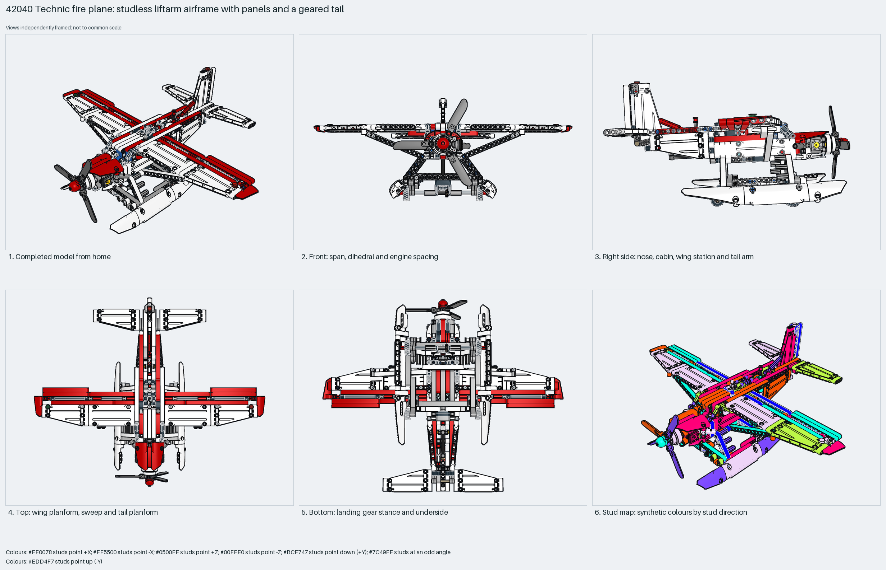

# Technic fire plane: studless liftarm airframe with panels and a geared tail

A studless Technic fire plane: three red spar beams carry panel wings, a liftarm fin and a joystick-geared stabiliser; a two-cylinder engine with a three-blade rotor sits in the nose; V-strut landing gear on treaded 61254 tyres hangs under a liftarm belly; the water bay door works on a rubber band. Measured: span 53 studs, length 42, height 23, 570 parts, 94% Technic.

Inspiration study: the source keeps errors (`coverage.raw_geometry` ×393, `geometry.nonplanar` ×122). Study the technique and rebuild it; `manual export` is blocked.

Whole aircraft · studless Technic · 570 parts · 114 source steps in 20 sections

[Completed-model views](index.html) · [Inspection board](board/mosaic.png) · [Source](source.mpd) · [Editable plan](scene.plan.json) · [Checks](source-checks.json) · [Board provenance](board/board.json)

## Read the construction

570 parts in 114 steps across 20 sections: the root frame with `floor`, `seats`, `leftside` and `rearframe`; the `motor` engine tree in the nose; the `tail` tree (fin, stabiliser, gearing, joystick, both wings and tail sides); two `flap` children; the `rubberBandRound-1` LDCad band and embedded 61254 tyre, 2850b and 33299b parts.

Studless: 172 sideways and 398 angled placements. Pins and axles throughout; the engine cradle, floor and spar beams meet the front frame; the wings pin to the spars; the gear V struts pin under the floor.

## What the parent supplies

- This section is the root of its source model; nothing places it.

Root section; nothing places it. Built with the propeller at −Z.

None; root section.

## Description check

- **Database (accurate):** “Technic fire-fighting plane featuring an articulated engine, landing gear with treaded tyres, wings with flaps, and a geared tail boom with horizontal stabilizer.”
- **What it is:** Accurate: a fire-fighting plane with an articulated engine, treaded landing gear, wings with flaps and a geared tail boom with horizontal stabiliser.

## Read the board

Panel 1: home, the red-and-white liftarm airframe with the three-blade propeller and gear. Panel 2: front, the panel wings, V-strut gear on treaded tyres and the propeller. Panel 3: right side, the engine cowling, open cockpit, spar beams and fin. Panel 4: top, panel wings and tail. Panel 5: bottom, the belly liftarms and gear. Panel 6: the stud map, entirely sideways and angled: studless.

Magenta edges mark highlighted parts or the parts added in a source step. Pale grey, see-through parts are ghosted context. A neon-green rod (`#39FF14`) is a synthetic axis marker, not a part. Stud maps recolour each part by where its studs point: up lilac, +X rose, −X vermilion, +Z electric blue, −Z aqua, down lime, odd angle violet. These synthetic colours are ΔE ≥ 16 from every LDraw colour. LDraw −Y is up; LeoCAD `right` shows the model's right side, from −X.

Replay a board into `output/`:

    ./ldraw-xray board run examples/aircraft-atlas/recipes/42040-fire-plane.json --output output/boards/42040-fire-plane

## Reuse it

Use it for the layout of a studless Technic prop plane: a floor-and-spar frame, panels as wing and tail skins, and one cockpit lever driving a surface. Inspiration only: the embedded tyres and the rubber band are raw geometry; use the library 61254 and the flex workflow for the band when rebuilding.

Rebuild the technique with the new model's own parts and interfaces; the source errors above stay in this copy.

The placement plan preserves source axes. `source_origin` is a positioning frame, not a physical connector.

## Limits

Inspiration only: `coverage.raw_geometry` and `geometry.nonplanar` from the embedded tyres and the rubber band; the BOM comparison matches. No mechanism was checked.

The source and renders teach a construction. They do not prove clutch, fit, clearance, travel or stability. Boards are rendered from synthetic inspection copies, and poses are rigid re-placements.

## Source and evidence

Source: `42040-1.mpd` / `42040 - Fire Plane.ldr`, SHA-256 `574f72260e19873b2f5d906ea687d1313ac35412c06bd5de4a299ca89dab55db`. Parent: `none (root section)`. Look it up with `./ldraw-agent discover show submodel-07c1f2ed381b540cf4f4832f`.

Original authors and licences stay in [source.mpd](source.mpd); [extraction.json](extraction.json) records renamed sections and 18 bounded preparation changes. Python and LeoCAD BOMs match. The visual review is recorded separately, after opening the actual images.
