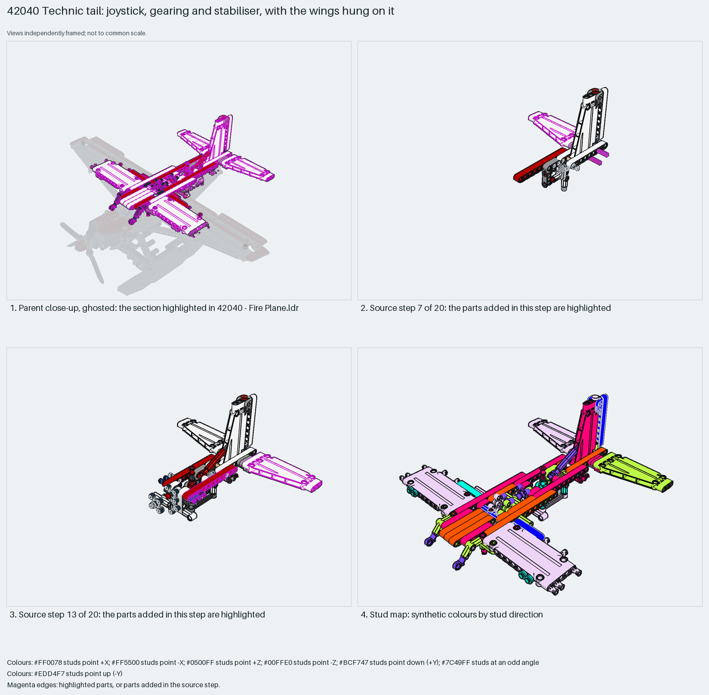

# Technic rear airframe: three spar beams carry the wings, fin and a joystick-geared stabiliser

How a studless plane hangs everything behind the cockpit off three parallel 9-long spar beams: a tall liftarm fin, a tilting stabiliser driven by knob gears from a cockpit joystick, trapezium-panel wings pinned to the spars, and panel tail sides.

Reusable source construction: source checks pass and the Python and LeoCAD BOMs match.

Aircraft tail · studless Technic · 168 parts · 39 source steps in 8 sections

[Build pages](index.html) · [Inspection board](board/mosaic.png) · [Source](source.mpd) · [Editable plan](scene.plan.json) · [Checks](source-checks.json) · [Board provenance](board/board.json)



## Read the construction

168 parts in 20 root steps and seven children. Steps 1–3: the fin, white liftarms pinned into a tall tapered frame. Step 4: the first red 9-long spar beam. Steps 5–12: the `hstab` child (a white panel on a short axle so it can tilt), the `tailgearing` child (five 4-knob gears on cross axles turning the stabiliser axle), more spar beams and axle joiners. Steps 13–20: the `wing1` and `wing2` children (a 5×11 trapezium panel on a beam with pins), the `joystick` child (a red lever on a gear hub with a towball), and the `tailside` panel children closing the rear fuselage.

Studless: 37 friction pins, axles and joiners. The three red spar beams and the pins on the tail sides connect to the front frame; the joystick turns knob gears that pitch the stabiliser axle; the wings pin onto the spar beams, not onto panels.

## What the parent supplies

- `42040 - Fire Plane.ldr` places it at `-140 -266.429 412.895`, matrix `1 0 0 / 0 0.9986 0.0523 / 0 -0.0523 0.9986`.

`42040 - Fire Plane.ldr` places it at (−140, −266, 413) with the identity rotation pitched 3° about X: it is the rear two-thirds of the airframe above the floor, seats, engine and landing gear that the parent supplies.

The floor, seats, engine cradle, landing gear and the front frame the spar beams pin into.

## Description check

- **Database (partly accurate):** “Tail boom assembly with white trapezium panels, beams, a trans-red light tile and mounting cross blocks.”
- **What it is:** Partly accurate: it is a tail boom with trapezium panels and beams, but the section also carries both wings, the horizontal stabiliser, its knob-gear control train and the cockpit joystick.

## Read the board

Panel 1: the ghosted plane with the whole rear airframe highlighted: fin, stabiliser, spar beams and both wings. Panel 2: source step 7, the white stabiliser child on its axle beside the fin and the first red spar. Panel 3: source step 13, the right wing child highlighted on the spar beams with the gearing below. Panel 4: the stud map, beams and panels in every direction.

Magenta edges mark highlighted parts or the parts added in a source step. Pale grey, see-through parts are ghosted context. A neon-green rod (`#39FF14`) is a synthetic axis marker, not a part. Stud maps recolour each part by where its studs point: up lilac, +X rose, −X vermilion, +Z electric blue, −Z aqua, down lime, odd angle violet. These synthetic colours are ΔE ≥ 16 from every LDraw colour. LDraw −Y is up; LeoCAD `right` shows the model's right side, from −X.

Replay a board into `output/`:

    ./ldraw-xray board run examples/aircraft-atlas/recipes/42040-geared-tail.json --output output/boards/42040-geared-tail

## Reuse it

Use it to learn two things: keep the spar beams continuous and hang wings and tail off them, and route a cockpit lever to a tail surface through knob gears on cross axles. Check the stabiliser's travel before closing the tail sides.

```sh
./ldraw-agent manual export examples/42040-geared-tail --outdir output/my-42040-geared-tail
./ldraw-agent build output/my-42040-geared-tail/scene.plan.json --output output/my-42040-geared-tail/42040-geared-tail.mpd
```

Export needs a current visual review. Build the copied plan, then inspect its interfaces in the new model.

The placement plan preserves source axes. `source_origin` is a positioning frame, not a physical connector.

## Limits

The joystick-to-stabiliser travel and the pin retention of the wings were not checked; one static pose. `./ldraw-agent build` of the exported plan reports `technic.invalid_seating` for 18 source interfaces (32556 long pins and 2780/6558 friction pins only partly seated in the 11-, 7- and 5-long beams as drawn); `manual export`, the plan rebuild and the BOM comparison pass.

The source and renders teach a construction. They do not prove clutch, fit, clearance, travel or stability. Boards are rendered from synthetic inspection copies, and poses are rigid re-placements.

## Source and evidence

Source: `42040-1.mpd` / `42040 - tail.ldr`, SHA-256 `574f72260e19873b2f5d906ea687d1313ac35412c06bd5de4a299ca89dab55db`. Parent: `42040 - Fire Plane.ldr`. Look it up with `./ldraw-agent discover show submodel-0418cb92590727bda30acb0e`.

Original authors and licences stay in [source.mpd](source.mpd); [extraction.json](extraction.json) records renamed sections and 26 bounded preparation changes. Python and LeoCAD BOMs match. The visual review is recorded separately, after opening the actual images.
