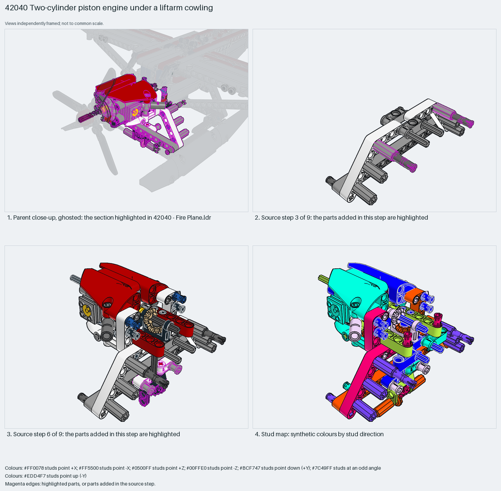

# Two-cylinder piston engine under a liftarm cowling

A two-cylinder engine for a Technic propeller plane: two pistons on connecting rods and a crank between cross blocks, driven through a bevel-gear pair from the propeller axle, in a white bent-liftarm cradle with eight axle joiners as exhaust stubs and a red beam-and-panel cowling on top.

Reusable source construction: source checks pass and the Python and LeoCAD BOMs match.

Aircraft engine · studless Technic · 123 parts · 22 source steps in 5 sections

[Build pages](index.html) · [Inspection board](board/mosaic.png) · [Source](source.mpd) · [Editable plan](scene.plan.json) · [Checks](source-checks.json) · [Board provenance](board/board.json)



## Read the construction

123 parts in 9 root steps and four children. Steps 1–3: a white 4×6 bent-liftarm cradle with axles, cross blocks and eight smooth axle joiners standing as exhaust stubs. Step 4: the `motor2` child, the two-cylinder block: red beams and black tooth plates as rocker covers over two 2851 pistons on 2852 rods and two 2853 crank pieces with a 12-tooth bevel gear. Steps 5–9: the `motorgears` child (a bevel pair on the long axle that runs to the propeller), the `motortop` cover of black beams and a white bent liftarm, and the `motorhood` red panels pinned over the cylinders.

Studless: friction pins, axle pins and cross blocks in every direction. The long axle out of the front of the gear child is the propeller shaft; the cradle's pin holes meet the nose frame.

## What the parent supplies

- `42040 - Fire Plane.ldr` places it at `-120 -174.855 -132.646`, matrix `0 0 -1 / 0.0523 0.9986 0 / 0.9986 -0.0523 0`.

`42040 - Fire Plane.ldr` places it at (−120, −175, −133) with a 90° turn about Y and a 3° roll, so the propeller axle points −Z out of the nose; the parent adds the three-blade 99012 rotor, the nose frame and the landing gear beneath.

The propeller axle and rotor, the nose frame the cradle pins into, and the geared drive that turns the crank from the propeller.

## Description check

- **Database (partly accurate):** “Engine motor subassembly built from bent liftarms, cross blocks, bevel gears and a toggle-joint connector to transfer rotation.”
- **What it is:** Partly accurate: bent liftarms, cross blocks, bevel gears and a toggle joint are there, but the section is the two-cylinder engine itself, with pistons, rods, crank and a red cowling.

## Read the board

Panel 1: the ghosted nose with the engine highlighted behind the propeller. Panel 2: source step 3, the white cradle with the grey axle joiners as exhaust stubs. Panel 3: source step 6, the red beams, pistons and bevel gear with the hood pins highlighted. Panel 4: the stud map, pins and liftarms in every direction.

Magenta edges mark highlighted parts or the parts added in a source step. Pale grey, see-through parts are ghosted context. A neon-green rod (`#39FF14`) is a synthetic axis marker, not a part. Stud maps recolour each part by where its studs point: up lilac, +X rose, −X vermilion, +Z electric blue, −Z aqua, down lime, odd angle violet. These synthetic colours are ΔE ≥ 16 from every LDraw colour. LDraw −Y is up; LeoCAD `right` shows the model's right side, from −X.

Replay a board into `output/`:

    ./ldraw-xray board run examples/aircraft-atlas/recipes/42040-piston-engine.json --output output/boards/42040-piston-engine

## Reuse it

Use it for a visible piston engine in any Technic prop plane: build cradle, crank and pistons first, then the covers and hood; mesh the bevel pair with the propeller axle and check piston travel before closing the cowling.

```sh
./ldraw-agent manual export examples/42040-piston-engine --outdir output/my-42040-piston-engine
./ldraw-agent build output/my-42040-piston-engine/scene.plan.json --output output/my-42040-piston-engine/42040-piston-engine.mpd
```

Export needs a current visual review. Build the copied plan, then inspect its interfaces in the new model.

The placement plan preserves source axes. `source_origin` is a positioning frame, not a physical connector.

## Limits

Piston travel, the bevel mesh with the propeller axle and hood clearance were not checked.

The source and renders teach a construction. They do not prove clutch, fit, clearance, travel or stability. Boards are rendered from synthetic inspection copies, and poses are rigid re-placements.

## Source and evidence

Source: `42040-1.mpd` / `42040 - motor.ldr`, SHA-256 `574f72260e19873b2f5d906ea687d1313ac35412c06bd5de4a299ca89dab55db`. Parent: `42040 - Fire Plane.ldr`. Look it up with `./ldraw-agent discover show submodel-90b31f1b8129c7eb92b63e9a`.

Original authors and licences stay in [source.mpd](source.mpd); [extraction.json](extraction.json) records renamed sections and 15 bounded preparation changes. Python and LeoCAD BOMs match. The visual review is recorded separately, after opening the actual images.
