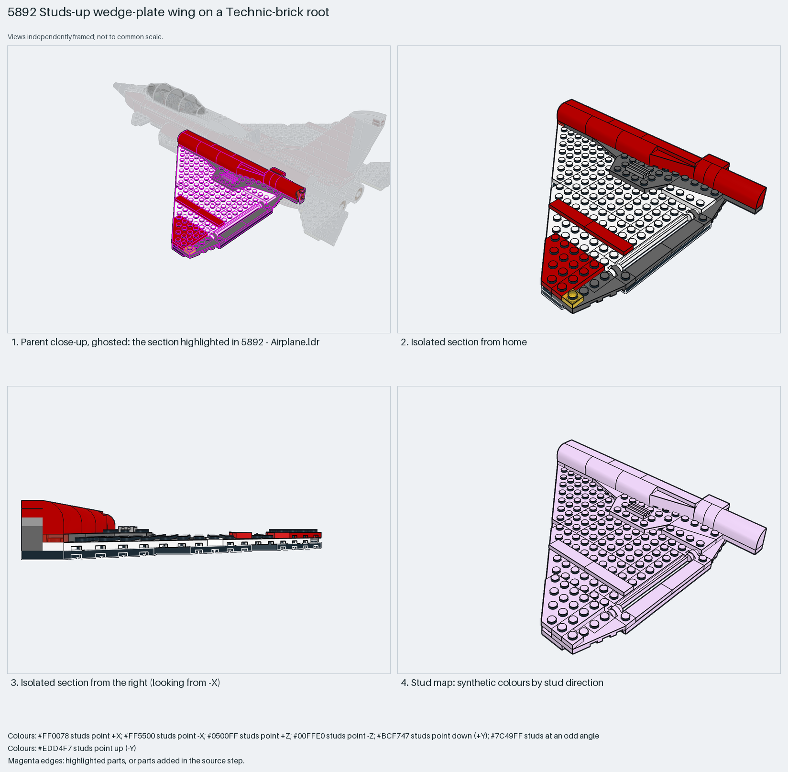

# Studs-up delta wing from overlapped corner-cut plates with a Technic-brick root

A studs-up delta wing from corner-cut plates (8×8, 6×6, 4×6 and 4×4 without corners) overlapped two deep, tiles along the trailing edge, red curved-top bricks as the leading-edge fairing, and two 1×2 Technic bricks with handle and clip plates at the root as the fuselage interface.

Reusable source construction: source checks pass and the Python and LeoCAD BOMs match.

Aircraft wing · Creator hybrid · 55 parts · 1 source steps in 1 section

[Build pages](index.html) · [Inspection board](board/mosaic.png) · [Source](source.mpd) · [Editable plan](scene.plan.json) · [Checks](source-checks.json) · [Board provenance](board/board.json)



## Read the construction

55 parts in 1 step: two 8×8 and three 6×6 corner-cut plates, a 4×6 and a 4×4 corner-cut plate and a 6×12 plate overlapped into a swept trapezoid, two 4×4 wings with cutout at the tip, 1×4 and 1×6 tiles along the trailing edge, three 2×4 and two 2×1 curved-top bricks in red along the leading edge, two 3700 Technic bricks, two 60478 handle plates and two 61252 clip plates at the root, a grille tile vent and a 1×1 plate as the tip light.

All studs up. The root Technic bricks' pin holes, the handle plates and the clip plates meet the fuselage frame; the plates' studs carry the parent's upper skin.

## What the parent supplies

- `5892 - Airplane.ldr` places it at `-90 -40 -120`, matrix `1 0 0 / 0 1 0 / 0 0 1`.

`5892 - Airplane.ldr` places it at (−90, −40, −120) with the identity matrix; the right wing is a separate mirrored section at +Z.

The fuselage frame with pins and bars for the root bricks, handles and clips, and the skin above the root.

## Description check

- **Database (accurate):** “Large left wing assembly with white and black plates, wing cutout elements, and a red accent stripe.”
- **What it is:** Accurate: a large left wing of white and black plates with wing cut-out elements and a red stripe.

## Read the board

Panel 1: the ghosted jet with the left wing highlighted. Panel 2: the isolated wing from home, red leading-edge fairing and root bricks. Panel 3: from the right, the wing is two plates thick with the fairing bricks above. Panel 4: the stud map, everything up.

Magenta edges mark highlighted parts or the parts added in a source step. Pale grey, see-through parts are ghosted context. A neon-green rod (`#39FF14`) is a synthetic axis marker, not a part. Stud maps recolour each part by where its studs point: up lilac, +X rose, −X vermilion, +Z electric blue, −Z aqua, down lime, odd angle violet. These synthetic colours are ΔE ≥ 16 from every LDraw colour. LDraw −Y is up; LeoCAD `right` shows the model's right side, from −X.

Replay a board into `output/`:

    ./ldraw-xray board run examples/aircraft-atlas/recipes/5892-plate-wing.json --output output/boards/5892-plate-wing

## Reuse it

Use it for any swept plate wing: overlap corner-cut plates so every seam is bridged by the layer above, tile the trailing edge, fair the leading edge with curved bricks and give the root a Technic-brick spar for pins.

```sh
./ldraw-agent manual export examples/5892-plate-wing --outdir output/my-5892-plate-wing
./ldraw-agent build output/my-5892-plate-wing/scene.plan.json --output output/my-5892-plate-wing/5892-plate-wing.mpd
```

Export needs a current visual review. Build the copied plan, then inspect its interfaces in the new model.

The placement plan preserves source axes. `source_origin` is a positioning frame, not a physical connector.

## Limits

Root pin engagement and the clip plates' hold were not checked.

The source and renders teach a construction. They do not prove clutch, fit, clearance, travel or stability. Boards are rendered from synthetic inspection copies, and poses are rigid re-placements.

## Source and evidence

Source: `5892-1.mpd` / `5892 - Left wing.ldr`, SHA-256 `deb0dfcf1657114846d3cb73f93b3fca01f699dfa75e9327279652209fc6b320`. Parent: `5892 - Airplane.ldr`. Look it up with `./ldraw-agent discover show submodel-429d62369766de1b740e6ece`.

Original authors and licences stay in [source.mpd](source.mpd); [extraction.json](extraction.json) records renamed sections and 0 bounded preparation changes. Python and LeoCAD BOMs match. The visual review is recorded separately, after opening the actual images.
