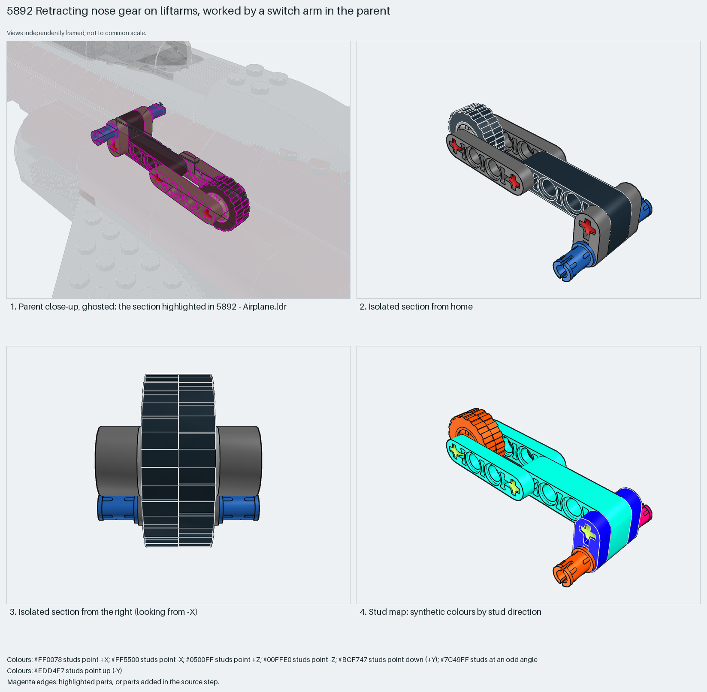

# Retracting nose gear on liftarms, worked by a switch arm in the parent

A nose leg that can swing: one bent 2×4 liftarm carries the wheel on a 2-long axle at its tip, two thin 4×0.5 liftarms and two 2×0.5 liftarms form a parallel link, and axle pins at the top are the pivot the parent holds.

Reusable source construction: source checks pass and the Python and LeoCAD BOMs match.

Aircraft landing gear · Creator hybrid · 12 parts · 1 source steps in 1 section

[Build pages](index.html) · [Inspection board](board/mosaic.png) · [Pose sweep](board/poses.png) · [Source](source.mpd) · [Editable plan](scene.plan.json) · [Checks](source-checks.json) · [Board provenance](board/board.json)



## Read the construction

12 parts in 1 step: a 32140 bent liftarm, a 42610 rim with 51011 tyre on a 32062 axle at the bent end, two 32449 thin liftarms and two 41677 thin liftarms linked by two more 2-long axles, and two 43093 axle pins at the pivot end.

Stud directions: 12 parts, liftarms facing −Z and +X, wheel axle along X. The two axle pins and the free ends of the thin liftarms are the interfaces; the parent's switch arm pulls the link.

## What the parent supplies

- `5892 - Airplane.ldr` places it at `-390 -46 0`, matrix `-0.996195 0.0871557 0 / -0.0871557 -0.996195 0 / 0 0 1`.

`5892 - Airplane.ldr` places it at (−390, −46, 0) with a matrix rotated about 175° about Z, so the leg hangs under the nose tilted 5° forward in the extended pose. The parent also holds `5892 - Switch arm.ldr` (two bent 32009 liftarms) that works the link to retract it.

The pin holes for the pivot, the switch arm that moves the link, and the opening in the nose the wheel swings into.

## Description check

- **Database (accurate):** “Retractable nose landing gear using liftarms, axles, and a small rubber tyre on a grooved wheel rim.”
- **What it is:** Accurate: a retractable nose leg on liftarms with one small wheel. Only the extended pose is drawn.

## Read the board

Panel 1: a ghosted close-up under the nose with the leg highlighted, hanging down and slightly forward. Panel 2: the isolated leg from home, bent liftarm, link and wheel. Panel 3: from the right, the wheel face-on between the blue axle pins. Panel 4: the stud map, liftarms aqua (−Z) and the bent liftarm blue/orange. The pose sweep board turns the leg 0, 45 and 90 degrees about the axle-pin axis (neon-green rod) with the pins fixed: a synthetic sweep, not a checked travel.

Magenta edges mark highlighted parts or the parts added in a source step. Pale grey, see-through parts are ghosted context. A neon-green rod (`#39FF14`) is a synthetic axis marker, not a part. Stud maps recolour each part by where its studs point: up lilac, +X rose, −X vermilion, +Z electric blue, −Z aqua, down lime, odd angle violet. These synthetic colours are ΔE ≥ 16 from every LDraw colour. LDraw −Y is up; LeoCAD `right` shows the model's right side, from −X.

Replay a board into `output/`:

    ./ldraw-xray board run examples/aircraft-atlas/recipes/5892-retracting-nose-gear.json --output output/boards/5892-retracting-nose-gear
    ./ldraw-xray board run examples/aircraft-atlas/recipes/5892-retracting-nose-gear-poses.json --output output/boards/5892-retracting-nose-gear-poses

## Reuse it

Use it for any nose or tail wheel that must fold: keep the pivot pins on the frame, the parallel link to a lever, and check the wheel's swept path through the fuselage opening. Draw both poses before claiming retraction.

```sh
./ldraw-agent manual export examples/5892-retracting-nose-gear --outdir output/my-5892-retracting-nose-gear
./ldraw-agent build output/my-5892-retracting-nose-gear/scene.plan.json --output output/my-5892-retracting-nose-gear/5892-retracting-nose-gear.mpd
```

Export needs a current visual review. Build the copied plan, then inspect its interfaces in the new model.

The placement plan preserves source axes. `source_origin` is a positioning frame, not a physical connector.

## Limits

Retraction travel, the switch-arm linkage and the wheel's clearance through the nose were not checked; one pose only.

The source and renders teach a construction. They do not prove clutch, fit, clearance, travel or stability. Boards are rendered from synthetic inspection copies, and poses are rigid re-placements.

## Source and evidence

Source: `5892-1.mpd` / `5892 - Nose gear.ldr`, SHA-256 `deb0dfcf1657114846d3cb73f93b3fca01f699dfa75e9327279652209fc6b320`. Parent: `5892 - Airplane.ldr`. Look it up with `./ldraw-agent discover show submodel-2197b68f91ada0838e35d0f0`.

Original authors and licences stay in [source.mpd](source.mpd); [extraction.json](extraction.json) records renamed sections and 0 bounded preparation changes. Python and LeoCAD BOMs match. The visual review is recorded separately, after opening the actual images.
