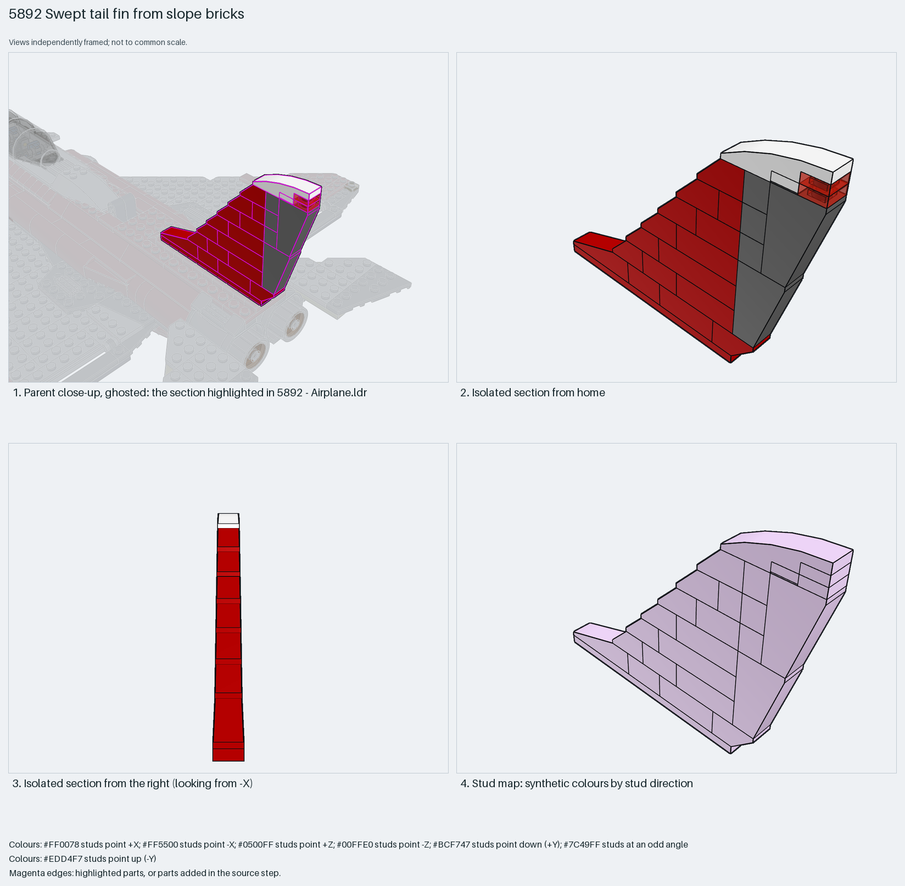

# Swept one-stud fin from stepped 45° slopes

A one-stud-thick swept fin: a brick stack whose leading edge steps back one 2×1 45° slope per course, a dark grey rudder strip of inverted 75° slopes at the trailing edge, a shallow 18° slope as the root fillet and a 4×1 curved slope as the tip cap, all on a 1×10 plate.

Reusable source construction: source checks pass and the Python and LeoCAD BOMs match.

Aircraft tail · Creator hybrid · 26 parts · 1 source steps in 1 section

[Build pages](index.html) · [Inspection board](board/mosaic.png) · [Source](source.mpd) · [Editable plan](scene.plan.json) · [Checks](source-checks.json) · [Board provenance](board/board.json)



## Read the construction

26 parts in 1 step: a 4477 1×10 plate base, 1×3, 1×2 and 1×1 bricks stepping back each course, six 3040b 2×1 45° slopes on the leading edge, two 2449 inverted 75° 2×1×3 slopes and a 3665b inverted slope at the trailing edge, a 60477 4×1 18° slope at the root, a 61678 curved slope on top and trans-red 1×1 plates with a tile as the tail light.

Stud directions: 26 parts, all up. The 1×10 plate's underside is the only interface; it sits on the fuselage spine studs.

## What the parent supplies

- `5892 - Airplane.ldr` places it at `90 -134 0`, matrix `1 0 0 / 0 1 0 / 0 0 1`.

`5892 - Airplane.ldr` places it at (90, −134, 0) with the identity matrix, on the rear fuselage centreline above the engines.

The fuselage spine studs the base plate sits on; the fin is not braced sideways.

## Description check

- **Database (accurate):** “Red vertical tail fin with angled slope bricks, a curved white tip, and translucent red accent plates.”
- **What it is:** Accurate: a red fin of angled slope bricks with a curved white tip and trans-red light plates.

## Read the board

Panel 1: a ghosted close-up of the rear fuselage with the fin highlighted. Panel 2: the isolated fin from home, stepped leading edge and grey trailing strip. Panel 3: from the right, the fin is one stud thick. Panel 4: the stud map, everything up (lilac).

Magenta edges mark highlighted parts or the parts added in a source step. Pale grey, see-through parts are ghosted context. A neon-green rod (`#39FF14`) is a synthetic axis marker, not a part. Stud maps recolour each part by where its studs point: up lilac, +X rose, −X vermilion, +Z electric blue, −Z aqua, down lime, odd angle violet. These synthetic colours are ΔE ≥ 16 from every LDraw colour. LDraw −Y is up; LeoCAD `right` shows the model's right side, from −X.

Replay a board into `output/`:

    ./ldraw-xray board run examples/aircraft-atlas/recipes/5892-slope-tail-fin.json --output output/boards/5892-slope-tail-fin

## Reuse it

Use it for any single fin: keep the stack one stud thick, step the leading edge with 45° slopes and the trailing edge with inverted 75° slopes, and change the courses to change the sweep. A two-stud fin needs 2×2 slopes instead.

```sh
./ldraw-agent manual export examples/5892-slope-tail-fin --outdir output/my-5892-slope-tail-fin
./ldraw-agent build output/my-5892-slope-tail-fin/scene.plan.json --output output/my-5892-slope-tail-fin/5892-slope-tail-fin.mpd
```

Export needs a current visual review. Build the copied plan, then inspect its interfaces in the new model.

The placement plan preserves source axes. `source_origin` is a positioning frame, not a physical connector.

## Limits

Sideways strength of the one-stud stack was not checked.

The source and renders teach a construction. They do not prove clutch, fit, clearance, travel or stability. Boards are rendered from synthetic inspection copies, and poses are rigid re-placements.

## Source and evidence

Source: `5892-1.mpd` / `5892 - Tail fin.ldr`, SHA-256 `deb0dfcf1657114846d3cb73f93b3fca01f699dfa75e9327279652209fc6b320`. Parent: `5892 - Airplane.ldr`. Look it up with `./ldraw-agent discover show submodel-0640aea6e70e64feed9096a5`.

Original authors and licences stay in [source.mpd](source.mpd); [extraction.json](extraction.json) records renamed sections and 0 bounded preparation changes. Python and LeoCAD BOMs match. The visual review is recorded separately, after opening the actual images.
