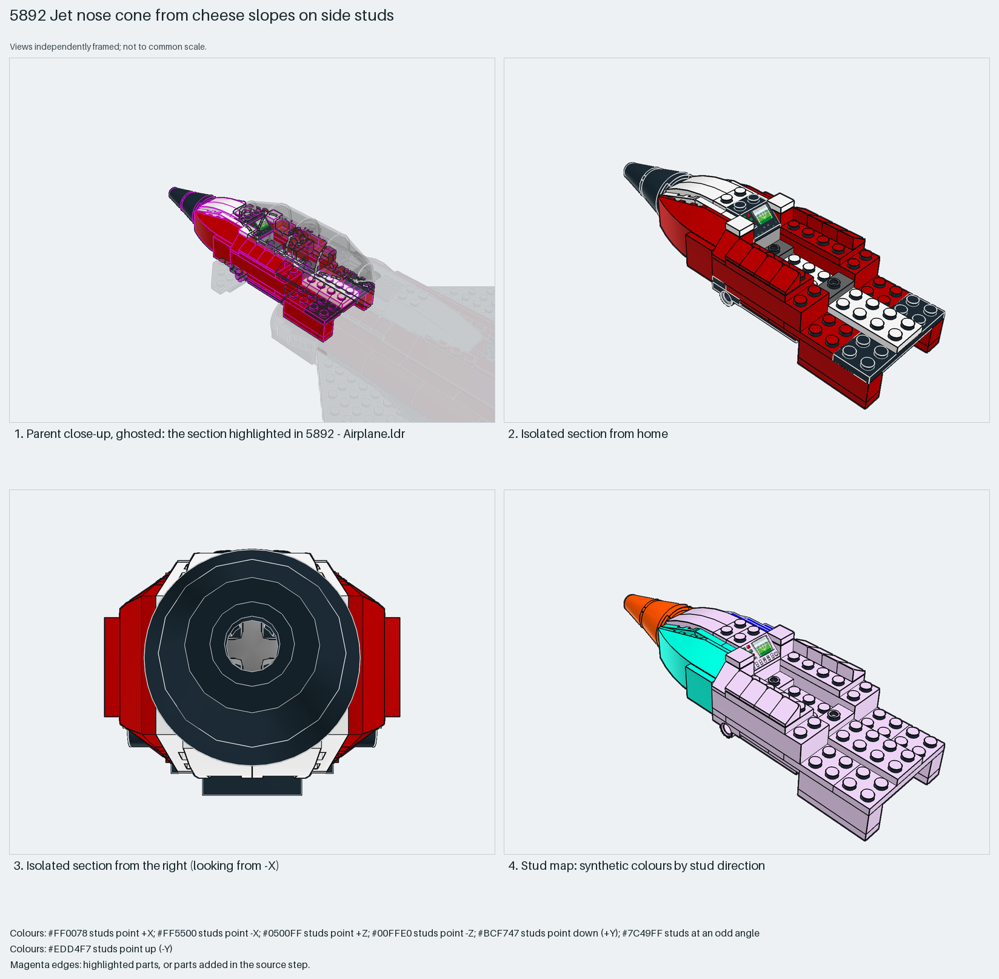

# Jet nose: curved wedges hung sideways on side-stud bricks, cone spike on an axle

A jet nose that tapers in two directions: the top with 4×1 curved slopes and 1×1 cheese slopes, the sides with 6×4 triple-curved wedges hung sideways on 1×4 side-stud bricks and jumper plates, and a 3×3 cone plus a 2×2 cone on a 5-long axle as the spike.

Reusable source construction: source checks pass and the Python and LeoCAD BOMs match.

Aircraft nose · Creator hybrid · 69 parts · 1 source steps in 1 section

[Build pages](index.html) · [Inspection board](board/mosaic.png) · [Source](source.mpd) · [Editable plan](scene.plan.json) · [Checks](source-checks.json) · [Board provenance](board/board.json)



## Read the construction

69 parts in 1 step. A core of 2×6 bricks, 2×4/2×2 plates and 2×2 plates with holes carries two 30414 1×4 side-stud bricks; two 43712 6×4 triple-curved wedges and two 48183 3×4 wings sit on those side studs and on 3794a jumper plates. Two 42023 inverted curved slopes close the underside, two 61678 curved slopes and eight 54200 cheese slopes shape the top, a 3039pce printed radar slope is the instrument panel at the rear, and a 6233 cone with a 3942c cone ride a 32073 axle through a 32064b Technic brick.

Stud directions: 69 parts, 51 up, the wedges facing ±Z, the cones facing −X. The rear plate layer and the Technic brick are the interfaces to the fuselage; the instrument slope faces the canopy.

## What the parent supplies

- `5892 - Airplane.ldr` places it at `-490 -32 0`, matrix `1 0 0 / 0 1 0 / 0 0 1`.

`5892 - Airplane.ldr` places it at (−490, −32, 0) with the identity matrix: the nose points −X, ahead of the canopy and above the retracting nose gear.

The fuselage front it stacks on, the canopy behind the instrument slope and the nose-gear bay below.

## Description check

- **Database (accurate):** “Red and black forward fuselage section with sloped inverted bricks and curved white panels forming the nose cone.”
- **What it is:** Accurate: a red and black nose with inverted curved slopes under it and curved white wedge panels on the sides. The spike is two cones on an axle.

## Read the board

Panel 1: a ghosted close-up of the fuselage front with the nose highlighted. Panel 2: the isolated nose from home, cheese slopes along the top edges and the radar slope at the rear. Panel 3: from the right, the cone tip face-on inside the wedge outline. Panel 4: the stud map, core up (lilac), wedges aqua (−Z), cones orange (−X).

Magenta edges mark highlighted parts or the parts added in a source step. Pale grey, see-through parts are ghosted context. A neon-green rod (`#39FF14`) is a synthetic axis marker, not a part. Stud maps recolour each part by where its studs point: up lilac, +X rose, −X vermilion, +Z electric blue, −Z aqua, down lime, odd angle violet. These synthetic colours are ΔE ≥ 16 from every LDraw colour. LDraw −Y is up; LeoCAD `right` shows the model's right side, from −X.

Replay a board into `output/`:

    ./ldraw-xray board run examples/aircraft-atlas/recipes/5892-snot-nose.json --output output/boards/5892-snot-nose

## Reuse it

Use the pattern for any pointed nose: build a studs-up core one stud narrower than the fuselage, hang the curved side panels on side studs, and let a cone pair on an axle make the tip. Change the wedge part to change the curvature.

```sh
./ldraw-agent manual export examples/5892-snot-nose --outdir output/my-5892-snot-nose
./ldraw-agent build output/my-5892-snot-nose/scene.plan.json --output output/my-5892-snot-nose/5892-snot-nose.mpd
```

Export needs a current visual review. Build the copied plan, then inspect its interfaces in the new model.

The placement plan preserves source axes. `source_origin` is a positioning frame, not a physical connector.

## Limits

Clutch of the wedges on the side studs and the cone pair's fit on the axle were not checked.

The source and renders teach a construction. They do not prove clutch, fit, clearance, travel or stability. Boards are rendered from synthetic inspection copies, and poses are rigid re-placements.

## Source and evidence

Source: `5892-1.mpd` / `5892 - Nose section.ldr`, SHA-256 `deb0dfcf1657114846d3cb73f93b3fca01f699dfa75e9327279652209fc6b320`. Parent: `5892 - Airplane.ldr`. Look it up with `./ldraw-agent discover show submodel-54f6f039fd4f74b0e88596c1`.

Original authors and licences stay in [source.mpd](source.mpd); [extraction.json](extraction.json) records renamed sections and 0 bounded preparation changes. Python and LeoCAD BOMs match. The visual review is recorded separately, after opening the actual images.
