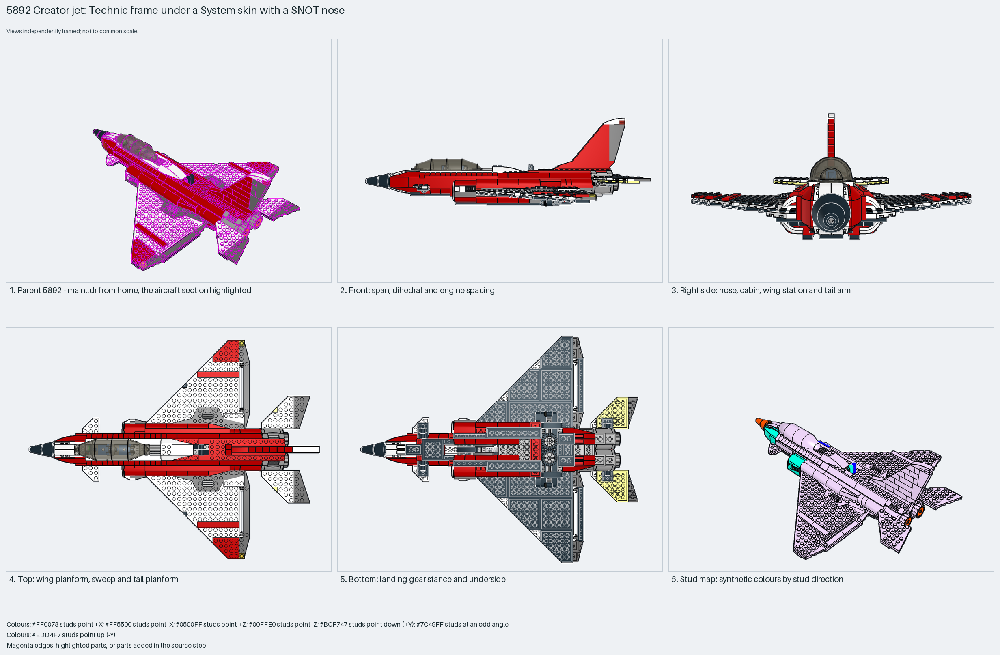

# Creator jet: Technic frame under a System skin with a SNOT nose

A Creator jet: a Technic-brick spine with pins carries a studs-up System skin, delta plate wings with Technic-brick roots, a SNOT nose with a cone spike, a one-stud slope fin, twin 43121 engines side by side at the tail and a retracting nose gear. Measured: span 41 studs, length 50, height 17, 524 parts, 16% Technic.

Reusable source construction: source checks pass and the Python and LeoCAD BOMs match.

Whole aircraft · Creator hybrid (Technic frame, System skin) · 524 parts · 9 source steps in 9 sections

[Completed-model views](index.html) · [Inspection board](board/mosaic.png) · [Source](source.mpd) · [Editable plan](scene.plan.json) · [Checks](source-checks.json) · [Board provenance](board/board.json)



## Read the construction

524 parts in 9 steps across 9 sections: `Bottom section` and `Center support` (Technic bricks and plates as the spine), `Nose gear` with its `Switch arm`, `Nose section` (the SNOT nose with the instrument slope), `Left wing` and `Right wing` (mirrored plate deltas), `Tail fin`, plus the 89762 canopy, 54200 cheese slopes along the fuselage edges and the two 43121 engines in the root.

429 studs up, 84 sideways (nose wedges and fuselage sides), 7 angled. The wings pin to the spine through their 1×2 Technic bricks; the nose stacks on the front plates; the fin's base plate sits on the spine; the canopy sits on the cockpit rim.

## What the parent supplies

- `5892 - main.ldr` places it at `0 0 0`, matrix `1 0 0 / 0 1 0 / 0 0 1`.

`5892 - main.ldr` places it at the origin with the identity matrix; the nose points −X, so LeoCAD's front view shows the side.

Nothing; the wrapper only places it.

## Description check

- **Database (partly accurate):** “Assembled aircraft fuselage with Technic beams, plates, and curved red wedge panels forming the body shell.”
- **What it is:** Partly accurate: the fuselage shell with Technic beams, plates and red wedge panels is there, but the section also contains the wings, nose, fin, gear and engines.

## Read the board

Panel 1: the parent from home with the whole jet highlighted. Panel 2: LeoCAD's front view, which is this model's side because the nose points −X: the cone nose, canopy, fin and rear engines. Panel 3: LeoCAD's right view, the nose-on view: level delta wings, the cone, canopy and fin. Panel 4: top, the delta planform with red stripes and the small tailplanes. Panel 5: bottom, the Technic spine, nose gear and main wheels. Panel 6: the stud map, skin lilac, nose wedges aqua, cone orange.

Magenta edges mark highlighted parts or the parts added in a source step. Pale grey, see-through parts are ghosted context. A neon-green rod (`#39FF14`) is a synthetic axis marker, not a part. Stud maps recolour each part by where its studs point: up lilac, +X rose, −X vermilion, +Z electric blue, −Z aqua, down lime, odd angle violet. These synthetic colours are ΔE ≥ 16 from every LDraw colour. LDraw −Y is up; LeoCAD `right` shows the model's right side, from −X.

Replay a board into `output/`:

    ./ldraw-xray board run examples/aircraft-atlas/recipes/5892-sonic-jet.json --output output/boards/5892-sonic-jet

## Reuse it

Use it as the template for a mid-size jet: length 1.2× span, delta wings two plates thick, engines at the rear, fin one stud thick. Build the Technic spine first, then hang wings, nose and fin on it before closing the skin.

```sh
./ldraw-agent manual export examples/5892-sonic-jet --outdir output/my-5892-sonic-jet
./ldraw-agent build output/my-5892-sonic-jet/scene.plan.json --output output/my-5892-sonic-jet/5892-sonic-jet.mpd
```

Export needs a current visual review. Build the copied plan, then inspect its interfaces in the new model.

The placement plan preserves source axes. `source_origin` is a positioning frame, not a physical connector.

## Limits

Wing root pin engagement, gear retraction and canopy fit were not checked.

The source and renders teach a construction. They do not prove clutch, fit, clearance, travel or stability. Boards are rendered from synthetic inspection copies, and poses are rigid re-placements.

## Source and evidence

Source: `5892-1.mpd` / `5892 - Airplane.ldr`, SHA-256 `deb0dfcf1657114846d3cb73f93b3fca01f699dfa75e9327279652209fc6b320`. Parent: `5892 - main.ldr`. Look it up with `./ldraw-agent discover show submodel-18d9164b0a31e18b0ce79ed3`.

Original authors and licences stay in [source.mpd](source.mpd); [extraction.json](extraction.json) records renamed sections and 0 bounded preparation changes. Python and LeoCAD BOMs match. The visual review is recorded separately, after opening the actual images.
