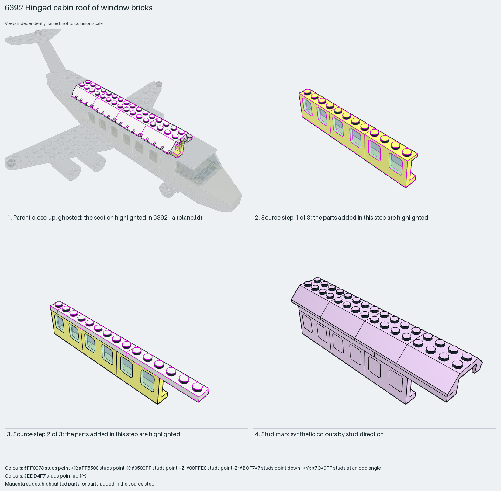

# Openable cabin roof: hinged double-slope bricks on a window wall

The openable roof of the classic City airliner: four 4×4 double-slope bricks with a hinge edge sit on one wall of window bricks; the opposite wall in the parent carries the matching hinge, so the whole roof lifts to load minifigures.

Reusable source construction: source checks pass and the Python and LeoCAD BOMs match.

Aircraft cockpit · classic City studs-up · 16 parts · 3 source steps in 1 section

[Build pages](index.html) · [Inspection board](board/mosaic.png) · [Source](source.mpd) · [Editable plan](scene.plan.json) · [Checks](source-checks.json) · [Board provenance](board/board.json)



## Read the construction

16 parts in 3 steps. Step 1: a 12-stud wall of three 4863 1×4×2 windows with six 4862 glass panes. Step 2: a 1×8 and a 1×6 plate (and a 1×1 plate) capping the wall. Step 3: four 4857 4×4 double-slope hinge bricks forming the roof.

Stud directions: 16 parts, all up. The window wall's underside meets the fuselage floor plates; the hinge fingers on the far edge of the roof bricks meet the hinge on the parent's other wall.

## What the parent supplies

- `6392 - airplane.ldr` places it at `200 -156 -34.997`, matrix `-1 0 0 / 0 1 0 / 0 0 -1`.

`6392 - airplane.ldr` places it at (200, −156, −35) with matrix −1 0 0 / 0 1 0 / 0 0 −1, a 180° turn about Y: the section becomes the right-hand cabin wall and roof. The same design appears in 10159.

The left-hand wall with the hinge counterpart, the floor plates and the end walls.

## Description check

- **Database (accurate):** “Airplane subassembly featuring cockpit windows, transparent glass panes, and hinged slope sections.”
- **What it is:** Accurate: cabin windows with glass panes and hinged double-slope roof sections; they are cabin windows, not cockpit windows.

## Read the board

Panel 1: the ghosted classic airliner with the wall and roof highlighted along the cabin. Panel 2: source step 1, the window wall. Panel 3: source step 2, the capping plates. Panel 4: the stud map, everything up (lilac).

Magenta edges mark highlighted parts or the parts added in a source step. Pale grey, see-through parts are ghosted context. A neon-green rod (`#39FF14`) is a synthetic axis marker, not a part. Stud maps recolour each part by where its studs point: up lilac, +X rose, −X vermilion, +Z electric blue, −Z aqua, down lime, odd angle violet. These synthetic colours are ΔE ≥ 16 from every LDraw colour. LDraw −Y is up; LeoCAD `right` shows the model's right side, from −X.

Replay a board into `output/`:

    ./ldraw-xray board run examples/aircraft-atlas/recipes/6392-hinged-cabin-roof.json --output output/boards/6392-hinged-cabin-roof

## Reuse it

Use it when a cabin must open without removing the roof: one wall carries the roof bricks, the other the hinge, and the cabin width is fixed by the 4×4 double slopes (four studs across). Window bricks give the row of cabin windows for free.

```sh
./ldraw-agent manual export examples/6392-hinged-cabin-roof --outdir output/my-6392-hinged-cabin-roof
./ldraw-agent build output/my-6392-hinged-cabin-roof/scene.plan.json --output output/my-6392-hinged-cabin-roof/6392-hinged-cabin-roof.mpd
```

Export needs a current visual review. Build the copied plan, then inspect its interfaces in the new model.

The placement plan preserves source axes. `source_origin` is a positioning frame, not a physical connector.

## Limits

Hinge mating and the roof's opening clearance were not checked.

The source and renders teach a construction. They do not prove clutch, fit, clearance, travel or stability. Boards are rendered from synthetic inspection copies, and poses are rigid re-placements.

## Source and evidence

Source: `6392-1.mpd` / `6392 - airplane - subpart.ldr`, SHA-256 `1d1efecda53a37d4ca23ec28ec737a49fae395b4a0595c9c8f5525c796b363c8`. Parent: `6392 - airplane.ldr`. Look it up with `./ldraw-agent discover show submodel-065e0f50f27f646e6c7789a9`.

Original authors and licences stay in [source.mpd](source.mpd); [extraction.json](extraction.json) records renamed sections and 0 bounded preparation changes. Python and LeoCAD BOMs match. The visual review is recorded separately, after opening the actual images.
