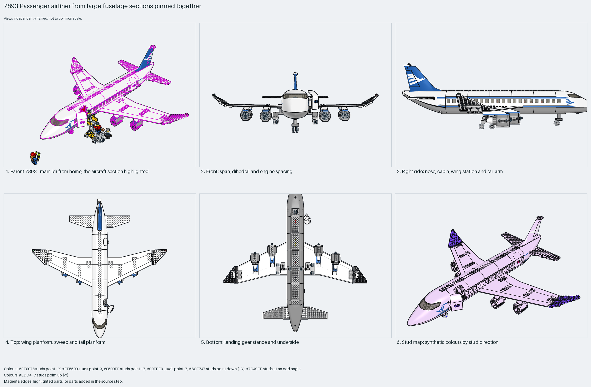

# Passenger airliner from large fuselage sections pinned together

A minifigure airliner from large moulded sections: the 54092 glazed nose, 54091 cabin sections and the 54701 tail cone pinned end to end with 2780 friction pins, one 54093 wing part each side carrying two nacelles, a two-axle bogie under each wing root and the flight deck dropped into the nose. Measured: span 70 studs, length 64, height 23, 358 parts, 12% Technic.

Reusable source construction: source checks pass and the Python and LeoCAD BOMs match.

Whole aircraft · special-part System airliner · 358 parts · 33 source steps in 8 sections

[Completed-model views](index.html) · [Inspection board](board/mosaic.png) · [Source](source.mpd) · [Editable plan](scene.plan.json) · [Checks](source-checks.json) · [Board provenance](board/board.json)



## Read the construction

358 parts in 33 steps across 8 sections. The fuselage is a chain of moulded sections (54092p02c01 nose, 54090 and 54091 cabin sections with 4862/4863 window bricks, 54096, 54701p01c01 tail) joined by 2780 pins through their end holes; the wings are the 54093 wing part each side with 54095 fillets and 30355/30356 winglet wedges; the 54094 fin carries the tailplane plates; the `engine` (×4), `wheels` (×2) and `cabin` children plug in; 44568/44570 locking hinges carry the doors.

272 studs up, 72 sideways, 14 angled. The section joints are pin holes, not studs; the wing's underside anti-studs take the engine pylons; a pin hole under each wing root takes a bogie; the floor studs inside take the seats, service and bar sections from the parent.

## What the parent supplies

- `7893 - main.ldr` places it at `-12 -144 -16`, matrix `1 0 0 / 0 1 0 / 0 0 1`.

`7893 - main.ldr` places it at (−12, −144, −16) with the identity matrix, nose to −Z, with the boarding stairs at the open forward door and minifigures around it.

Nothing structural; the parent adds the stairs, cabin furniture and minifigures.

## Description check

- **Database (accurate):** “The main fuselage of a passenger jet built from large curved plane sections, a wide wing, structural bricks, and numerous plates and pins.”
- **What it is:** Accurate: the main fuselage of a passenger jet from large curved sections, a wide wing, structural bricks, plates and pins.

## Read the board

Panel 1: the parent from home with the plane highlighted and the stairs at the door. Panel 2: front, four engines under level wings and the tall fin. Panel 3: right side, the window row, the open door and the two bogies under the wing. Panel 4: top, the swept 54093 wings with winglets and the small tailplane. Panel 5: bottom, engines, bogies and the nose gear along the belly. Panel 6: the stud map, roof and wings lilac, winglets angled.

Magenta edges mark highlighted parts or the parts added in a source step. Pale grey, see-through parts are ghosted context. A neon-green rod (`#39FF14`) is a synthetic axis marker, not a part. Stud maps recolour each part by where its studs point: up lilac, +X rose, −X vermilion, +Z electric blue, −Z aqua, down lime, odd angle violet. These synthetic colours are ΔE ≥ 16 from every LDraw colour. LDraw −Y is up; LeoCAD `right` shows the model's right side, from −X.

Replay a board into `output/`:

    ./ldraw-xray board run examples/aircraft-atlas/recipes/7893-airliner.json --output output/boards/7893-airliner

## Reuse it

Use it when large moulded airliner parts are acceptable: set the cabin length by the number of 54091 sections, keep span about 1.1× length, hang engines from the wing anti-studs and bogies from wing-root pin holes. For a brick-built airliner take the module layout, not the parts.

```sh
./ldraw-agent manual export examples/7893-airliner --outdir output/my-7893-airliner
./ldraw-agent build output/my-7893-airliner/scene.plan.json --output output/my-7893-airliner/7893-airliner.mpd
```

Export needs a current visual review. Build the copied plan, then inspect its interfaces in the new model.

The placement plan preserves source axes. `source_origin` is a positioning frame, not a physical connector.

## Limits

Section pin clutch, door hinges and gear stance were not checked; a static pose. The source places the two bogies 20 LDU off-centre from each other.

The source and renders teach a construction. They do not prove clutch, fit, clearance, travel or stability. Boards are rendered from synthetic inspection copies, and poses are rigid re-placements.

## Source and evidence

Source: `7893-1.mpd` / `7893 - plane.ldr`, SHA-256 `8d175059a9cf28dcc1097bcff27b170e84b3ffd13b47d46136f44ca1d66876b9`. Parent: `7893 - main.ldr`. Look it up with `./ldraw-agent discover show submodel-752f2e4349612186206f84d8`.

Original authors and licences stay in [source.mpd](source.mpd); [extraction.json](extraction.json) records renamed sections and 40 bounded preparation changes. Python and LeoCAD BOMs match. The visual review is recorded separately, after opening the actual images.
