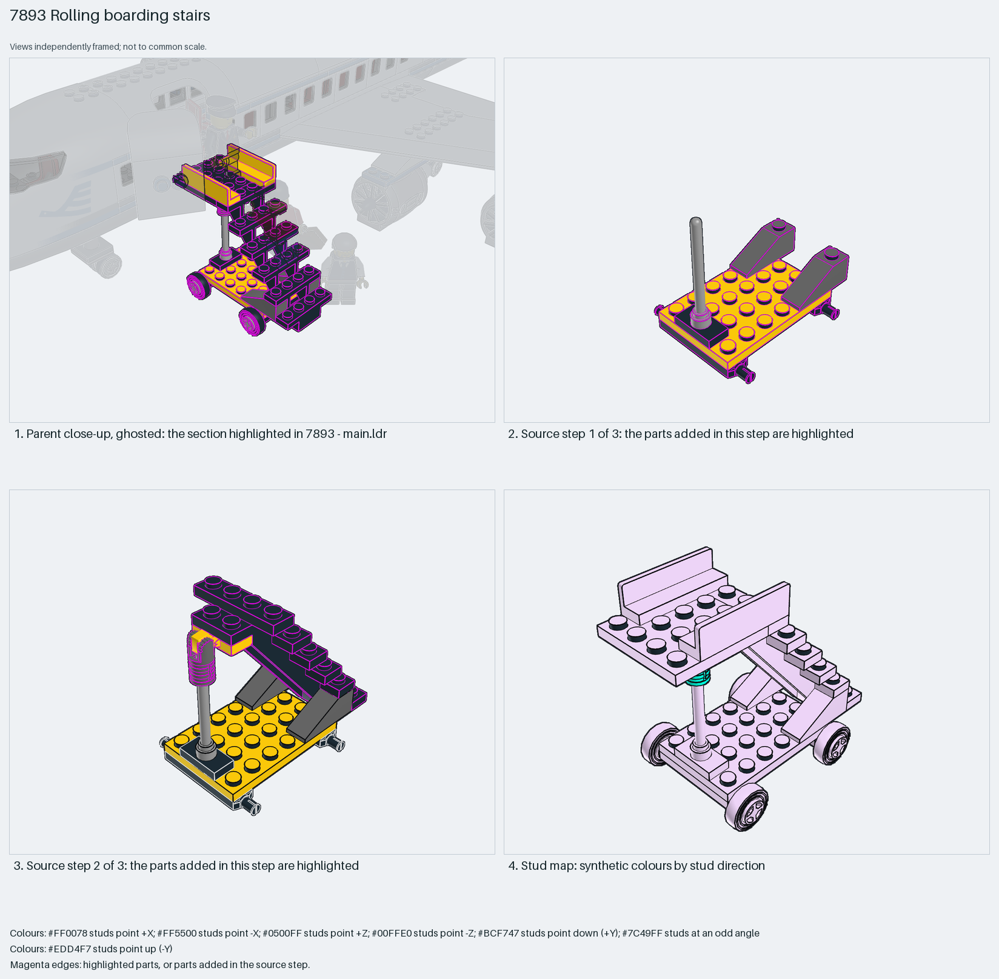

# Rolling boarding stairs

Rolling boarding stairs for a minifigure airliner: a dedicated 7×4×6 open staircase part on a 4×6 plate with wheel-pin plates and four small wheels, a 4×4 landing plate with two 1×4 panels as rails and an antenna as the handrail post.

Reusable source construction: source checks pass and the Python and LeoCAD BOMs match.

Airport ground equipment · special-part System airliner · 21 parts · 3 source steps in 1 section

[Build pages](index.html) · [Inspection board](board/mosaic.png) · [Source](source.mpd) · [Editable plan](scene.plan.json) · [Checks](source-checks.json) · [Board provenance](board/board.json)



## Read the construction

21 parts in 3 steps. Step 1: a 4×6 plate on two 1×4 wheel-pin plates, two 3×1 33° slopes and a 4H antenna. Step 2: the 30134 staircase with a locking hinge arm and plate and a jumper plate. Step 3: four 6.4×8 rims with tyres, a 4×4 landing plate and two 1×4×1 panels as rails.

Studs up; the staircase is one moulded part. Free-standing: nothing connects it to the aircraft, the parent only positions it at the door.

## What the parent supplies

- `7893 - main.ldr` places it at `168 -32 -332`, matrix `0 0 1 / 0 1 0 / -1 0 0`.

`7893 - main.ldr` places it at (168, −32, −332) turned 90° about Y, beside the open forward door of the airliner.

Only the position beside the door; the stairs stand on their own wheels.

## Description check

- **Database (accurate):** “A yellow and black staircase assembly with handrail, four rolling wheels, and landing plates for passenger boarding.”
- **What it is:** Accurate: a yellow and black staircase with handrail, four wheels and landing plates.

## Read the board

Panel 1: the ghosted airliner with the stairs highlighted at the forward door. Panel 2: source step 1, the wheel-pin plates, slopes and antenna on the base. Panel 3: source step 2, the staircase part and hinge. Panel 4: the stud map, everything up.

Magenta edges mark highlighted parts or the parts added in a source step. Pale grey, see-through parts are ghosted context. A neon-green rod (`#39FF14`) is a synthetic axis marker, not a part. Stud maps recolour each part by where its studs point: up lilac, +X rose, −X vermilion, +Z electric blue, −Z aqua, down lime, odd angle violet. These synthetic colours are ΔE ≥ 16 from every LDraw colour. LDraw −Y is up; LeoCAD `right` shows the model's right side, from −X.

Replay a board into `output/`:

    ./ldraw-xray board run examples/aircraft-atlas/recipes/7893-boarding-stairs.json --output output/boards/7893-boarding-stairs

## Reuse it

Use it as ground equipment beside any minifigure airliner door; set the landing height to the door sill before choosing the base plates.

```sh
./ldraw-agent manual export examples/7893-boarding-stairs --outdir output/my-7893-boarding-stairs
./ldraw-agent build output/my-7893-boarding-stairs/scene.plan.json --output output/my-7893-boarding-stairs/7893-boarding-stairs.mpd
```

Export needs a current visual review. Build the copied plan, then inspect its interfaces in the new model.

The placement plan preserves source axes. `source_origin` is a positioning frame, not a physical connector.

## Limits

Landing height against the door sill and rolling clearance were not checked.

The source and renders teach a construction. They do not prove clutch, fit, clearance, travel or stability. Boards are rendered from synthetic inspection copies, and poses are rigid re-placements.

## Source and evidence

Source: `7893-1.mpd` / `7893 - stairs.ldr`, SHA-256 `8d175059a9cf28dcc1097bcff27b170e84b3ffd13b47d46136f44ca1d66876b9`. Parent: `7893 - main.ldr`. Look it up with `./ldraw-agent discover show submodel-54aba4bdbccd0aa647aeed26`.

Original authors and licences stay in [source.mpd](source.mpd); [extraction.json](extraction.json) records renamed sections and 0 bounded preparation changes. Python and LeoCAD BOMs match. The visual review is recorded separately, after opening the actual images.
