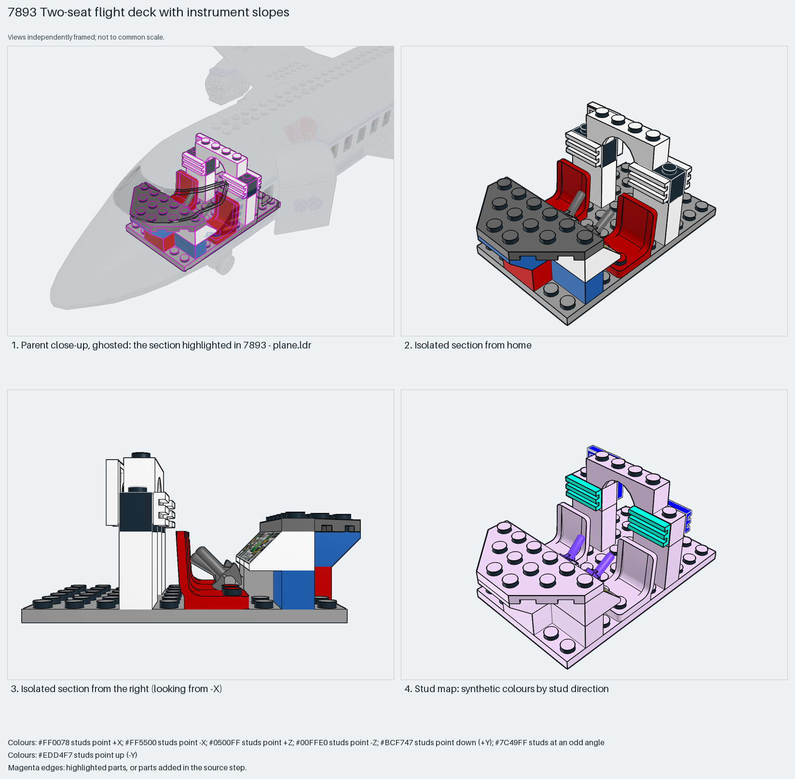

# Two-seat flight deck with instrument slopes

A two-seat flight deck that drops into a moulded nose: two 2×2 seats, two printed instrument slopes, bar control columns, grille tiles on side-stud bricks as side consoles and a 1×4 arch over the centre.

Reusable source construction: source checks pass and the Python and LeoCAD BOMs match.

Aircraft cockpit · special-part System airliner · 22 parts · 2 source steps in 1 section

[Build pages](index.html) · [Inspection board](board/mosaic.png) · [Source](source.mpd) · [Editable plan](scene.plan.json) · [Checks](source-checks.json) · [Board provenance](board/board.json)



## Read the construction

22 parts in 2 steps. Step 1: a 6×10 plate with a 3×6 cut-corner plate ahead of it, 1×2 bricks as seat bases and two 48729a bar clips as control columns. Step 2: two 4079 seats, two 3039pc9 instrument slopes, two 52107 side-stud bricks with 2412b grille tiles as the side consoles, a 3659 1×4 arch on 1×2×2 bricks between the seats, a handle brick and a printed tile.

Stud directions: 22 parts, 16 up, the grille tiles facing −Z and the control columns angled. The base plates' underside is the interface; everything above is contained by the parent's nose section.

## What the parent supplies

- `7893 - plane.ldr` places it at `0 8 -460`, matrix `1 0 0 / 0 1 0 / 0 0 1`.

`7893 - plane.ldr` places it at (0, 8, −460) with the identity matrix, inside the 54092 moulded nose under its glazing.

The moulded nose section with its glazing, floor sockets and the opening behind the deck.

## Description check

- **Database (accurate):** “The cockpit interior with two pilot seats, flight control slopes, a radar display, instrument monitor, and console detailing.”
- **What it is:** Accurate: two pilot seats, instrument slopes, a radar display tile and console detailing.

## Read the board

Panel 1: a ghosted close-up of the nose with the flight deck highlighted. Panel 2: the isolated deck from home. Panel 3: from the right, seats, columns, instrument slope and consoles in profile. Panel 4: the stud map, plates up (lilac), grille tiles aqua (−Z), columns violet (angled).

Magenta edges mark highlighted parts or the parts added in a source step. Pale grey, see-through parts are ghosted context. A neon-green rod (`#39FF14`) is a synthetic axis marker, not a part. Stud maps recolour each part by where its studs point: up lilac, +X rose, −X vermilion, +Z electric blue, −Z aqua, down lime, odd angle violet. These synthetic colours are ΔE ≥ 16 from every LDraw colour. LDraw −Y is up; LeoCAD `right` shows the model's right side, from −X.

Replay a board into `output/`:

    ./ldraw-xray board run examples/aircraft-atlas/recipes/7893-cockpit-interior.json --output output/boards/7893-cockpit-interior

## Reuse it

Use it for any minifigure flight deck: seats, instruments and consoles on one plate, checked against the glazing height before closing the nose. Minifigure fit was not drawn; add pilots and check knees and headroom.

```sh
./ldraw-agent manual export examples/7893-cockpit-interior --outdir output/my-7893-cockpit-interior
./ldraw-agent build output/my-7893-cockpit-interior/scene.plan.json --output output/my-7893-cockpit-interior/7893-cockpit-interior.mpd
```

Export needs a current visual review. Build the copied plan, then inspect its interfaces in the new model.

The placement plan preserves source axes. `source_origin` is a positioning frame, not a physical connector.

## Limits

Minifigure seating, headroom under the glazing and the column's clip were not checked.

The source and renders teach a construction. They do not prove clutch, fit, clearance, travel or stability. Boards are rendered from synthetic inspection copies, and poses are rigid re-placements.

## Source and evidence

Source: `7893-1.mpd` / `7893 - cabin.ldr`, SHA-256 `8d175059a9cf28dcc1097bcff27b170e84b3ffd13b47d46136f44ca1d66876b9`. Parent: `7893 - plane.ldr`. Look it up with `./ldraw-agent discover show submodel-bd5c74c71375de6aef6eb068`.

Original authors and licences stay in [source.mpd](source.mpd); [extraction.json](extraction.json) records renamed sections and 1 bounded preparation changes. Python and LeoCAD BOMs match. The visual review is recorded separately, after opening the actual images.
