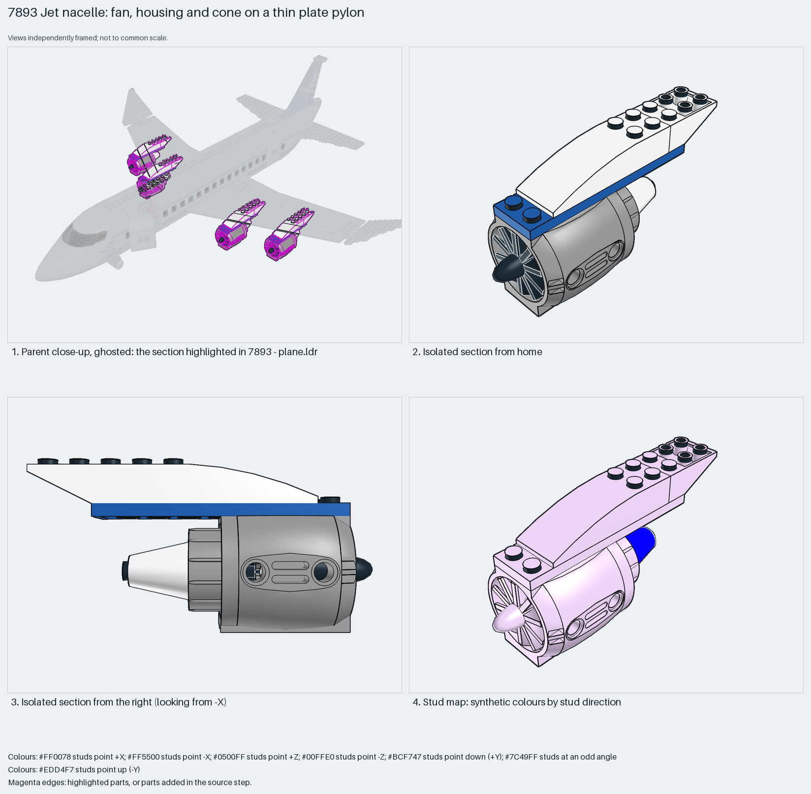

# Jet nacelle: fan, housing and cone on a thin plate pylon

A convincing jet nacelle from three dedicated parts (43121 engine shell, 46667 fan on its own pin, 3942c cone as the exhaust) hung under the wing on a thin pylon: a 2×8 plate with a 6×2 curved slope and an inverted 33° slope as its fairing.

Reusable source construction: source checks pass and the Python and LeoCAD BOMs match.

Aircraft engine · special-part System airliner · 12 parts · 2 source steps in 1 section

[Build pages](index.html) · [Inspection board](board/mosaic.png) · [Source](source.mpd) · [Editable plan](scene.plan.json) · [Checks](source-checks.json) · [Board provenance](board/board.json)



## Read the construction

12 parts in 2 steps. Step 1: the engine core, a 43121 shell with the 46667 fan pushed into its front, four bushes on the fan pin, and at the back a 2×2 round plate, a four-prong spider (LDraw part 2566, catalogued as an obsolete palm-tree top) and the 3942c cone pointing aft as the exhaust. Step 2: the pylon, a 2×8 plate laid along the engine with a 6×2 curved slope and an inverted 3×2 slope on top closing the fairing.

Stud directions: 12 parts, 10 up, 2 facing +Z (the round plate and cone on the exhaust axis). The pylon plate's studs are the only mounting interface; it meets the anti-studs under the 54093 wing. The fan turns on its pin; nothing else moves.

## What the parent supplies

- `7893 - plane.ldr` places it at `-220 32 -80`, matrix `1 0 0 / 0 1 0 / 0 0 1`.
- `7893 - plane.ldr` places it at `-380 32 0`, matrix `1 0 0 / 0 1 0 / 0 0 1`.
- `7893 - plane.ldr` places it at `220 32 -80`, matrix `1 0 0 / 0 1 0 / 0 0 1`.
- `7893 - plane.ldr` places it at `380 32 0`, matrix `1 0 0 / 0 1 0 / 0 0 1`.

`7893 - plane.ldr` places it four times with the identity matrix at X ±220 (Z −80) and X ±380 (Z 0), all at Y 32: two engines per wing, the outboard pair one stud further aft. The wing underside supplies the anti-studs; the engines hang below the wing plane.

The 54093 wing with its underside anti-studs, and the sweep that staggers the outboard engine aft.

## Description check

- **Database (partly accurate):** “A jet engine pod featuring a fan, engine housing, cone intake, and curved slope fairing.”
- **What it is:** A jet nacelle with the fan at the front and the cone as the exhaust at the back, not an intake; the four-prong black part at the rear is LDraw 2566, an obsolete palm-tree-top identity used as an exhaust spider.

## Read the board

Panel 1: the ghosted airliner with all four nacelles highlighted under the wings. Panel 2: the isolated nacelle from home, fan forward. Panel 3: from the right, the pylon plate and fairing on top, cone aft. Panel 4: the stud map, pylon and plates up (lilac), round plate and cone facing +Z (blue).

Magenta edges mark highlighted parts or the parts added in a source step. Pale grey, see-through parts are ghosted context. A neon-green rod (`#39FF14`) is a synthetic axis marker, not a part. Stud maps recolour each part by where its studs point: up lilac, +X rose, −X vermilion, +Z electric blue, −Z aqua, down lime, odd angle violet. These synthetic colours are ΔE ≥ 16 from every LDraw colour. LDraw −Y is up; LeoCAD `right` shows the model's right side, from −X.

Replay a board into `output/`:

    ./ldraw-xray board run examples/aircraft-atlas/recipes/7893-jet-nacelle.json --output output/boards/7893-jet-nacelle

## Reuse it

Use it for any twin- or four-engine airliner: keep the fan, shell and cone on one axis, mount through the pylon plate only, and space repeated engines along the wing sweep. Swap the pylon fairing slopes to change the pylon profile.

```sh
./ldraw-agent manual export examples/7893-jet-nacelle --outdir output/my-7893-jet-nacelle
./ldraw-agent build output/my-7893-jet-nacelle/scene.plan.json --output output/my-7893-jet-nacelle/7893-jet-nacelle.mpd
```

Export needs a current visual review. Build the copied plan, then inspect its interfaces in the new model.

The placement plan preserves source axes. `source_origin` is a positioning frame, not a physical connector.

## Limits

Fan rotation, pylon strength and the exhaust ring's attachment were not checked; part 2566 is an obsolete LDraw identity.

The source and renders teach a construction. They do not prove clutch, fit, clearance, travel or stability. Boards are rendered from synthetic inspection copies, and poses are rigid re-placements.

## Source and evidence

Source: `7893-1.mpd` / `7893 - engine.ldr`, SHA-256 `8d175059a9cf28dcc1097bcff27b170e84b3ffd13b47d46136f44ca1d66876b9`. Parent: `7893 - plane.ldr`. Look it up with `./ldraw-agent discover show submodel-9dd2ac5bcbd1c1dabf67779c`.

Original authors and licences stay in [source.mpd](source.mpd); [extraction.json](extraction.json) records renamed sections and 0 bounded preparation changes. Python and LeoCAD BOMs match. The visual review is recorded separately, after opening the actual images.
