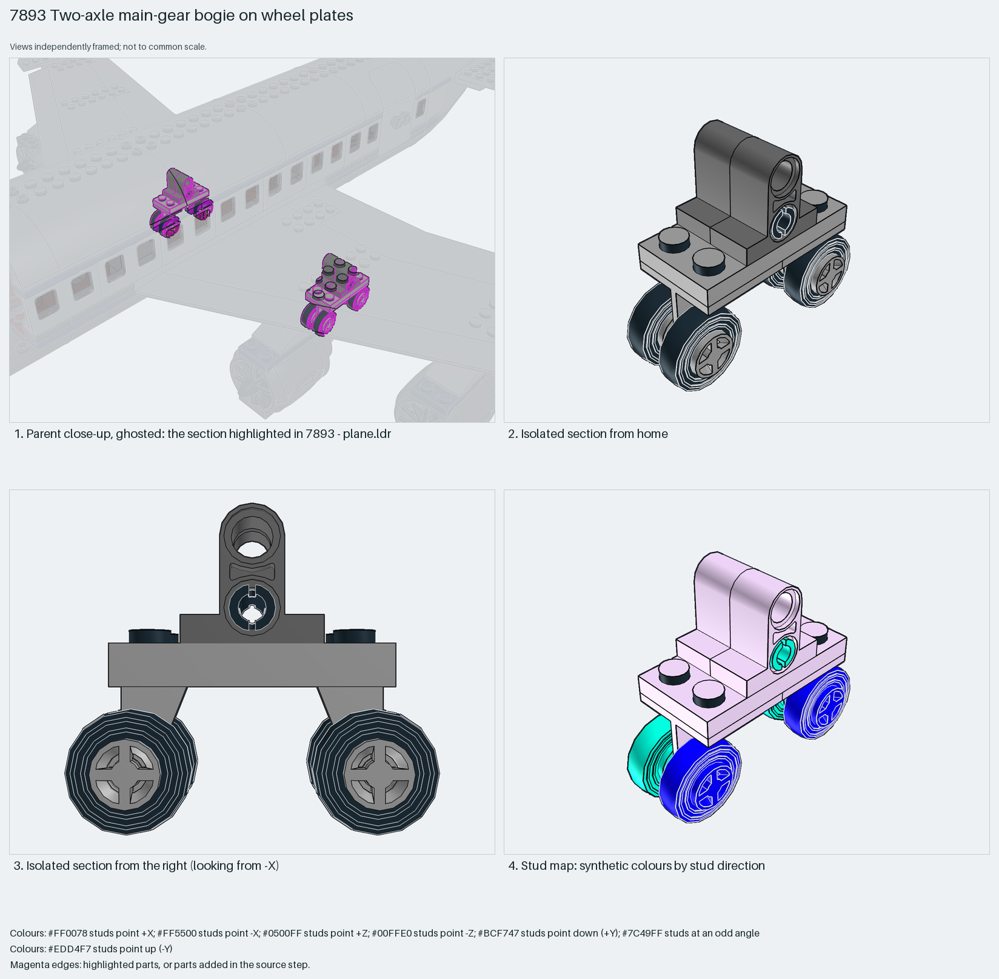

# Four-wheel bogie on wheel-pin plates, mounted by one pin through standing tiles

A compact main-gear bogie: two 2×2 wheel-pin plates under a 2×4 plate carry four small wheels; two 1×2 tiles with holes stand on the plate so that one friction pin through them is the whole mounting interface to the fuselage.

Reusable source construction: source checks pass and the Python and LeoCAD BOMs match.

Aircraft landing gear · special-part System airliner · 14 parts · 1 source steps in 1 section

[Build pages](index.html) · [Inspection board](board/mosaic.png) · [Source](source.mpd) · [Editable plan](scene.plan.json) · [Checks](source-checks.json) · [Board provenance](board/board.json)



## Read the construction

14 parts in 1 step: a 2×4 plate on two 4870 2×2 plates with wheel pins, four 4624 rims with 3139 tyres pressed onto the pins, two 32530 1×2 tiles with two holes standing side by side on the plate, and a 2780 friction pin through their lower holes.

Stud directions: 14 parts, 7 up, the standing tiles and wheels facing ±Z. The pin is the only connection to the parent; the wheels turn on their pins.

## What the parent supplies

- `7893 - plane.ldr` places it at `-150 127 64`, matrix `1 0 0 / 0 1 0 / 0 0 1`.
- `7893 - plane.ldr` places it at `170 127 64`, matrix `1 0 0 / 0 1 0 / 0 0 1`.

`7893 - plane.ldr` places it twice with the identity matrix at Y 127, Z 64, X −150 and X +170: the two bogies are not symmetric about X=0 because the fuselage sections are offset one stud in the source. They hang under the wing root behind the engines.

A pin hole under each wing root at the right height; the bogie cannot stand on its own without it.

## Description check

- **Database (accurate):** “A landing gear assembly of four wheels with tyres, wheel pins, and mounting plates.”
- **What it is:** Accurate: four wheels on two wheel-pin plates with a pin mount. The source places the two bogies 20 LDU off-centre from each other.

## Read the board

Panel 1: the ghosted airliner with both bogies highlighted under the wing roots. Panel 2: the isolated bogie from home, standing tiles on top. Panel 3: from the right, the four wheels, the plate and the two standing tiles with their holes. Panel 4: the stud map, plates up (lilac), tiles and wheels facing ±Z (blue and aqua).

Magenta edges mark highlighted parts or the parts added in a source step. Pale grey, see-through parts are ghosted context. A neon-green rod (`#39FF14`) is a synthetic axis marker, not a part. Stud maps recolour each part by where its studs point: up lilac, +X rose, −X vermilion, +Z electric blue, −Z aqua, down lime, odd angle violet. These synthetic colours are ΔE ≥ 16 from every LDraw colour. LDraw −Y is up; LeoCAD `right` shows the model's right side, from −X.

Replay a board into `output/`:

    ./ldraw-xray board run examples/aircraft-atlas/recipes/7893-wheel-bogie.json --output output/boards/7893-wheel-bogie

## Reuse it

Use it under any minifigure-scale airliner or cargo plane: one pin hole per bogie in the fuselage or wing is enough, and the standing tiles set the leg height. Mirror the placement, not the part.

```sh
./ldraw-agent manual export examples/7893-wheel-bogie --outdir output/my-7893-wheel-bogie
./ldraw-agent build output/my-7893-wheel-bogie/scene.plan.json --output output/my-7893-wheel-bogie/7893-wheel-bogie.mpd
```

Export needs a current visual review. Build the copied plan, then inspect its interfaces in the new model.

The placement plan preserves source axes. `source_origin` is a positioning frame, not a physical connector.

## Limits

Pin clutch, the asymmetric placement and rolling clearance against the fuselage were not checked.

The source and renders teach a construction. They do not prove clutch, fit, clearance, travel or stability. Boards are rendered from synthetic inspection copies, and poses are rigid re-placements.

## Source and evidence

Source: `7893-1.mpd` / `7893 - wheels.ldr`, SHA-256 `8d175059a9cf28dcc1097bcff27b170e84b3ffd13b47d46136f44ca1d66876b9`. Parent: `7893 - plane.ldr`. Look it up with `./ldraw-agent discover show submodel-8c004489e1f4ececee31c06d`.

Original authors and licences stay in [source.mpd](source.mpd); [extraction.json](extraction.json) records renamed sections and 0 bounded preparation changes. Python and LeoCAD BOMs match. The visual review is recorded separately, after opening the actual images.
