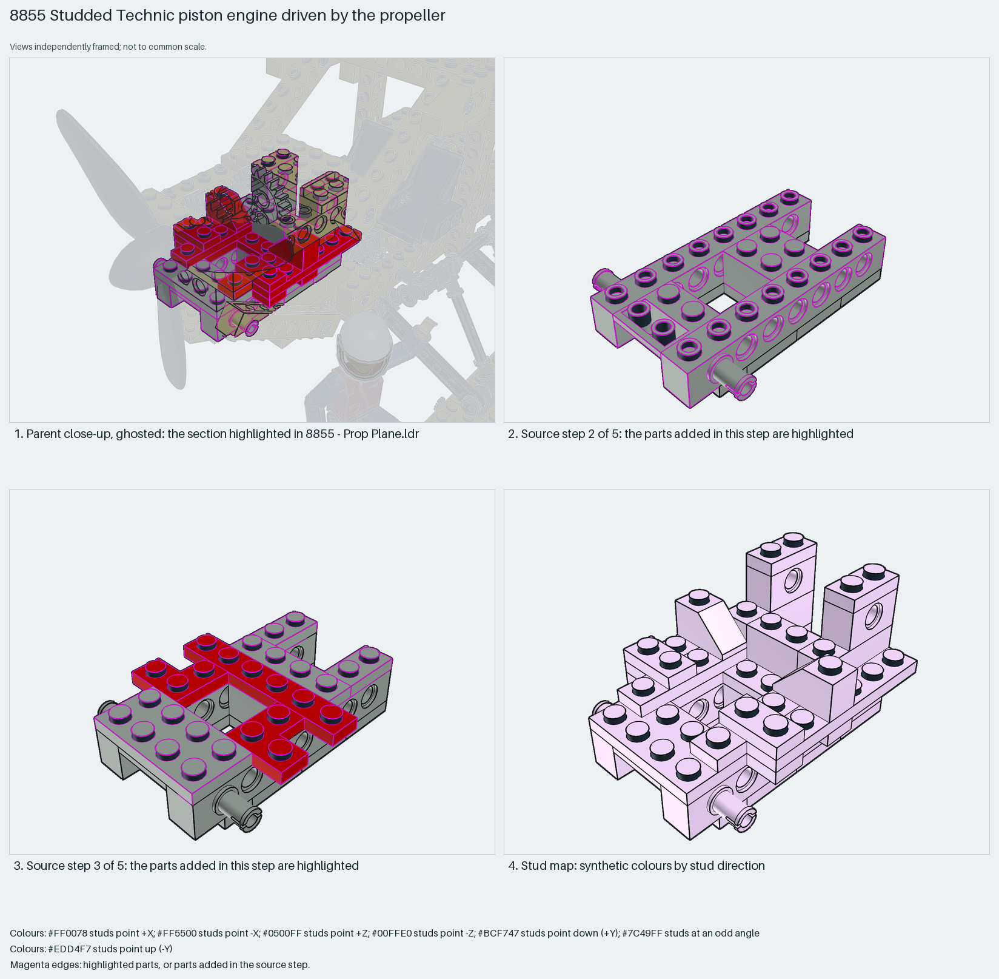

# Boxy studded Technic engine block with hole-brick crank bearings

A boxy studded Technic engine block: an H of plates, two 1×8 Technic bricks whose holes carry the propeller axle, red plates and bricks as the crankcase, and 1×3 bricks standing as cylinder banks with 45° slopes as the cowl.

Reusable source construction: source checks pass and the Python and LeoCAD BOMs match.

Aircraft engine · studded Technic (1988) · 34 parts · 5 source steps in 1 section

[Build pages](index.html) · [Inspection board](board/mosaic.png) · [Source](source.mpd) · [Editable plan](scene.plan.json) · [Checks](source-checks.json) · [Board provenance](board/board.json)



## Read the construction

34 parts in 5 steps. Step 1: two 2×4 plates with two 2×2 corner plates in an H. Step 2: two 1×8 Technic bricks along the sides with two 1×2 hole bricks and two pins. Step 3: red 1×6, 1×4 and corner plates. Step 4: red 2×4 and 1×3 bricks as the crankcase. Step 5: grey 1×3 bricks standing as cylinder banks, two red 45° slopes and a 2×2 brick.

All studs up. The Technic-brick holes carry the parent's propeller axle and gears; the plate base stacks on the nose frame.

## What the parent supplies

- `8855 - Prop Plane.ldr` places it at `0 -229 -250`, matrix `1 0 0 / 0 1 0 / 0 0 1`.

`8855 - Prop Plane.ldr` places it at (0, −229, −250) with the identity matrix, in the nose behind the propeller; the `Piston` and `Piston gear` children that move belong to the parent.

The propeller axle, the piston and piston-gear sections and the cowling around the block.

## Description check

- **Database (partly accurate):** “A light grey and red Technic engine block built from bricks, plates, and slope pieces forming the cylindrical engine housing.”
- **What it is:** Partly accurate: a light grey and red engine block of bricks, plates and slopes, but boxy rather than cylindrical; the pistons and gears are separate sections.

## Read the board

Panel 1: the ghosted nose with the block highlighted behind the propeller. Panel 2: source step 2, the two 1×8 Technic bricks and pins on the plate H. Panel 3: source step 3, the red plate layer. Panel 4: the stud map, everything up.

Magenta edges mark highlighted parts or the parts added in a source step. Pale grey, see-through parts are ghosted context. A neon-green rod (`#39FF14`) is a synthetic axis marker, not a part. Stud maps recolour each part by where its studs point: up lilac, +X rose, −X vermilion, +Z electric blue, −Z aqua, down lime, odd angle violet. These synthetic colours are ΔE ≥ 16 from every LDraw colour. LDraw −Y is up; LeoCAD `right` shows the model's right side, from −X.

Replay a board into `output/`:

    ./ldraw-xray board run examples/aircraft-atlas/recipes/8855-piston-engine.json --output output/boards/8855-piston-engine

## Reuse it

Use it as a quick studded engine block for a 1980s-style Technic plane: hole bricks on both sides give the crank bearing, and the block stays one stud narrower than the cowling.

```sh
./ldraw-agent manual export examples/8855-piston-engine --outdir output/my-8855-piston-engine
./ldraw-agent build output/my-8855-piston-engine/scene.plan.json --output output/my-8855-piston-engine/8855-piston-engine.mpd
```

Export needs a current visual review. Build the copied plan, then inspect its interfaces in the new model.

The placement plan preserves source axes. `source_origin` is a positioning frame, not a physical connector.

## Limits

Bearing alignment with the parent's axle was not checked.

The source and renders teach a construction. They do not prove clutch, fit, clearance, travel or stability. Boards are rendered from synthetic inspection copies, and poses are rigid re-placements.

## Source and evidence

Source: `8855-1.mpd` / `8855 - Engine block.ldr`, SHA-256 `98bb90e07be0a121c13018abd5fc51a2c0a7b1a4a94871b7c4bb92f3a3f04f8f`. Parent: `8855 - Prop Plane.ldr`. Look it up with `./ldraw-agent discover show submodel-c2b1194bbecf9b8c5a6ea4ca`.

Original authors and licences stay in [source.mpd](source.mpd); [extraction.json](extraction.json) records renamed sections and 0 bounded preparation changes. Python and LeoCAD BOMs match. The visual review is recorded separately, after opening the actual images.
