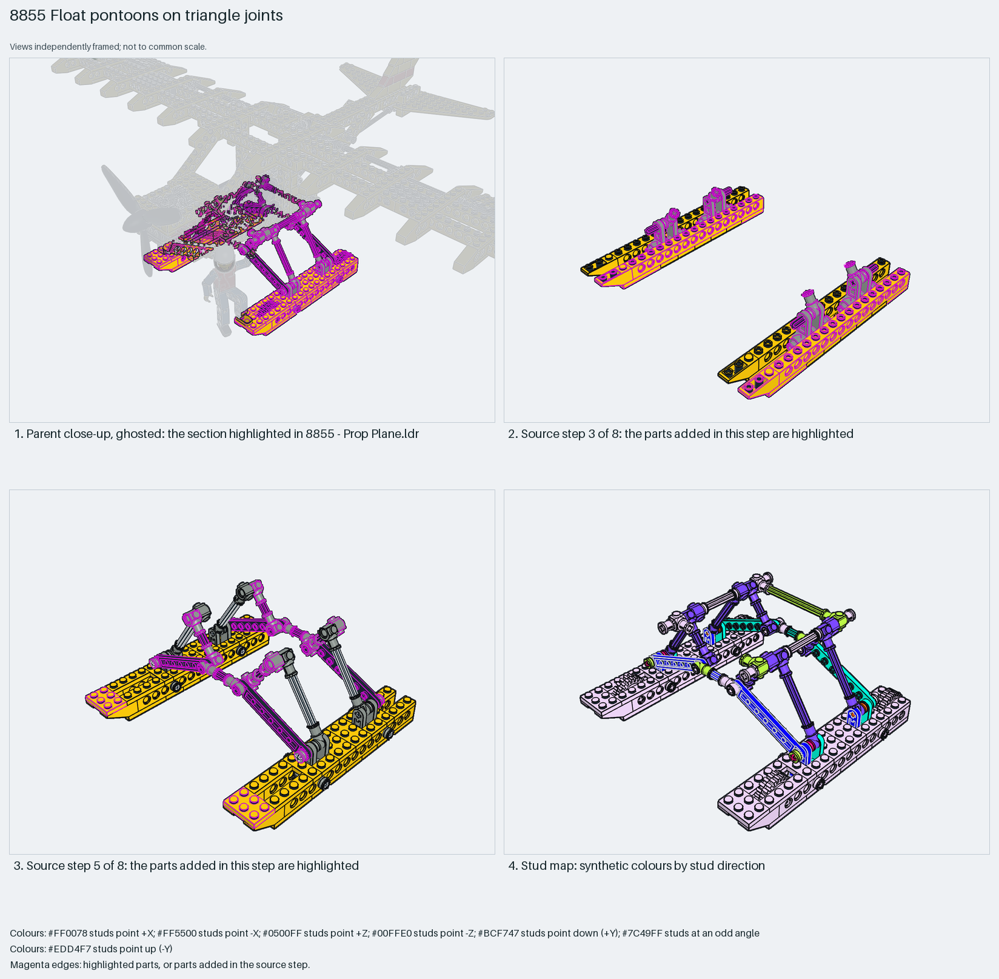

# Twin floats on an axle-and-steering-arm truss, with wheels inside the floats

Twin floats for a studded Technic floatplane: each float is a pair of 1×16 Technic bricks with stepped 2×3 plates and an inverted-slope bow, carrying a wheel inside so the plane also rolls; the floats hang on a truss of 3-long axles joined by steering arms and toggle joints that set the strut angles.

Inspiration study: the source keeps errors (`assembly.nonrigid` ×2). Study the technique and rebuild it; `manual export` is blocked.

Aircraft floats · studded Technic (1988) · 153 parts · 17 source steps in 4 sections

[Build pages](index.html) · [Inspection board](board/mosaic.png) · [Source](source.mpd) · [Editable plan](scene.plan.json) · [Checks](source-checks.json) · [Board provenance](board/board.json)

## Read the construction

153 parts in 8 root steps and three children. Steps 1–2: two floats, each two 1×16 Technic bricks with 1×8 Technic plates, stepped 2×3 and 1×3 plates and 4287a inverted slopes at the bow. Step 3: 4261 steering arms and 3651 pin connectors standing on the floats. Steps 4–8: the `Pontoon joint 1`, `2` and `3` children (a steering arm, toggle joint and axle each) and 3-long axles with half bushes forming the A-frame truss, with the 3482 rims and 3483 tyres inside the floats on 6-long axles.

Studs up on the floats; the truss angled. The truss apex connectors meet the fuselage underside; the wheels turn on their axles inside the floats.

## What the parent supplies

- `8855 - Prop Plane.ldr` places it at `0 -0.35 0`, matrix `1 0 0 / 0 1 0 / 0 0 1`.

`8855 - Prop Plane.ldr` places it at (0, −0.35, 0) with the identity matrix: the floats are the lowest element, under the fuselage and ahead of the tail.

The fuselage underside the truss apexes pin into, and the wing above.

## Description check

- **Database (accurate):** “A pair of pontoon floats with sloped plating, axles, and rubber tyres mounted on yellow wheel rims.”
- **What it is:** Accurate: a pair of pontoon floats with sloped plating, axles and rubber tyres on yellow rims.

## Read the board

Panel 1: the ghosted floatplane with the floats and truss highlighted below the fuselage. Panel 2: source step 3, the steering arms and pin connectors standing on the two floats. Panel 3: source step 5, the joint children and axles forming the truss. Panel 4: the stud map, floats up, truss angled.

Magenta edges mark highlighted parts or the parts added in a source step. Pale grey, see-through parts are ghosted context. A neon-green rod (`#39FF14`) is a synthetic axis marker, not a part. Stud maps recolour each part by where its studs point: up lilac, +X rose, −X vermilion, +Z electric blue, −Z aqua, down lime, odd angle violet. These synthetic colours are ΔE ≥ 16 from every LDraw colour. LDraw −Y is up; LeoCAD `right` shows the model's right side, from −X.

Replay a board into `output/`:

    ./ldraw-xray board run examples/aircraft-atlas/recipes/8855-pontoons.json --output output/boards/8855-pontoons

## Reuse it

Rebuild the technique: Technic-brick floats give a long slim hull with pin holes for the truss; steering arms and toggle joints let axle struts meet at non-grid angles. One joint child keeps a skewed part from the original strained model, so this is inspiration only.

Rebuild the technique with the new model's own parts and interfaces; the source errors above stay in this copy.

The placement plan preserves source axes. `source_origin` is a positioning frame, not a physical connector.

## Limits

Inspiration only: `Pontoon joint 1` keeps two skewed placements from the author's strained physical model (assembly.nonrigid), so source checks fail and export is blocked. Truss geometry and wheel rotation were not checked.

The source and renders teach a construction. They do not prove clutch, fit, clearance, travel or stability. Boards are rendered from synthetic inspection copies, and poses are rigid re-placements.

## Source and evidence

Source: `8855-1.mpd` / `8855 - Pontoons.ldr`, SHA-256 `98bb90e07be0a121c13018abd5fc51a2c0a7b1a4a94871b7c4bb92f3a3f04f8f`. Parent: `8855 - Prop Plane.ldr`. Look it up with `./ldraw-agent discover show submodel-bd84963b547c33dc2b5dd87c`.

Original authors and licences stay in [source.mpd](source.mpd); [extraction.json](extraction.json) records renamed sections and 0 bounded preparation changes. Python and LeoCAD BOMs match. The visual review is recorded separately, after opening the actual images.
