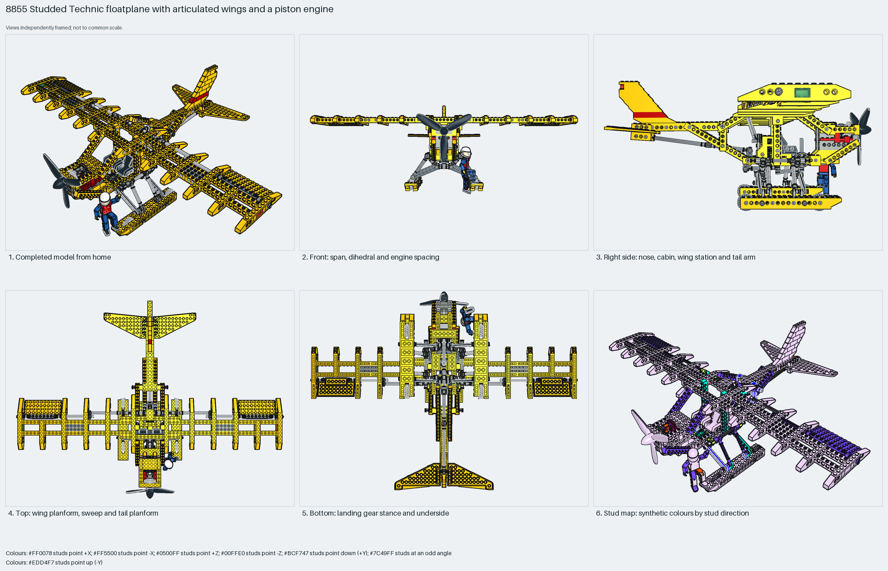

# Studded Technic floatplane with articulated wings and a piston engine

The 1988 studded Technic floatplane: a Technic-brick fuselage with an open cockpit and pilot, a high wing of Technic-brick spars and wing-brick ribs on universal joints, a piston engine behind a three-blade propeller, a tail boom with a 7×12 wing-plate tailplane and jumper-plate fin, and twin floats on an axle truss with wheels inside. Measured: span 72 studs, length 50, height 26, 598 parts, 66% Technic.

Inspiration study: the source keeps errors (`assembly.nonrigid` ×8). Study the technique and rebuild it; `manual export` is blocked.

Whole aircraft · studded Technic (1988) · 598 parts · 81 source steps in 20 sections

[Completed-model views](index.html) · [Inspection board](board/mosaic.png) · [Source](source.mpd) · [Editable plan](scene.plan.json) · [Checks](source-checks.json) · [Board provenance](board/board.json)

## Read the construction

598 parts in 81 steps across 20 sections: the `Prop Plane` root (fuselage of 1×16 and 1×12 Technic bricks and plates), `Engine block`, `Piston`, `Piston gear`, `Bottom gear` ×2, `Bottom link`, `Bottom back connector`, `Pontoons` with three joint children, `Triangle joint`, `Tail` with `Tail body`, `Wings` with two joints and two flaps, and the `Pilot`.

327 studs up, 62 sideways, 198 angled. The wing's universal joints and towballs sit on the fuselage cabane; the floats' truss apexes pin under the fuselage; the propeller axle drives the piston through gears.

## What the parent supplies

- This section is the root of its source model; nothing places it.

Root section; nothing places it. Built with the propeller at +Z, so LeoCAD's front view is the tail-on view.

None; root section.

## Description check

- **Database (accurate):** “A large Technic propeller plane with a geared engine, adjustable wings, pontoons, a tail assembly, and an articulated pilot figure.”
- **What it is:** Accurate: a large Technic propeller plane with a geared engine, adjustable wings, pontoons, a tail assembly and an articulated pilot figure.

## Read the board

Panel 1: home, the yellow studded airframe, floats and propeller. Panel 2: LeoCAD's front view, which is tail-on here: the long rib wing above the fuselage and the float truss. Panel 3: right side, cockpit, engine, the wing mid-fuselage and the tail boom. Panel 4: top, the rib wing, flaps and tailplane. Panel 5: bottom, floats, truss and boom. Panel 6: the stud map, mostly up with the truss and propeller angled.

Magenta edges mark highlighted parts or the parts added in a source step. Pale grey, see-through parts are ghosted context. A neon-green rod (`#39FF14`) is a synthetic axis marker, not a part. Stud maps recolour each part by where its studs point: up lilac, +X rose, −X vermilion, +Z electric blue, −Z aqua, down lime, odd angle violet. These synthetic colours are ΔE ≥ 16 from every LDraw colour. LDraw −Y is up; LeoCAD `right` shows the model's right side, from −X.

Replay a board into `output/`:

    ./ldraw-xray board run examples/aircraft-atlas/recipes/8855-prop-plane.json --output output/boards/8855-prop-plane

## Reuse it

Use it for the proportions and module layout of a studded Technic floatplane: span 1.4× length, high wing, floats two-thirds of the length. Inspiration only: the author scaled or skewed eight placements to match the strained real model, so rebuild rather than export.

Rebuild the technique with the new model's own parts and interfaces; the source errors above stay in this copy.

The placement plan preserves source axes. `source_origin` is a positioning frame, not a physical connector.

## Limits

Inspiration only: eight skewed placements (`assembly.nonrigid`) in the root and a pontoon joint; the BOM comparison matches. Nothing mechanical was checked.

The source and renders teach a construction. They do not prove clutch, fit, clearance, travel or stability. Boards are rendered from synthetic inspection copies, and poses are rigid re-placements.

## Source and evidence

Source: `8855-1.mpd` / `8855 - Prop Plane.ldr`, SHA-256 `98bb90e07be0a121c13018abd5fc51a2c0a7b1a4a94871b7c4bb92f3a3f04f8f`. Parent: `none (root section)`. Look it up with `./ldraw-agent discover show submodel-16e2578539f8a9c87fe23286`.

Original authors and licences stay in [source.mpd](source.mpd); [extraction.json](extraction.json) records renamed sections and 36 bounded preparation changes. Python and LeoCAD BOMs match. The visual review is recorded separately, after opening the actual images.
