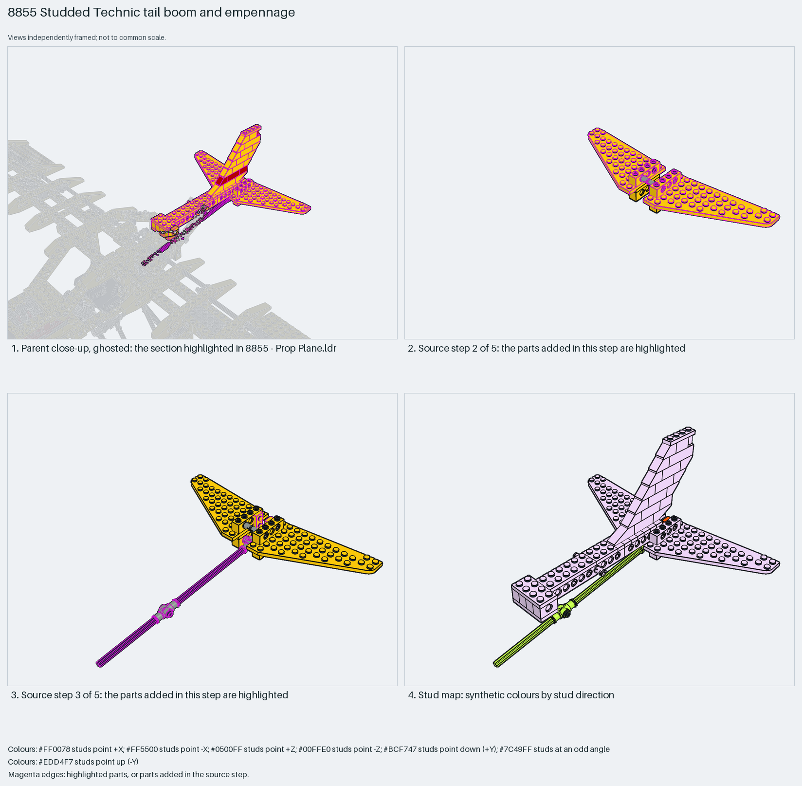

# Studded Technic empennage: 7×12 wing plates, jumper-plate fin and a control axle along the boom

A studded Technic empennage: 7×12 wing plates as the tailplane halves on a short Technic-brick block, a one-stud fin of 45° slopes and jumper plates with a red stripe, and a `Tail body` boom of 1×12 and 1×6 Technic bricks; a long axle with toggle joints runs forward along the boom as the elevator control.

Reusable source construction: source checks pass and the Python and LeoCAD BOMs match.

Aircraft tail · studded Technic (1988) · 71 parts · 8 source steps in 2 sections

[Build pages](index.html) · [Inspection board](board/mosaic.png) · [Source](source.mpd) · [Editable plan](scene.plan.json) · [Checks](source-checks.json) · [Board provenance](board/board.json)



## Read the construction

71 parts in 5 root steps and one child. Step 1: two jumper plates. Step 2: the 3585/3586 7×12 wing plates on 1×4 hole bricks as the tailplane. Step 3: a long axle through the block with two toggle joints and half bushes, running forward. Step 4: the `Tail body` child, a boom of two 1×12, two 1×6 and four 1×4 Technic bricks with plates and pins. Step 5: the fin, 45° and inverted 45° slopes stepping up a 1×3 brick stack with jumper plates, a red plate stripe and a round brick at the top.

Studs up; the control axle angled. The boom's Technic bricks pin to the rear fuselage; the axle's toggle joint meets the parent's control run.

## What the parent supplies

- `8855 - Prop Plane.ldr` places it at `0 -304.251 233.331`, matrix `1 0 0 / 0 1 0.007 / 0 -0.007 1`.

`8855 - Prop Plane.ldr` places it at (0, −304, 233) with the identity matrix pitched 0.4°: behind the wing and above the pontoons, with the boom entering the rear fuselage.

The rear fuselage the boom pins into and the control lever that drives the axle.

## Description check

- **Database (accurate):** “An aircraft tail unit with left and right wing elements, sloped bricks, axles, and pin connectors forming the empennage.”
- **What it is:** Accurate: a tail unit with left and right wing elements, slope bricks, axles and pin connectors.

## Read the board

Panel 1: the ghosted floatplane with the tail highlighted at the rear. Panel 2: source step 2, the two 7×12 wing plates on the block. Panel 3: source step 3, the long control axle with its toggle joint running forward. Panel 4: the stud map, everything up with the axle angled.

Magenta edges mark highlighted parts or the parts added in a source step. Pale grey, see-through parts are ghosted context. A neon-green rod (`#39FF14`) is a synthetic axis marker, not a part. Stud maps recolour each part by where its studs point: up lilac, +X rose, −X vermilion, +Z electric blue, −Z aqua, down lime, odd angle violet. These synthetic colours are ΔE ≥ 16 from every LDraw colour. LDraw −Y is up; LeoCAD `right` shows the model's right side, from −X.

Replay a board into `output/`:

    ./ldraw-xray board run examples/aircraft-atlas/recipes/8855-tail-boom.json --output output/boards/8855-tail-boom

## Reuse it

Use the 7×12 wing plates as one-part tailplane halves and the jumper-plate stack for a thin swept fin; run control axles along the boom inside the Technic bricks.

```sh
./ldraw-agent manual export examples/8855-tail-boom --outdir output/my-8855-tail-boom
./ldraw-agent build output/my-8855-tail-boom/scene.plan.json --output output/my-8855-tail-boom/8855-tail-boom.mpd
```

Export needs a current visual review. Build the copied plan, then inspect its interfaces in the new model.

The placement plan preserves source axes. `source_origin` is a positioning frame, not a physical connector.

## Limits

Elevator travel and the axle's bearings in the boom were not checked. `./ldraw-agent build` of the exported plan reports `technic.invalid_seating` for one 3673 pin partly seated in a 1×6 Technic brick as drawn; `manual export`, the plan rebuild and the BOM comparison pass.

The source and renders teach a construction. They do not prove clutch, fit, clearance, travel or stability. Boards are rendered from synthetic inspection copies, and poses are rigid re-placements.

## Source and evidence

Source: `8855-1.mpd` / `8855 - Tail.ldr`, SHA-256 `98bb90e07be0a121c13018abd5fc51a2c0a7b1a4a94871b7c4bb92f3a3f04f8f`. Parent: `8855 - Prop Plane.ldr`. Look it up with `./ldraw-agent discover show submodel-5c88e904198d157a6a4a6492`.

Original authors and licences stay in [source.mpd](source.mpd); [extraction.json](extraction.json) records renamed sections and 25 bounded preparation changes. Python and LeoCAD BOMs match. The visual review is recorded separately, after opening the actual images.
