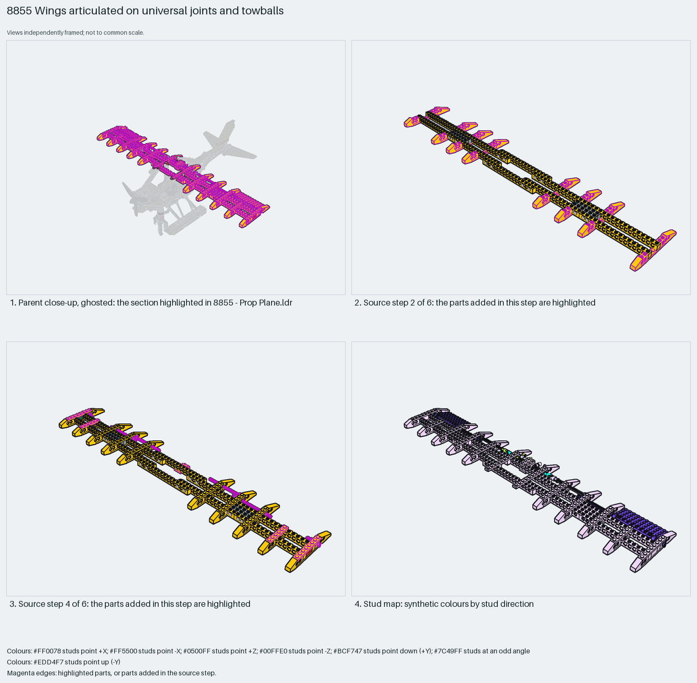

# Studded Technic wing: Technic-brick spars, wing-brick ribs, universal-joint roots and plate flaps

A studded Technic wing: two 1×16 Technic bricks as leading and trailing spars on 10-long axles, 1×4 wing-front and 1×6 wing-back bricks as ribs, 1×8 plates as skin strips; each root is a universal joint with a towball so the wing can be tilted, and the flaps are 4×10 plates on a Technic-plate hinge with toggle joints.

Reusable source construction: source checks pass and the Python and LeoCAD BOMs match.

Aircraft wing · studded Technic (1988) · 136 parts · 13 source steps in 4 sections

[Build pages](index.html) · [Inspection board](board/mosaic.png) · [Source](source.mpd) · [Editable plan](scene.plan.json) · [Checks](source-checks.json) · [Board provenance](board/board.json)



## Read the construction

136 parts in 6 root steps and three children. Step 1: two 1×16 Technic bricks and four 10-long axles as the twin spar. Steps 2–3: ten 2743 wing-front bricks on the leading spar and ten 2744 wing-back bricks on the trailing spar as ribs. Step 4: 1×8 plates as skin strips and the `Wing joint left` and `right` children (a 3712 universal joint with its 3326a centre on the axle, a 2736 towball and 1×2 hole bricks). Steps 5–6: 8-tooth gears, half bushes and the two `Flap` children (a 4×10 plate on a 1×8 Technic plate with toggle joints) on the trailing edge.

Stud directions: ribs and plates up, the flaps angled. The universal joints on the spar axles and the towballs are the interfaces to the fuselage; the 8-tooth gears at the root take the parent's adjustment drive.

## What the parent supplies

- `8855 - Prop Plane.ldr` places it at `0 -365 10`, matrix `1 0 0 / 0 1 0 / 0 0 1`.

`8855 - Prop Plane.ldr` places it at (0, −365, 10) with the identity matrix: a high wing above the fuselage, with the pontoons below and the engine ahead.

The cabane bricks and towball sockets the wing sits on, and the control gears that meet the 8-tooth gears at the root.

## Description check

- **Database (partly accurate):** “The main wings constructed from wing-front and wing-back Technic bricks, long plates, gears, and translucent indicator lights.”
- **What it is:** Partly accurate: wing bricks, long plates, gears and indicator lights are there; it omits the universal joints and towballs that make the wing adjustable and the two flap children.

## Read the board

Panel 1: the ghosted floatplane with the wing highlighted above the fuselage. Panel 2: source step 2, the wing-front bricks going onto the leading spar. Panel 3: source step 4, the 1×8 skin plates and the wing-joint children at the root. Panel 4: the stud map, ribs and plates up, the flaps angled (violet).

Magenta edges mark highlighted parts or the parts added in a source step. Pale grey, see-through parts are ghosted context. A neon-green rod (`#39FF14`) is a synthetic axis marker, not a part. Stud maps recolour each part by where its studs point: up lilac, +X rose, −X vermilion, +Z electric blue, −Z aqua, down lime, odd angle violet. These synthetic colours are ΔE ≥ 16 from every LDraw colour. LDraw −Y is up; LeoCAD `right` shows the model's right side, from −X.

Replay a board into `output/`:

    ./ldraw-xray board run examples/aircraft-atlas/recipes/8855-universal-joint-wings.json --output output/boards/8855-universal-joint-wings

## Reuse it

Use the spar-and-rib pattern for any studded Technic wing: Technic-brick spars give the span and pin holes, wing bricks give the profile, plates the skin. Drop the universal joints unless the wing must tilt, and hinge flaps on a Technic plate.

```sh
./ldraw-agent manual export examples/8855-universal-joint-wings --outdir output/my-8855-universal-joint-wings
./ldraw-agent build output/my-8855-universal-joint-wings/scene.plan.json --output output/my-8855-universal-joint-wings/8855-universal-joint-wings.mpd
```

Export needs a current visual review. Build the copied plan, then inspect its interfaces in the new model.

The placement plan preserves source axes. `source_origin` is a positioning frame, not a physical connector.

## Limits

Wing tilt travel, flap travel and the universal joints' retention were not checked. `./ldraw-agent build` of the exported plan reports `technic.invalid_seating` for the two 6-long axles passing through the 1×2 hole bricks at the root as drawn; `manual export`, the plan rebuild and the BOM comparison pass.

The source and renders teach a construction. They do not prove clutch, fit, clearance, travel or stability. Boards are rendered from synthetic inspection copies, and poses are rigid re-placements.

## Source and evidence

Source: `8855-1.mpd` / `8855 - Wings.ldr`, SHA-256 `98bb90e07be0a121c13018abd5fc51a2c0a7b1a4a94871b7c4bb92f3a3f04f8f`. Parent: `8855 - Prop Plane.ldr`. Look it up with `./ldraw-agent discover show submodel-de73e9b073136323402217e8`.

Original authors and licences stay in [source.mpd](source.mpd); [extraction.json](extraction.json) records renamed sections and 38 bounded preparation changes. Python and LeoCAD BOMs match. The visual review is recorded separately, after opening the actual images.
