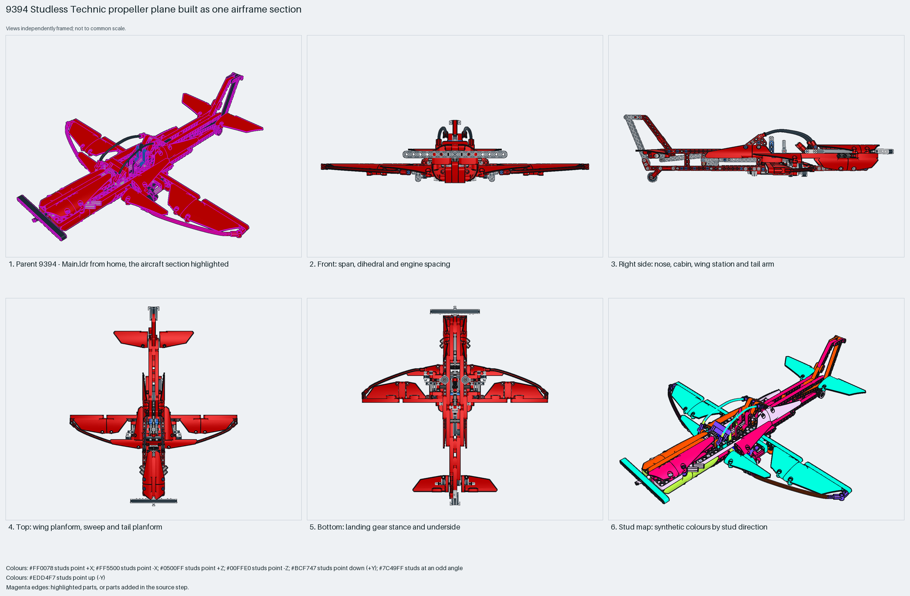

# Studless Technic propeller plane built as one airframe section

A studless Technic propeller plane kept as one section: a red liftarm fuselage and wings with white panel skins, a 15-long beam as the two-blade propeller on a worm-and-knob gear train, tricycle gear on 42610 wheels plus a tail wheel, and two LSynth flexible axles arcing wingtip to wingtip as the wing leading edges. Measured: span 54 studs, length 60, height 16, 583 placements, 66% Technic.

Inspiration study: the source keeps errors (`assembly.nonrigid` ×161). Study the technique and rebuild it; `manual export` is blocked.

Whole aircraft · studless Technic · 583 parts · 68 source steps in 1 section

[Completed-model views](index.html) · [Inspection board](board/mosaic.png) · [Source](source.mpd) · [Editable plan](scene.plan.json) · [Checks](source-checks.json) · [Board provenance](board/board.json)

## Read the construction

583 placements in 68 steps in one section; the source never splits the airframe. Fuselage: red 32525, 32278 and 32524 beams with cross blocks; wings: beams with 64681/64393 panels; nose: a 4716 worm, 3648 24-tooth gear and 32072 knob gears driving the propeller beam; the LS40/LS41/LS50/LS51 LSynth flex-axle segments as the curved leading edges and cables.

Studless: 201 up, 137 sideways, 218 angled. The `9394 - Main.ldr` wrapper places the airframe; the flex axles end in connectors at the wing tips; the gear's three wheels sit on pins and axles under the belly.

## What the parent supplies

- `9394 - Main.ldr` places it at `0 0 0`, matrix `1 0 0 / 0 1 0 / 0 0 1`.

`9394 - Main.ldr` places it at the origin with the identity matrix; this is the 9394 Jet Plane's B model, built with the propeller at −Z.

The `Main.ldr` wrapper only.

## Description check

- **Database (accurate):** “Primary structural airframe built predominantly from red Technic liftarms, beams, pins, axles, and cross blocks forming the plane's fuselage and wings.”
- **What it is:** Accurate: the primary airframe of red liftarms, beams, pins, axles and cross blocks forming fuselage and wings.

## Read the board

Panel 1: the parent from home with the airframe highlighted; the flex axles arc over the wings. Panel 2: front, the low panel wings, flex leading edges and propeller beam. Panel 3: right side, the long fuselage, tall fin and tail wheel. Panel 4: top, the planform with the flex arcs and tailplane. Panel 5: bottom, the belly beams and tricycle gear. Panel 6: the stud map, studless in every direction, flex arcs angled.

Magenta edges mark highlighted parts or the parts added in a source step. Pale grey, see-through parts are ghosted context. A neon-green rod (`#39FF14`) is a synthetic axis marker, not a part. Stud maps recolour each part by where its studs point: up lilac, +X rose, −X vermilion, +Z electric blue, −Z aqua, down lime, odd angle violet. These synthetic colours are ΔE ≥ 16 from every LDraw colour. LDraw −Y is up; LeoCAD `right` shows the model's right side, from −X.

Replay a board into `output/`:

    ./ldraw-xray board run examples/aircraft-atlas/recipes/9394-technic-airframe.json --output output/boards/9394-technic-airframe

## Reuse it

Use it for the layout of a studless Technic trainer: length 1.1× span, low wing, tricycle gear, propeller on a geared nose axle. Inspiration only: the 163 LSynth segments use mirrored matrices, so rebuild the flex leading edges with the flex workflow.

Rebuild the technique with the new model's own parts and interfaces; the source errors above stay in this copy.

The placement plan preserves source axes. `source_origin` is a positioning frame, not a physical connector.

## Limits

Inspiration only: 161 `assembly.nonrigid` placements from LSynth segments; the BOM comparison matches. Gear train and gear stance not checked.

The source and renders teach a construction. They do not prove clutch, fit, clearance, travel or stability. Boards are rendered from synthetic inspection copies, and poses are rigid re-placements.

## Source and evidence

Source: `9394-1_Propeller-Plane.mpd` / `9394 - 9394-2.ldr`, SHA-256 `d87d2975a64c4a8e3abac988b06407ffe1419b4e07289f6289e037dde44953be`. Parent: `9394 - Main.ldr`. Look it up with `./ldraw-agent discover show submodel-a195a08f6e4528d0f52a05bf`.

Original authors and licences stay in [source.mpd](source.mpd); [extraction.json](extraction.json) records renamed sections and 10 bounded preparation changes. Python and LeoCAD BOMs match. The visual review is recorded separately, after opening the actual images.
