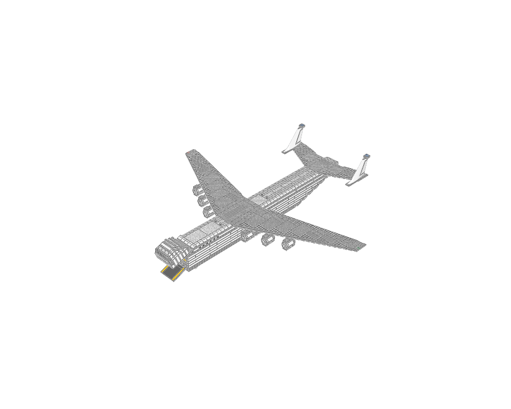
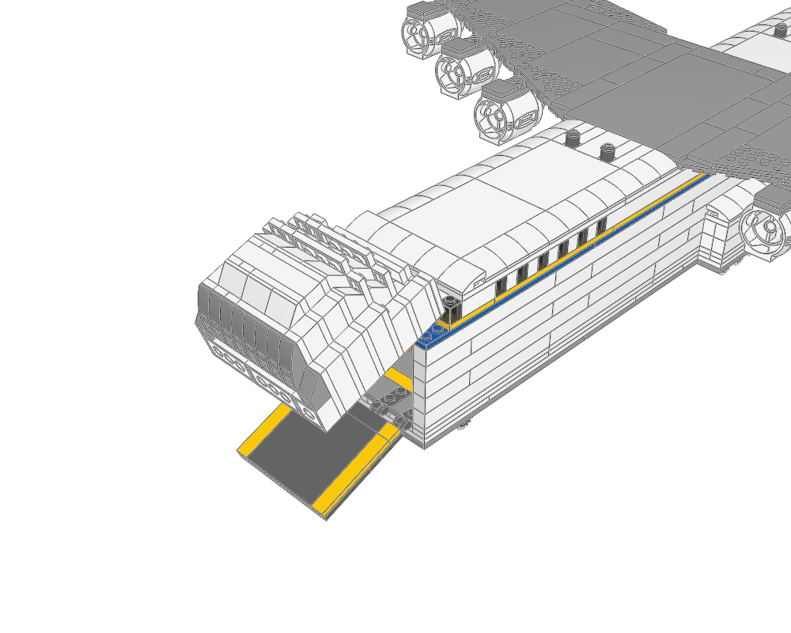

> Historical generation report; use the [current package lesson](../README.md) for corrected scope and limits. Links to research and iterations refer to the original local `output/` run.

# Antonov An-225 Mriya — 1:100 System-brick model



The world's largest cargo aircraft, parked on all **32 wheels** with its **nose visor
raised**, its **forward ramp lowered** and two microscale containers in the hold.

The model:

- is 104 studs long with a 106-stud span and a 10-wide fuselage;
- has **1,011 physical placements** of **130 part/colour combinations**, organised in
  **18 MPD sections**;
- is a System-brick build, with no Technic parts or mechanisms.



## Files

| File | Purpose |
|---|---|
| [an225-mriya.mpd](../an225-mriya.mpd) | Final editable model (SHA-256 in [manifest.json](../evidence/manifest.json)) |
| [generate.py](../generate.py) | Generator for the complete plan; all geometry fixes live here |
| [an225-mriya.plan.json](../an225-mriya.plan.json) | Generated version-1 assembly plan (built into the MPD) |
| [design-brief.md](../design-brief.md) | Brief, palette roles, measured interfaces, module checklist |
| [visual-review.md](visual-review.md) | Opened images, problems found and revisions, per pass |
| [validation.json](../evidence/validation.json), [validation.contacts-all.json](../evidence/validation.contacts-all.json) | Assembly validation (auto mode, and with full contacts) |
| [gear-main.vehicle.json](../evidence/gear-main.vehicle.json), [gear-nose.vehicle.json](../evidence/gear-nose.vehicle.json), [aircraft.vehicle.json](../evidence/aircraft.vehicle.json) | Vehicle-profile reports |
| [bom.json](../evidence/bom.json), [bom-comparison.json](../evidence/bom-comparison.json), [review/leocad-bom.csv](../evidence/review/leocad-bom.csv) | Python BOM, LeoCAD BOM and their comparison |
| [check-model.json](../evidence/check-model.json) | LeoCAD import/snapshot/BOM smoke test |
| [review/](../evidence/review) | Final seven views; [review/closeups/](../evidence/review/closeups) holds the nose, tail, gear, engines, aft and sponson views |
| [checks/](../evidence/checks) | Full and per-module contact inspections, mesh clearance, hinge study, interface contacts |
| [closeup.py](../closeup.py), [components.py](../components.py), [mesh_clearance.py](../mesh_clearance.py), [hinge_study.py](../hinge_study.py) | Review aids: framed renders, connection-group tracing, triangle clearance, hinge-angle study |
| [research/](../../../output/an225-mriya/research), [shortlists/](../../../output/an225-mriya/shortlists) | Jev part rankings per role and LeoCAD part boards |
| [tests/](../evidence/tests) | Hinge connector test (3937/3938 at 0° and 60°) and the clearance-checker control |
| [iterations/](../../../output/an225-mriya/iterations) | Renders from the earlier design passes cited in the visual review |

## Reproduce

Run from the repository root:

```sh
.venv/bin/python output/an225-mriya/generate.py
./ldraw-agent build output/an225-mriya/an225-mriya.plan.json --output output/an225-mriya/an225-mriya.mpd --force \
  --detail summary --report output/an225-mriya/build.json
./ldraw-agent validate output/an225-mriya/an225-mriya.mpd --geometry --contacts all --detail summary \
  --report output/an225-mriya/validation.contacts-all.json
./ldraw-agent vehicle check output/an225-mriya/an225-mriya.mpd --section an225-main-gear.ldr
./ldraw-agent render output/an225-mriya/an225-mriya.mpd --outdir output/an225-mriya/review \
  --views home front back left right top bottom
./ldraw-agent compare-bom output/an225-mriya/an225-mriya.mpd --csv output/an225-mriya/review/leocad-bom.csv
.venv/bin/python output/an225-mriya/closeup.py
.venv/bin/python output/an225-mriya/hinge_study.py
```

## Evidence

- **Build and validation.**
  - No errors in `build` or `validate --geometry`.
  - `validate --strict` passes on the assembly profile without the geometry pass. With
    `--geometry --strict` it fails, because it treats the remaining coverage warning as
    an error.
  - Two warnings remain. `coverage.contacts_skipped` appears in auto mode only; full
    contacts were computed separately. `coverage.collision_review` notes that irregular
    parts have no curated body profile; the mesh clearance check below covers those
    pairs.
- **Connectivity.**
  - With all 7,662 contacts computed, all 1,011 placements form **one** optimistic
    connection group.
  - The confirmed-only graph has 417 groups, because many socket contacts are heuristic
    "potential" evidence. That graph is reported, not suppressed.
  - Key interfaces are confirmed:
    - 4600 wheel pins with the 4624 rims;
    - 3641/4624 rim seats;
    - 43121 nacelle studs in the pylons;
    - 3937/3938 visor hinges;
    - 44301a/44302a ramp click hinges;
    - 54094 fins and their flag caps.
- **Material clearance.**
  - `mesh_clearance.py` tested all 1,256 bounding-box review candidates against the real
    library triangles. Only the 8 hinge pairs cross.
  - **Visor hinges:** crossings lie on the pin cylinder and are at most 0.038 LDU deep
    (facet artifact).
  - **Ramp click hinges:** crossings are 0.432 LDU deep, identical to the designed flat
    pose.
  - The checker gives 0 crossings for stacked control bricks and 362 for a
    deliberately overlapping pair.
- **Hinge poses.**
  - `hinge_study.py` showed that the plated 3937/3938 top cuts the base at yaw 0 between
    15° and 85°, but is clear at yaw 180. The visor uses yaw 180 at −70°.
  - The click-hinge teeth mesh every 22.5°, so the ramp sits at the 22.5° detent.
- **Running gear.**
  - The main-gear section passes the road profile: 7 paired transverse axles, track
    60 LDU, zero ground error, correct rim fit and no wheel-space intrusion.
  - Across the whole model, all 32 tyres touch Y=0 (maximum error 0.0 LDU).
  - The whole-model `vehicle.axle_pair` errors are expected, because 4 wheels share each
    station (bogies on both sides).
  - The single nose-leg section fails only `vehicle.axle_count`, because one axle is not
    a road vehicle.
- **Aircraft profile.** It reports `family_part` and `family_pair` errors because this
  brick-built airframe does not use the atlas courier-jet parts (87613 nose, 30355/30356
  wings, 4868b engines). It found no Technic parts.
- **BOM.** The Python and LeoCAD BOMs match exactly: 1,011 = 1,011, with no differences.
  The LeoCAD import and snapshot pass.

## Limitations

Physical validity is `not_proven`.

- **Not tested:**
  - physical assembly;
  - clutch or strength of a roughly 85 cm model;
  - wheel-pin retention and rolling;
  - hinge friction, and whether the visor stays up at −70°;
  - the ramp detent under load;
  - retail part/colour availability (for example trans-black 1×1 bricks or white
    54094).
- **Nav lights:** the 1×1 tile lamps have heuristic contact evidence only.
- **Stated simplifications:**
  - flat wing without anhedral;
  - stepped aft belly and a blunt tail cone;
  - stepped brick visor shell;
  - normal (non-kneeling) nose stance;
  - ramp toe 6 LDU above the ground at its detent;
  - no cockpit interior.
- **Scale:** 1:100 is not minifigure scale.
