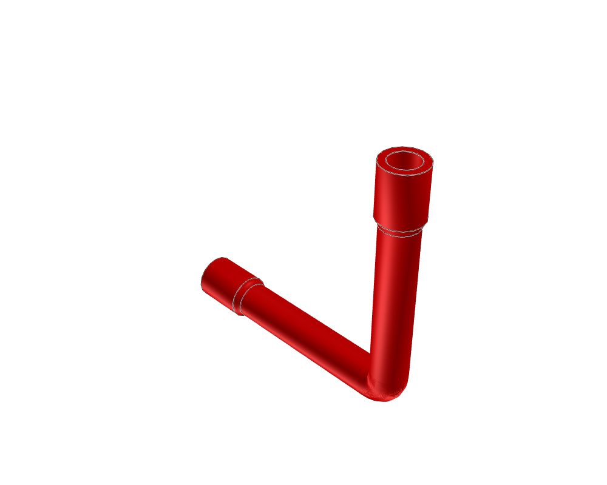
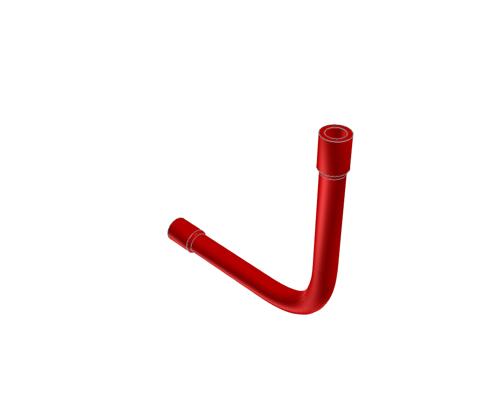
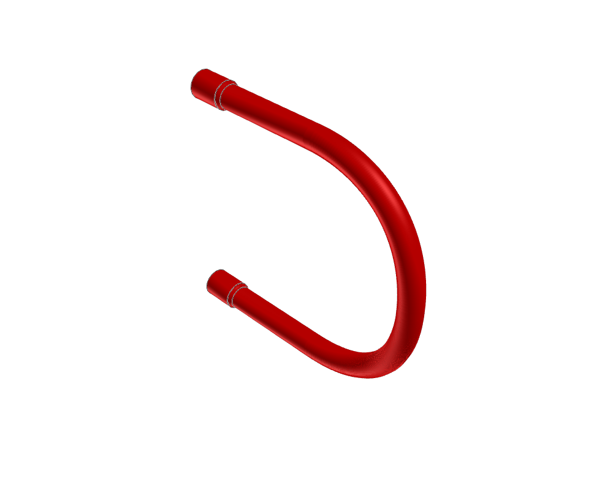
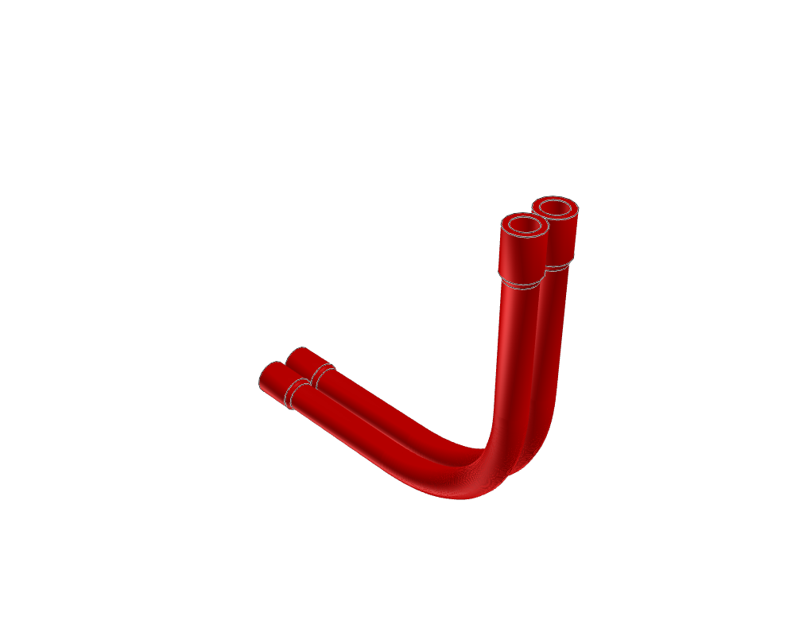

# Learn constraints by measuring actual LSynth output

These small geometry experiments make the effects of marker choices visible.
They are not mounted mechanisms. Use the [pneumatic press](../pneumatic-press/README.md)
for an assembly with real fittings and supports, and the
[constraint guide](../../../docs/agent/flex-constraints.md) for the authoring and repair process.

```sh
.venv/bin/python examples/flex/constraint-lab/generate.py --outdir output/flex-lab
./ldraw-agent review output/flex-lab/corner-32/asset.mpd \
  --outdir output/flex-lab/corner-32/review --contacts none
```

Open the generated views. Each experiment retains its constraints, generated
asset and manifest, constraint report and actual-geometry report. `results.json`
collects the measurements. Use a new output directory, or explicitly `--force`
to overwrite generated experiment files. An expected failed geometric check
remains in the results; it does not prevent inspecting the generated shape.

| Experiment | Question |
| --- | --- |
| Straight | Are endpoint directions and the 22 LDU leads correct? |
| Corners with nominal radii 6, 24, 32, 48 | What bend does the real output produce? Nominal geometry and output radius differ. |
| Corner 32 with a midpoint | Does an extra marker help? In this fixture it tightens the bend. |
| Two parallel corners | Do routes 12 LDU apart stay separated? |
| Return loop | Can a deliberate loop reverse travel without a local hairpin? |

| Tight corner: rejected | Larger corner: accepted geometric limit |
| --- | --- |
|  |  |

| Return loop | Parallel pair |
| --- | --- |
|  |  |

These home images were opened, along with the top views. The top views look
edge-on at these XY-plane routes and cannot show the bends properly. Source,
asset and image hashes are retained in [visual-review.json](visual-review.json).
Normal source/BOM review passes even for the tight corner; the separate bend
check correctly rejects it. This distinction is part of the lesson.

The test criterion is a **geometric** minimum radius of 15 LDU and a round tube
radius of 5 LDU for the beveled pneumatic definition. These are not universal
LEGO material limits. The 6 LDU corner must fail. The larger baseline fixtures
pass those criteria; inspect their actual appearance too. Tests exercise rigidly
rotated/transformed versions and deliberately invalid input separately.

To exercise every installed synthesis definition:

```sh
.venv/bin/python examples/flex/constraint-lab/generate.py \
  --outdir output/flex-families --families
```

This generates straight hose fixtures and simple loop fixtures. It is a smoke
test for definition discovery, authoring, packaging and measurement, **not**
approval of wheel compatibility, manufactured lengths, motion or all shapes in
a family. Errors are retained explicitly. BRICK_ARC in the tested 3.1.0 engine
emits reflected physical bricks; source validation rejects those placements.
Do not relax the validator to make its example pass.

For agent evaluation, start from the guide and these sources, then request an
unseen rotated fitting, changed passage or second nearby route. Require the
actual generated output, checks and opened contextual previews. Record repair
count, elapsed active time and any expert intervention. Passing the software
tests establishes tool behaviour; independent agent competence must still be
measured on these adaptation tasks.
