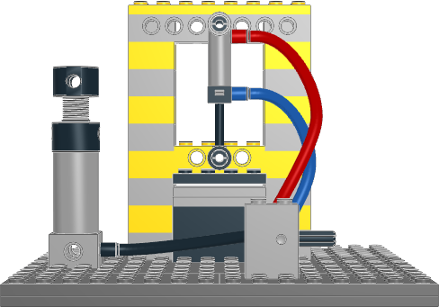

# Pneumatic press: three hoses doing real work

A hand pump feeds a valve. The valve drives a cylinder hung in a Technic C-frame, and the cylinder pushes a press head onto an anvil. All three hoses are required: without them, nothing is connected.

This model is inspired by lsynth-nova's `TECHNIC_PNEUMATIC_HOSE` example (pump, switch and cylinder with beveled hoses). It is rebuilt with current pneumatic parts.



| Item | Value |
|---|---|
| Physical placements | 41: 38 rigid parts and 3 posed hoses |
| Hoses | `TECHNIC_PNEUMATIC_HOSE_BEVELED`: black supply, plus red and blue cylinder lines |
| Pneumatic parts | `2797c01-f1` pump, `4694c01-f1` valve, `74981-f2` cylinder (extended) |
| Review | No errors; Python and LeoCAD BOMs match |

```sh
.venv/bin/python examples/flex/pneumatic-press/generate.py
./ldraw-agent flex build examples/flex/pneumatic-press/hoses.ldr \
  --output examples/flex/pneumatic-press/hoses.mpd --namespace press-hoses --force
./ldraw-agent review examples/flex/pneumatic-press/press.plan.json --outdir output/press-review --contacts all
```

## How the hoses are placed

Every pneumatic part's hose nozzle is an R=4 male cylinder in its LDCad shadow data: a base, an axis and a length. You can read them with `./ldraw-agent part 2797c01-f1`. The generator copies these local frames, transforms them with each part's placement, and writes each hose like this:

1. The first marker sits on the source nozzle's base, pointing out along the nozzle.
2. A second marker sits 22 LDU further out, so the hose runs straight over the nozzle before it bends.
3. Optional waypoints follow.
4. The last two markers mirror the first two, ending on the target nozzle.

The plan and the constraint source come from the same frames, so moving a part also moves its hose ends.

## What is checked

[tests/test_pneumatic_press.py](../../../tests/test_pneumatic_press.py) checks these points:

| Check | Result |
|---|---|
| Six end sleeves (LS22) on their nozzles | Exactly coaxial; each 16 LDU sleeve covers the whole nozzle |
| Minimum centreline bend radius | 16.9 LDU, against a limit of 15; no segment turns more than 5.6° |
| Tube-to-tube distance | At least 11.2 LDU, against a limit of 10 (tube radius 5), excluding 30 LDU at each end |
| Hose points inside any rigid part's oriented box | None, outside the end zones |
| Generator → plan and constraints | Byte-identical |
| LSynth → `hoses.mpd`; plan → `press.mpd` | Byte-identical |

The 30 LDU end zones are needed because the valve's three nozzles sit 11–22 LDU apart, so its hoses leave it side by side.

The contact graph has 7 groups: one rigid structure plus six single parts. Three of those are the posed hoses, which carry no connector data. The other three are checker gaps, and the test verifies each one geometrically instead:

- **Cylinder connholes:** the cylinder's mount ring and rod-end ring are not matched by the checker. Both `3673` pins are exactly coaxial with them and fill half of each ring.
- **Pump base:** its sockets are modeled as pin holes. All four sit exactly on bench studs.

## Limits

`physical_validity` is `not_proven`. These are not established:

- tube length against stock lengths
- elasticity, tension and pressure
- clutch strength
- whether the extended stroke matches the 4 LDU die gap under load

LSynth's `hoses.manifest.json` records absolute local paths. Treat it as provenance from the machine that generated it.

### Why the first attempt failed

A first attempt used ribbed hose on a helmet. It showed visible breaks: LSynth draws ribbed hose as separate rigid rings, and the route turned 36–56° between neighbouring rings. Stretched types such as this pneumatic hose stay continuous, but any route still needs a bend-radius check. The test above includes one.
