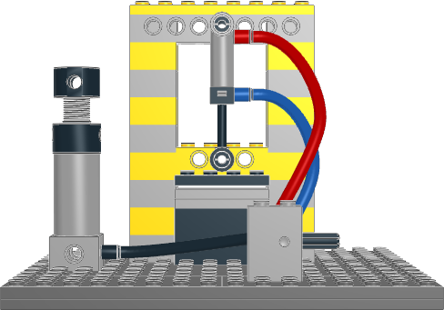

# Pneumatic press: three hoses doing real work

A hand pump feeds a valve. The valve drives a cylinder hung in a Technic C-frame, and the cylinder pushes a press head onto an anvil. All three hoses are required: without them, nothing is connected.

This model is inspired by lsynth-nova's `TECHNIC_PNEUMATIC_HOSE` example (pump, switch and cylinder with beveled hoses). It is rebuilt with current pneumatic parts.



| Item | Value |
|---|---|
| Physical placements | 41: 38 rigid parts and 3 posed hoses |
| Hoses | `TECHNIC_PNEUMATIC_HOSE_BEVELED`: black supply, plus red and blue cylinder lines |
| Pneumatic parts | `2797c01-f1` pump, `4694c01-f1` valve, `74981-f2` cylinder (extended) |
| Review | No errors; Python and LeoCAD BOMs match |

The [named JSON version](named.plan.json) keeps the same rigid geometry and BOM,
with nozzle references and mounting contracts in the plan:

```sh
cp examples/flex/pneumatic-press/named.plan.json output/press.plan.json
./ldraw-agent review output/press.plan.json --views home front back top
```

See [named authoring](../../../docs/agent/guides/build-model.md) to move fittings or repair
routes. The original generator and fixture remain compatibility evidence:

```sh
.venv/bin/python examples/flex/pneumatic-press/generate.py --automatic \
  --output output/press/press.plan.json --hoses output/press/hoses.ldr
./ldraw-agent review output/press/press.plan.json --contacts all
```

`--automatic` declares the hose source, namespace and geometric limits in the plan. Review builds and checks the hoses before composing the press; later runs reuse unchanged synthesis. Use `--force` on review after edits. The result reproduces the supplied reviewed MPD byte for byte. The generator's original mode and prebuilt `hoses.mpd` remain supported; run without `--automatic` to reproduce those source fixtures.

## How the hoses are placed

Every pneumatic part's hose nozzle is an R=4 male cylinder in its LDCad shadow data: a base, an axis and a length. You can read them with `./ldraw-agent part 2797c01-f1`. The generator copies these local frames, transforms them with each part's placement, and writes each hose like this:

1. The first marker sits on the source nozzle's base, pointing out along the nozzle.
2. A second marker sits 22 LDU further out, so the hose runs straight over the nozzle before it bends.
3. Optional waypoints follow.
4. The last two markers mirror the first two, ending on the target nozzle.

The plan and the constraint source come from the same frames, so moving a part also moves its hose ends.

## What is checked

[tests/test_pneumatic_press.py](../../../tests/test_pneumatic_press.py) checks these points:

| Check | Result |
|---|---|
| Six end sleeves (LS22) on their nozzles | Exactly coaxial; each 16 LDU sleeve covers the whole nozzle |
| Minimum centreline bend radius | 16.9 LDU, against a limit of 15; no segment turns more than 5.6° |
| Tube-to-tube distance | At least 11.2 LDU, against a limit of 10 (tube radius 5), excluding 30 LDU at each end |
| Hose points inside any rigid part's oriented box | None, outside the end zones |
| Generator → plan and constraints | Byte-identical |
| LSynth → `hoses.mpd`; plan → `press.mpd` | Byte-identical |

The 30 LDU end zones are needed because the valve's three nozzles sit 11–22 LDU apart, so its hoses leave it side by side.

The current reviewed registry resolves the cylinder's two mounting eyes and the
pump's four bottom stud sockets. The contact graph now has four groups: the
connected rigid assembly and three posed hoses without connector data. The named
plan checks both cylinder pins, all four pump mounts and both valve mounts
through normal `review`; moving a fitting away from its supports fails its
required joint even if the hose follows it.

The original report had seven groups because those cylinder/pump interfaces
were checker gaps. Independent geometric fixture assertions remain in the tests
as historical evidence; original MPD and source geometry are unchanged.

## Limits

`physical_validity` is `not_proven`. These are not established:

- tube length against stock lengths
- elasticity, tension and pressure
- clutch strength
- whether the extended stroke matches the 4 LDU die gap under load

LSynth's `hoses.manifest.json` records absolute local paths. Treat it as provenance from the machine that generated it.

### Why the first attempt failed

A first attempt used ribbed hose on a helmet. It showed visible breaks: LSynth draws ribbed hose as separate rigid rings, and the route turned 36–56° between neighbouring rings. Stretched types such as this pneumatic hose stay continuous, but any route still needs a bend-radius check. The test above includes one.

## Knowledge registration

```ldraw-knowledge
[
  {
    "id": "pneumatic-press",
    "title": "Portal-frame press with three fitted hoses",
    "scope": "construction",
    "kind": "assembly",
    "aliases": [
      "mounted-flex:press"
    ],
    "families": [
      "flex",
      "technic"
    ],
    "legacy_groups": [
      "examples"
    ],
    "lesson": "Named-plan static press: portal frame, mounted pump/valve/cylinder and three distinct hoses following actual fitting interfaces. Preserve their geometric limits and passage; no tested control circuit, fixed stock length or moving-machine claim.",
    "limits": "Static visual evidence only unless the linked package records specific further checks. Search eligibility does not certify fit, motion or strength.",
    "audit": "docs/plans/knowledge-base-overhaul/snapshot/mounted-flex-audit.json",
    "model": "examples/flex/pneumatic-press/named-review/model.mpd",
    "generator": "examples/flex/pneumatic-press/generate.py",
    "model_sha256": "2b21bb66b901e8d623c617470907a4f5d5cea79dc81fe12032f77dcc860afa15",
    "audit_pointer": "/press",
    "findings": "docs/plans/knowledge-base-overhaul/snapshot/mounted-flex-findings.md",
    "plan": "examples/flex/pneumatic-press/named.plan.json",
    "techniques": [
      "technic",
      "flex"
    ],
    "subjects": []
  }
]
```

## Audited section observations

These observations refer to the source hashes in the registrations. They correct earlier source descriptions and preserve static visual scope; existing numeric and export checks remain separate.

### Portal-frame press with three fitted hoses

| Source section | Opened-image observation |
|---|---|
| `press.ldr` | Mounted static pump-valve-cylinder press on plate base; two-column portal frame, not documented C-frame. Three distinct hoses connect actual fittings; no pressure or loaded-stroke claim. |
| `press-bench.ldr` | Broad bonded studded plate base beneath all mounts; bench name does not imply a raised table. |
| `press-frame.ldr` | Two brick columns and Technic crossbeam form closed-top portal with a central anvil. Correct C-frame wording. |
| `press-ram.ldr` | Extended cylinder, upper pin and lower pressing shoe. Parent places it between columns over anvil; loaded gap and travel unproven. |
| `press-controls.ldr` | Separated pump and valve share a logical section; their physical connection is through base mounts and the parent supply hose, not a rigid control module. |
| `route-e8c880158836619b.ldr` | Short black curved supply hose between pump and valve; both end sleeves visible alone and in actual parent. |
| `route-8a9c27749e252068.ldr` | Red route rises from valve to upper cylinder port, with curved upper departure. |
| `route-8869bb380eddd979.ldr` | Blue route rises from valve to lower cylinder port; distinct route below red endpoint. |
