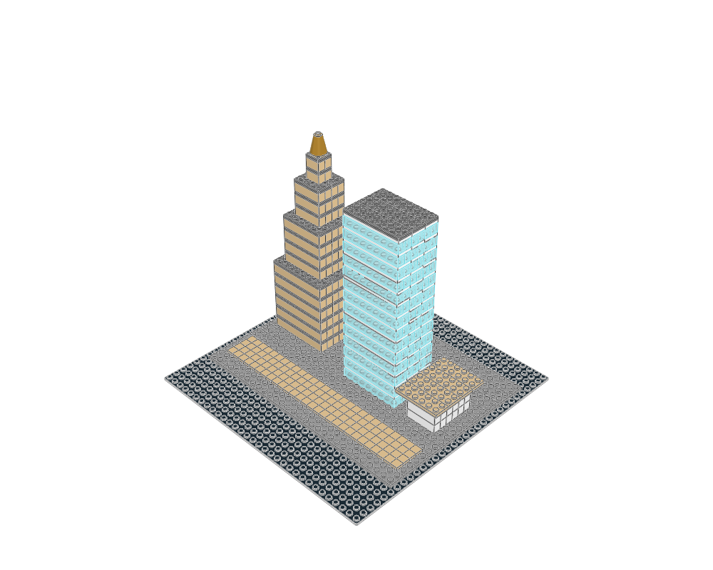

# Three Rivers Skyline

Microscale architecture and landmarks · microscale scale · 441 physical placements · 1 FILE sections.



[MPD](skyline.mpd) · [Editable plan](scene.plan.json) · [Front](front.png) · [Top](top.png) · [Validation](validation.json) · [BOM comparison](bom-comparison.json) · [Review](visual-review.json)

## What to learn

Three different tower silhouettes around a shared plinth demonstrate massing at a declared small scale.

**Place details:** Use tiny repeated window bands and broad quiet plinths; tower spacing is part of the composition.

**Avoid:** Never mix full minifigure doors, trees or lampposts into this scene.

This is an original teaching model. The [LEGO example](https://www.lego.com/en-us/product/new-york-city-21028) establishes the building family; its source geometry was not copied. The family labels are the atlas's practical classification, not an exhaustive official LEGO taxonomy.

## Construction

The root section places the site and named modules. `base` anchors describe underside contact planes; `roof` anchors use body-top heights. The [shared helpers](../../ldraw_tools/architecture.py) author X/Z in studs and upward height in LDU, then emit `[20*x, -h, 20*z]`. The [generator](../building-atlas/generate.py) contains the composition and every reserved footprint. Inspect unfamiliar parts with `ldraw-agent part` before changing their interfaces.

| Submodel | Construction purpose |
|---|---|


Render and inspect one submodel with `--section NAME --colour CODE`; replace NAME with a FILE name from this table. The [detail library](../building-atlas/README.md#details) supplies isolated modules with measured envelopes, local anchors and placement advice. Use the [placement guide](../../docs/agent/guides/design-models.md#architecture) when composing a different scene.

```sh
.venv/bin/python examples/building-atlas/generate.py skyline --outdir output/atlas-study --render
./ldraw-agent build examples/microscale-skyline/scene.plan.json --output output/skyline.mpd --detail summary
```

Change the generator for reproducible structural edits; changing only the emitted MPD loses the change on regeneration. The examples focus on exterior composition and interfaces. Most rooms have no furniture or internal stairs; the skyline is explicitly microscale. No vehicles, minifigures, moving mechanisms or manufacturing inventory are implied. Read the per-view observations and physical scope in the [collection review](../building-atlas/README.md).

## Knowledge registration

```ldraw-knowledge
[
  {
    "id": "microscale-skyline",
    "title": "Three Rivers: two towers and a pavilion",
    "scope": "construction",
    "kind": "assembly",
    "aliases": [
      "building:skyline"
    ],
    "families": [
      "building"
    ],
    "legacy_groups": [
      "examples"
    ],
    "lesson": "Microscale massing with a stepped tan tower, glazed slab tower and low pavilion on one plinth. Two towers and one pavilion, not three towers; do not transfer its proportions to minifigure-scale buildings.",
    "limits": "Static visual evidence only unless the linked package records specific further checks. Search eligibility does not certify fit, motion or strength.",
    "audit": "docs/plans/knowledge-base-overhaul/snapshot/building-audit.json",
    "scale": "microscale",
    "subjects": [
      "Microscale architecture and landmarks"
    ],
    "model": "examples/microscale-skyline/skyline.mpd",
    "plan": "examples/microscale-skyline/scene.plan.json",
    "preview": "examples/microscale-skyline/home.png",
    "model_sha256": "2cb9ec3a4d5a00516ee632035bd4dd9ca2131e3c891c501208f1d42a0f8307a7",
    "audit_pointer": "/items/2",
    "findings": "docs/plans/knowledge-base-overhaul/snapshot/building-findings.md",
    "techniques": []
  }
]
```