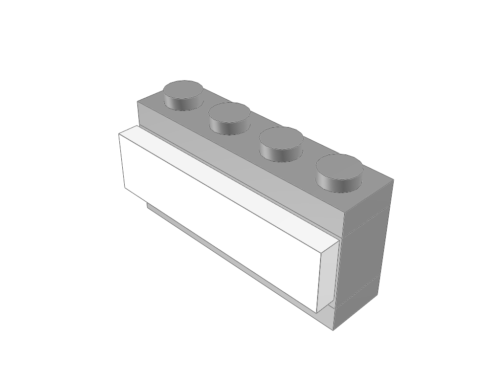
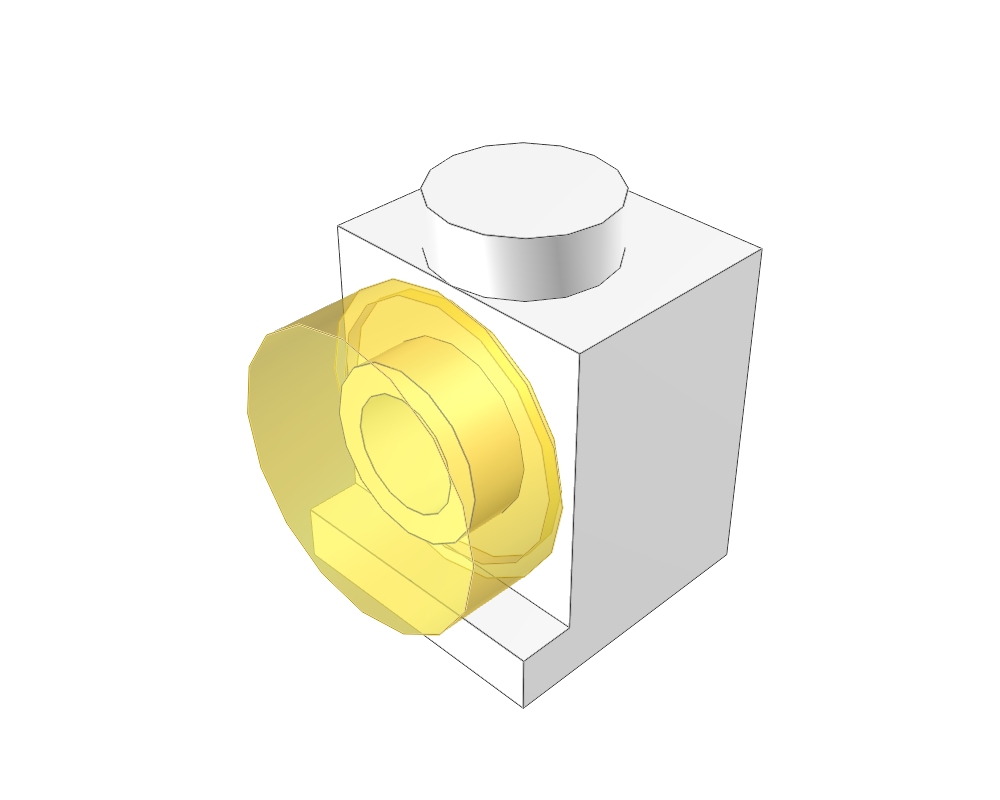
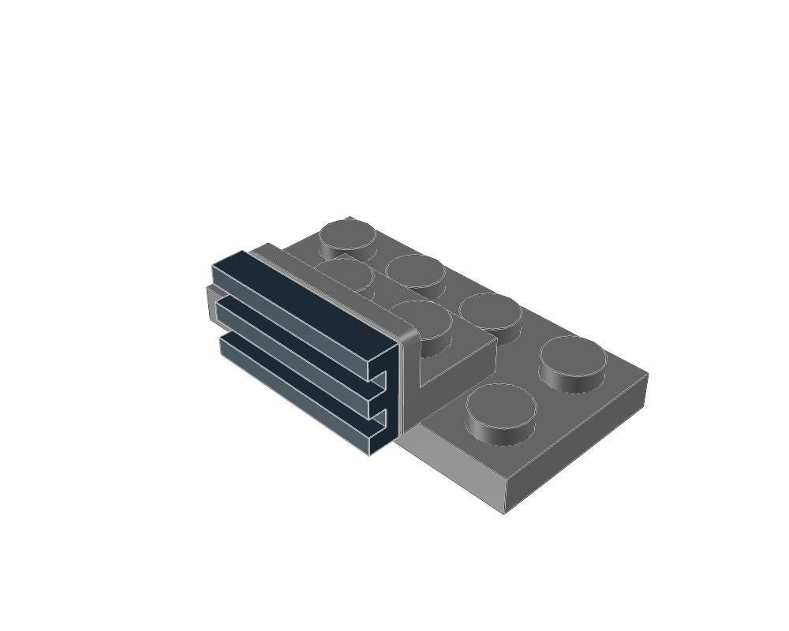
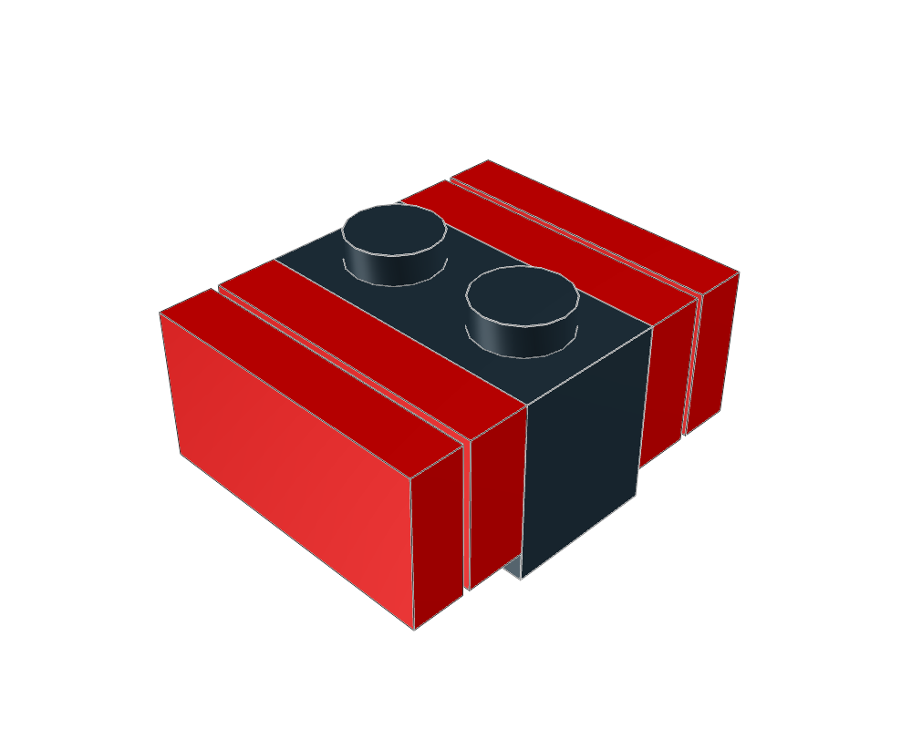
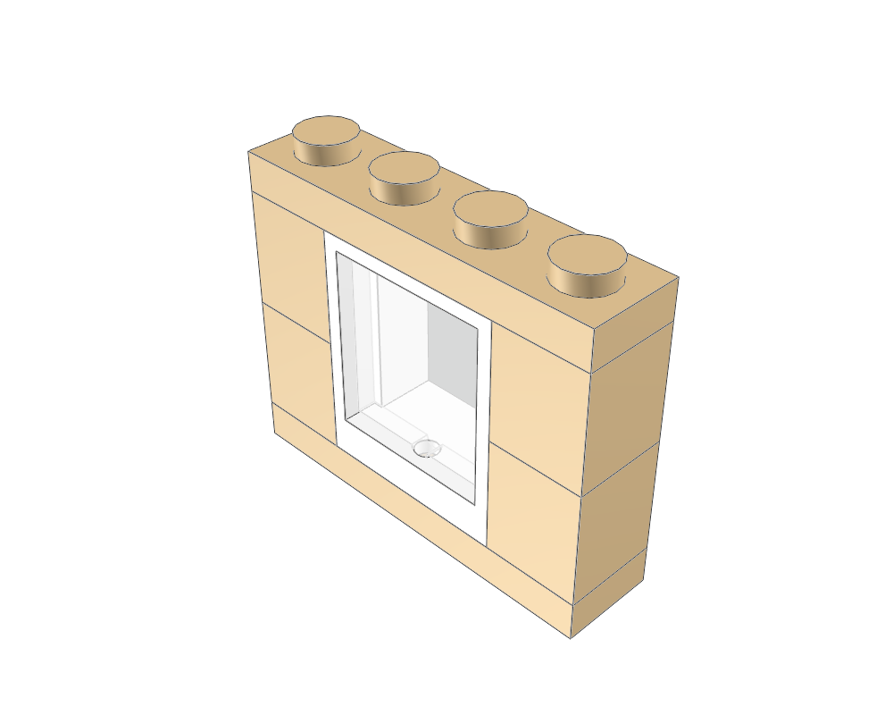
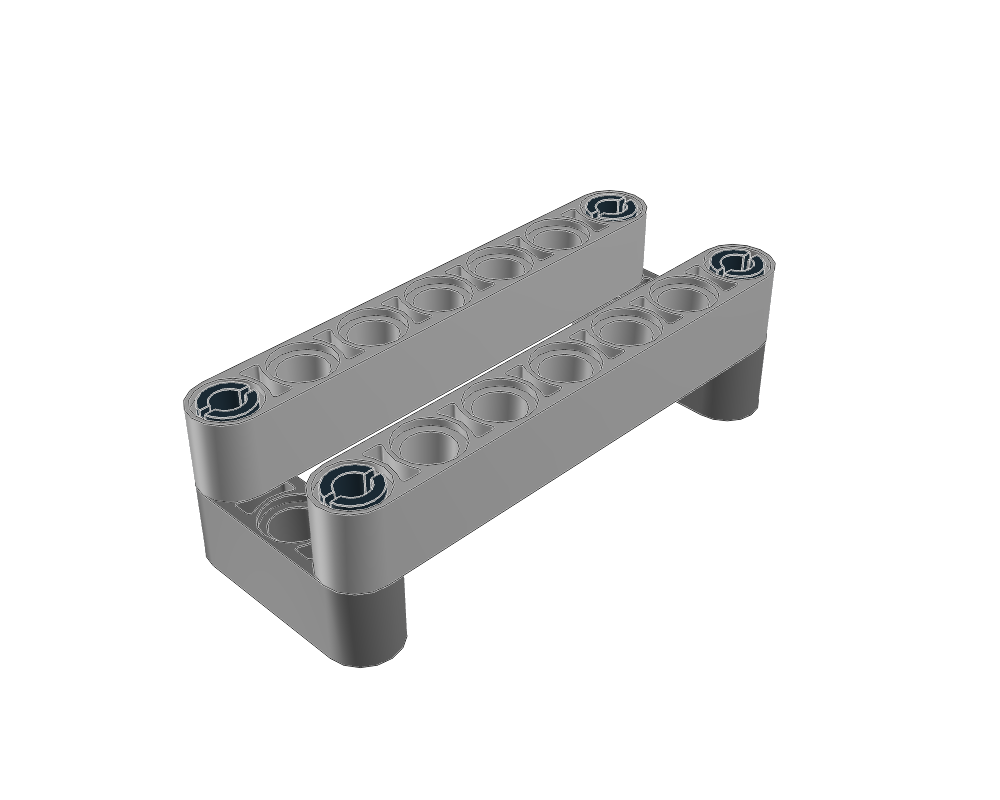
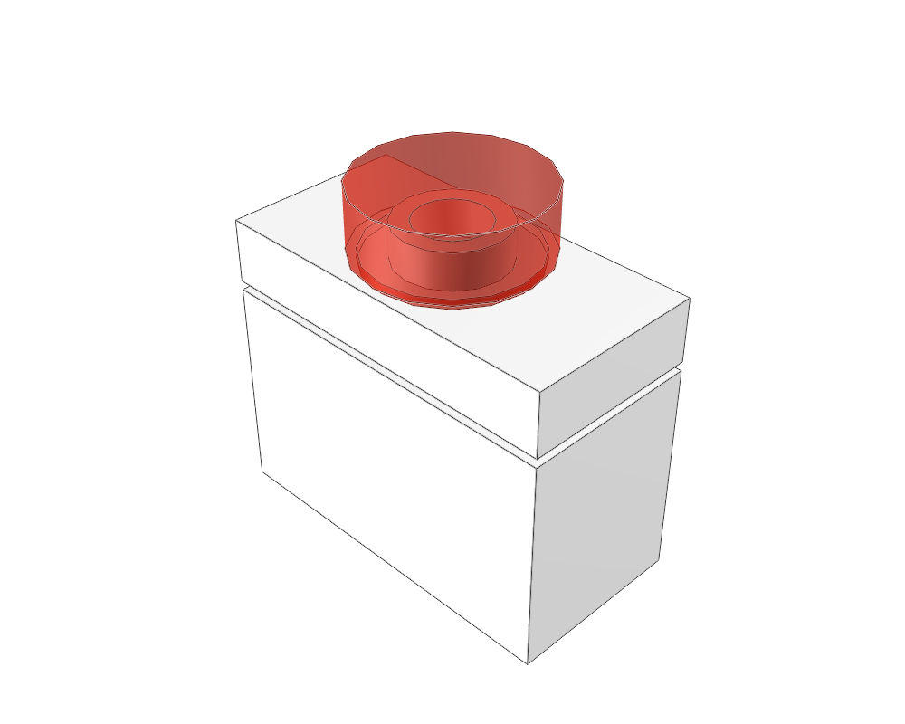
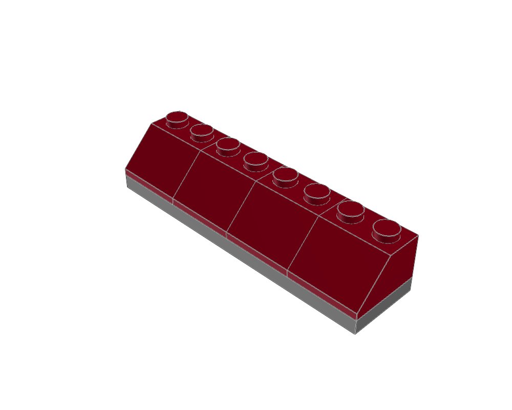

# Construction recipes

Small plans that place parts by their real interfaces (`on`, `under` and Technic seats) instead of hand-written coordinates and matrices. Each builds and reviews cleanly; copy the placements and change parts, colours and studs.

| Recipe | Plan | Preview |
|---|---|---|
| Cover a side-stud course with a tile | [side-stud-cover.plan.json](side-stud-cover.plan.json) |  |
| Headlight brick with a round lens | [headlight-lamp.plan.json](headlight-lamp.plan.json) |  |
| Upward bracket carrying a front grille | [bracket-grille.plan.json](bracket-grille.plan.json) |  |
| One panel module seated on both sides of a core | [side-panels.plan.json](side-panels.plan.json) |  |
| Window frame and glass between brick columns | [window-wall.plan.json](window-wall.plan.json) |  |
| Rigid Technic frame from beams and friction pins | [technic-pin-frame.plan.json](technic-pin-frame.plan.json) |  |
| Inverted slope hung under a plate | [inverted-nose.plan.json](inverted-nose.plan.json) |  |
| Jumper plate centring a detail between studs | [jumper-centre.plan.json](jumper-centre.plan.json) |  |
| Row of slopes placed by stud index | [roof-slope-row.plan.json](roof-slope-row.plan.json) |  |

Rebuild and review one:

```sh
./ldraw-agent review examples/recipes/side-stud-cover.plan.json --outdir output/recipes/side-stud-cover
```

Evidence: each recipe passed `review` with matching Python and LeoCAD BOMs, and its preview (the PNG beside the plan) was opened and checked on 2026-11-15. The Technic frame also passed `technic check` with eight pin joints. The MPD beside each plan is the reviewed model.

```ldraw-knowledge
[
 {
  "id": "recipe-side-stud-cover",
  "title": "Cover a side-stud course with a tile",
  "scope": "construction",
  "kind": "recipe",
  "aliases": [
   "recipe:side-stud-cover"
  ],
  "families": [
   "recipe",
   "snot"
  ],
  "lesson": "A 1 x 4 brick with studs on its side carries a 1 x 4 tile on all four side studs: on {to: core, face: -Z}. The default quarter turn covers the most studs, so no roll is needed. Plates above and below lock the course into a wall or hull. Parts: 30414, 2431, 3710.",
  "limits": "Small checked recipe: review passed with matching BOMs and its preview was inspected. It does not certify clutch or strength.",
  "plan": "examples/recipes/side-stud-cover.plan.json",
  "model": "examples/recipes/side-stud-cover.mpd",
  "model_sha256": "80668e3c1d55047b15de4a6bf1c39f17791be02f7fd7600451ad89c114252fcc",
  "preview": "examples/recipes/side-stud-cover.png",
  "techniques": [
   "connector seat",
   "snot"
  ],
  "subjects": [
   "side stud course",
   "smooth sideways surface",
   "hull skin"
  ]
 },
 {
  "id": "recipe-headlight-lamp",
  "title": "Headlight brick with a round lens",
  "scope": "construction",
  "kind": "recipe",
  "aliases": [
   "recipe:headlight-lamp"
  ],
  "families": [
   "recipe",
   "snot"
  ],
  "lesson": "A headlight brick (4070) carries a round 1 x 1 tile on its recessed side stud: on {to: lamp, face: -Z}. The stud sits 4 LDU inside the face, so the tile stands 4 LDU proud. Use for lamps, portholes and gauges. Parts: 4070, 98138.",
  "limits": "Small checked recipe: review passed with matching BOMs and its preview was inspected. It does not certify clutch or strength.",
  "plan": "examples/recipes/headlight-lamp.plan.json",
  "model": "examples/recipes/headlight-lamp.mpd",
  "model_sha256": "f52aefc7f2cd14dfd01d37ed3e0de72a2f6ce976c8a42f73fa97c29e04517b53",
  "preview": "examples/recipes/headlight-lamp.png",
  "techniques": [
   "connector seat",
   "snot"
  ],
  "subjects": [
   "lamp",
   "headlight",
   "porthole",
   "gauge"
  ]
 },
 {
  "id": "recipe-bracket-grille",
  "title": "Upward bracket carrying a front grille",
  "scope": "construction",
  "kind": "recipe",
  "aliases": [
   "recipe:bracket-grille"
  ],
  "families": [
   "recipe",
   "snot"
  ],
  "lesson": "A 1 x 2 - 1 x 2 up bracket (99780) on the front studs of a plate turns two studs forward; a grille tile sits on them: on {to: bracket, face: -Z}. Pick the plate stud with stud: N, counting in the order part lists them. Parts: 99780, 2412b, 3020.",
  "limits": "Small checked recipe: review passed with matching BOMs and its preview was inspected. It does not certify clutch or strength.",
  "plan": "examples/recipes/bracket-grille.plan.json",
  "model": "examples/recipes/bracket-grille.mpd",
  "model_sha256": "74bc2a8b36027ac4a0d503d9fb80f7463854a05c1830953eb26f92a64f5540c3",
  "preview": "examples/recipes/bracket-grille.png",
  "techniques": [
   "connector seat",
   "snot"
  ],
  "subjects": [
   "vehicle grille",
   "front fascia",
   "control panel"
  ]
 },
 {
  "id": "recipe-side-panels",
  "title": "One panel module seated on both sides of a core",
  "scope": "construction",
  "kind": "recipe",
  "aliases": [
   "recipe:side-panels"
  ],
  "families": [
   "recipe",
   "snot"
  ],
  "lesson": "A panel section built upright (plate under tile) is seated on the -Z and +Z side studs of a 52107 brick with on {to: core, face: F, socket_at: [-10, 8, 0], roll: 0}. The same module serves both sides: no matrices and no mirrored copy. Parts: 52107, 3023b, 3069b.",
  "limits": "Small checked recipe: review passed with matching BOMs and its preview was inspected. It does not certify clutch or strength.",
  "plan": "examples/recipes/side-panels.plan.json",
  "model": "examples/recipes/side-panels.mpd",
  "model_sha256": "d59d655316bcbf0f45c678b4b717a4d5f6c95c1878dd6babeab749e811f0b80b",
  "preview": "examples/recipes/side-panels.png",
  "techniques": [
   "connector seat",
   "snot"
  ],
  "subjects": [
   "door panel",
   "side skin",
   "symmetric panels",
   "module"
  ]
 },
 {
  "id": "recipe-window-wall",
  "title": "Window frame and glass between brick columns",
  "scope": "construction",
  "kind": "recipe",
  "aliases": [
   "recipe:window-wall"
  ],
  "families": [
   "recipe",
   "building"
  ],
  "lesson": "A 1 x 2 x 2 window frame stands on a sill plate between 1 x 1 brick columns; its glass shares the frame origin (48 LDU above the sill top). A lintel plate seated on the frame studs (socket 1) ties frame and columns together. Parts: 60592, 60601, 3005, 3710.",
  "limits": "Small checked recipe: review passed with matching BOMs and its preview was inspected. It does not certify clutch or strength.",
  "plan": "examples/recipes/window-wall.plan.json",
  "model": "examples/recipes/window-wall.mpd",
  "model_sha256": "8064020bedc45eb2e196e6d884bc745c164f9898fd73da23e0029b2b2c802471",
  "preview": "examples/recipes/window-wall.png",
  "techniques": [
   "connector seat",
   "snot"
  ],
  "subjects": [
   "building window",
   "wall opening",
   "facade"
  ]
 },
 {
  "id": "recipe-technic-pin-frame",
  "title": "Rigid Technic frame from beams and friction pins",
  "scope": "construction",
  "kind": "recipe",
  "aliases": [
   "recipe:technic-pin-frame"
  ],
  "families": [
   "recipe",
   "technic"
  ],
  "lesson": "Two 7-long beams are joined by 3-long cross beams underneath with four friction pins: on {to: rail, hole: hole-0, pin: grip-0} puts a pin in a beam, and on {to: pin, hole: hole-0, pin: grip-1, roll: 90} hangs the cross beam on the pin. The Technic check reports eight seated pin joints. Parts: 32524, 32523, 2780.",
  "limits": "Small checked recipe: review passed with matching BOMs and its preview was inspected. It does not certify clutch or strength.",
  "plan": "examples/recipes/technic-pin-frame.plan.json",
  "model": "examples/recipes/technic-pin-frame.mpd",
  "model_sha256": "6b27872e818e8db6073586fe5678e0aee7133e3c80004cd9efbf0b2486549ca6",
  "preview": "examples/recipes/technic-pin-frame.png",
  "techniques": [
   "connector seat",
   "technic"
  ],
  "subjects": [
   "technic frame",
   "chassis",
   "beam frame",
   "pin joint"
  ]
 },
 {
  "id": "recipe-inverted-nose",
  "title": "Inverted slope hung under a plate",
  "scope": "construction",
  "kind": "recipe",
  "aliases": [
   "recipe:inverted-nose"
  ],
  "families": [
   "recipe",
   "snot"
  ],
  "lesson": "An inverted 45 degree slope hangs under a 2 x 2 plate by its four top studs: under {to: deck}. A tile on top finishes the nose. Use for vehicle noses, chins, wing roots and overhangs built downward. Parts: 3660b, 3022, 3068b.",
  "limits": "Small checked recipe: review passed with matching BOMs and its preview was inspected. It does not certify clutch or strength.",
  "plan": "examples/recipes/inverted-nose.plan.json",
  "model": "examples/recipes/inverted-nose.mpd",
  "model_sha256": "ad38120cc1defbdbe29d4358896bf421bacc527bc77eae00826f7059d5ab1c25",
  "preview": "examples/recipes/inverted-nose.png",
  "techniques": [
   "connector seat",
   "snot"
  ],
  "subjects": [
   "vehicle nose",
   "chin",
   "overhang",
   "inverted slope"
  ]
 },
 {
  "id": "recipe-jumper-centre",
  "title": "Jumper plate centring a detail between studs",
  "scope": "construction",
  "kind": "recipe",
  "aliases": [
   "recipe:jumper-centre"
  ],
  "families": [
   "recipe",
   "snot"
  ],
  "lesson": "A 1 x 2 jumper plate on two studs offers one stud on the centre line, half a stud off the grid; a round tile on it is centred on the brick. Use for centred lamps, emblems and antennas on even-width parts. Parts: 3794b, 3004, 98138.",
  "limits": "Small checked recipe: review passed with matching BOMs and its preview was inspected. It does not certify clutch or strength.",
  "plan": "examples/recipes/jumper-centre.plan.json",
  "model": "examples/recipes/jumper-centre.mpd",
  "model_sha256": "0e1b1528d410198516886a0da6dcd0267519f43644d1db265729910566844f51",
  "preview": "examples/recipes/jumper-centre.png",
  "techniques": [
   "connector seat",
   "snot"
  ],
  "subjects": [
   "half stud offset",
   "centred detail",
   "jumper"
  ]
 },
 {
  "id": "recipe-roof-slope-row",
  "title": "Row of slopes placed by stud index",
  "scope": "construction",
  "kind": "recipe",
  "aliases": [
   "recipe:roof-slope-row"
  ],
  "families": [
   "recipe",
   "building"
  ],
  "lesson": "Four 2 x 2 slopes sit on a 2 x 8 plate with on {to: plate, stud: 0, 4, 8, 12}. The tool resolves the slope origin offset and turn from the sockets, so no coordinates are written by hand. Parts: 3039, 3034.",
  "limits": "Small checked recipe: review passed with matching BOMs and its preview was inspected. It does not certify clutch or strength.",
  "plan": "examples/recipes/roof-slope-row.plan.json",
  "model": "examples/recipes/roof-slope-row.mpd",
  "model_sha256": "37f6f741aae36deeaa3c029ac4f80bb218df2d7d35da42a906d4ff8f4c0ecf76",
  "preview": "examples/recipes/roof-slope-row.png",
  "techniques": [
   "connector seat",
   "snot"
  ],
  "subjects": [
   "roof",
   "slope row",
   "bonnet",
   "wedge surface"
  ]
 }
]
```
