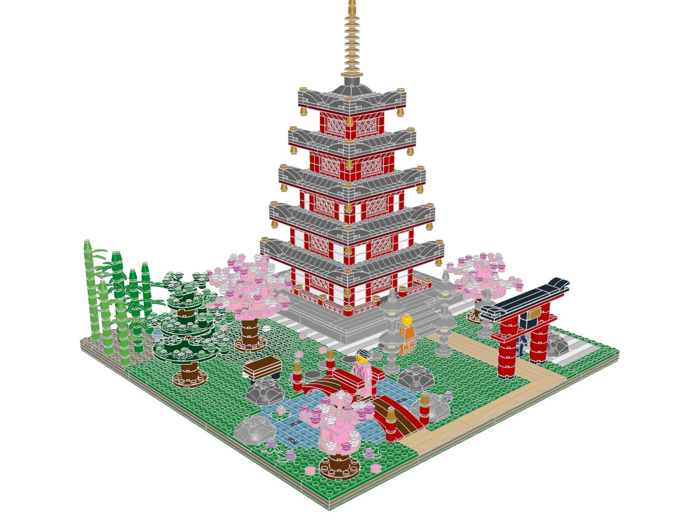

# Sakura Garden

A Japanese temple garden in cherry-blossom season, built on one 48×48 stud
baseplate. A vermilion five-storey pagoda with flared, gilded eaves stands on
a stone platform. You enter through a torii on a flagstone axis, cross a koi
pond on a humped bridge, and pass stone lanterns, a bamboo grove, a
cloud-pruned pine, a raked dry garden and three flowering cherries. A visitor
in a pink robe stands on the bridge, a monk walks the stepping stones, and a
gardener in a rice hat waits by the gravel.



**2,175 physical placements** (88 distinct parts, 244 part/colour rows) in
33 FILE blocks. The footprint is 960×960 LDU, and the model stands 944 LDU
tall.

## Files

| What | Where |
|---|---|
| Final model | [sakura-garden.mpd](sakura-garden.mpd) |
| Generator (edit this) | [generate.py](generate.py) → [sakura-garden.plan.json](sakura-garden.plan.json) |
| Hero renders | [render_hero.py](render_hero.py) → [hero/](hero) |
| Design brief | [design-brief.md](design-brief.md) |
| Visual review | [visual-review.md](visual-review.md) |
| Terrain map (top = back, bottom = front) | [terrain-map.txt](terrain-map.txt) |
| Validation | [sakura-garden.validation.json](sakura-garden.validation.json) |
| Full-contact inspection | [sakura-garden.inspection.json](sakura-garden.inspection.json), [connectivity.txt](connectivity.txt) |
| Overlap triage | [overlap-triage.txt](overlap-triage.txt) (from [overlaps-full.json](overlaps-full.json)) |
| BOM / LeoCAD comparison | [sakura-garden.bom.json](sakura-garden.bom.json), [sakura-garden.bom-comparison.json](sakura-garden.bom-comparison.json) |
| LeoCAD import check | [sakura-garden.check-model.json](sakura-garden.check-model.json) |
| Review renders | [review/](review) — home, front, back, left, right, top |
| Module renders and inspections | [modules/](modules) |
| Research (Jev queries, part boards, 10315 study) | [research/](research) |
| Earlier passes and prototypes | [iterations/](iterations), [proto/](proto) |
| Review helpers | [tools/](tools) |

## Rebuild

Run from the repository root:

```sh
.venv/bin/python output/sakura-garden/generate.py --map
./ldraw-agent build output/sakura-garden/sakura-garden.plan.json \
  --output output/sakura-garden/sakura-garden.mpd --detail summary --force \
  --report output/sakura-garden/sakura-garden.build.json
./ldraw-agent validate output/sakura-garden/sakura-garden.mpd --geometry --detail summary \
  --report output/sakura-garden/sakura-garden.validation.json
./ldraw-agent inspect output/sakura-garden/sakura-garden.mpd --contacts all --detail summary \
  --report output/sakura-garden/sakura-garden.inspection.json
./ldraw-agent bom output/sakura-garden/sakura-garden.mpd --report output/sakura-garden/sakura-garden.bom.json
./check-model.sh output/sakura-garden/sakura-garden.mpd
./ldraw-agent render output/sakura-garden/sakura-garden.mpd --outdir output/sakura-garden/review \
  --views home front back left right top
./ldraw-agent compare-bom output/sakura-garden/sakura-garden.mpd \
  --csv output/sakura-garden/review/leocad-bom.csv \
  --report output/sakura-garden/sakura-garden.bom-comparison.json
.venv/bin/python output/sakura-garden/render_hero.py
```

For the overlap and connectivity summaries, run `inspect --detail full --limit 6000`
(with `--contacts none` and `--contacts all` respectively), then
`tools/overlap_triage.py` and `tools/components.py` on the reports. The
generator is deterministic: two runs produce byte-identical plans.

## Checks on this exact revision

| Check | Result |
|---|---|
| `build` (assembly profile + geometry) | passed, no errors |
| `validate --geometry` | passed. Warnings: contacts skipped in auto mode (so full contacts were run separately) and non-curated parts need collision review |
| `inspect --contacts all` | 10,452 contacts; one component of 2,136 parts plus 32 small groups, all explained below |
| Overlap candidates | 2,797. Every pair deeper than stud engagement (29 part-pair groups) was reviewed; none is a material intersection (see below) |
| BOM vs LeoCAD | exact match, 2,175 = 2,175 |
| `check-model.sh` (LeoCAD import/snapshot/BOM) | passed |
| Images | review views and hero shots opened and reviewed ([visual-review.md](visual-review.md)) |

`physical_validity` stays `not_proven`, as intended.

### The 32 small connector groups

These are standard connections the connector solver can't pair, not floating
parts:

- 1×1 cones `4589` (bells, giboshi, jewels, bamboo tips, spire finial): the
  underside is typed as axle holes.
- The 3×3 dish lantern roofs `43898`: the centre socket is modelled as
  frictionless, although it sits exactly on the fire-box stud (y = −88 for
  both).
- Minifigure arms `43368/43369`: no connector metadata.
- Hair and hat: they follow the LDraw head-origin convention.

The real floaters that the checks found (the pagoda lattice screens) and the
wrongly seated figures (the 1.2 LDU foot-socket offset) were fixed.

### Deep overlap candidates reviewed

- **Rock shell over its hidden round brick:** surface sampling shows no rock
  surface inside the brick's volume.
- **Lantern dish over its fire box:** no dish surface inside the fire-box
  cylinder.
- **Bridge arch slopes against the tip plates, crown plate and crown posts:**
  bounding boxes only. The measured crest profile leaves the inner crown studs
  clear.
- **Two bamboo leaf fans at one level:** 15.8 LDU apart at their closest
  surfaces.
- **Minifigure internals, hat over head, plaque tile on side studs:**
  intended engagement.
- **Cherry disc against a lantern roof:** separated circles, 113 LDU apart
  between centres against a 90 LDU sum of radii.

## Physical limits not proven

- Clutch strength and stability were not measured. The pagoda's eave decks
  cantilever 2–3 studs over red corbels. Each wall course is bonded, but the
  1×1 corner posts are clamped columns.
- The bridge's central legs and the boulder rims rest on flat surfaces without
  clutch. They are held through their tips, sockets and hidden bricks.
- Several fronds and petals sit at 45° rotations on single studs. That is a
  valid rigid pose, but it isn't a grid-aligned build.
- I didn't do a detailed material-intersection pass. The containment and
  clearance cases above were checked by sampling LDraw surfaces instead.
- Availability of every part in every listed colour is not claimed.

## Attribution

This is an original design generated by the `ldraw-nova sakura-garden
generator`. Technique references came from LEGO set 10315 *Tranquil Garden*
(OMR source by Orion Pobursky, CC BY 4.0), which was studied but not copied.
The minifigure stack measurements are reused from this repository's
`examples/copper-bean` generator.

## Knowledge registration

```ldraw-knowledge
[
  {
    "id": "sakura-garden",
    "title": "Sakura garden",
    "scope": "construction",
    "kind": "assembly",
    "aliases": [
      "standalone:sakura-garden"
    ],
    "families": [
      "building"
    ],
    "legacy_groups": [
      "examples"
    ],
    "lesson": "Whole square garden combines five-tier pagoda at back right, foreground pond and humped bridge, torii, three blossom trees, pine and bamboo. Top view confirms distinct paths, gravel patch and planting zones. Retain scene decomposition and constrained terrain lesson; no whole-model physical certification. Layered square terrain with blue tiled pond, exposed bridge footing, tan paths, pagoda foundation zone and striped dry-garden tiles. Parent confirms placement beneath all scene modules.",
    "limits": "Static visual evidence only unless the linked package records specific further checks. Search eligibility does not certify fit, motion or strength.",
    "audit": "docs/plans/knowledge-base-overhaul/snapshot/standalone-audit.json",
    "model": "examples/sakura-garden/sakura-garden.mpd",
    "plan": "examples/sakura-garden/sakura-garden.plan.json",
    "generator": "examples/sakura-garden/generate.py",
    "model_sha256": "4880c2bdfc218d85629f9cffacbe52985092cdbe3e397f5ec0b2174e22b399a3",
    "audit_pointer": "/items/2",
    "findings": "docs/plans/knowledge-base-overhaul/snapshot/standalone-findings.md",
    "techniques": [],
    "subjects": [
      "architecture"
    ]
  }
]
```

## Audited section observations

These observations refer to the source hashes in the registrations. They correct earlier source descriptions and preserve static visual scope; existing numeric and export checks remain separate.

### Sakura garden

| Source section | Opened-image observation |
|---|---|
| `sakura-garden.ldr` | Whole square garden combines five-tier pagoda at back right, foreground pond and humped bridge, torii, three blossom trees, pine and bamboo. Top view confirms distinct paths, gravel patch and planting zones. Retain scene decomposition and constrained terrain lesson; no whole-model physical certification. |
| `garden-ground.ldr` | Layered square terrain with blue tiled pond, exposed bridge footing, tan paths, pagoda foundation zone and striped dry-garden tiles. Parent confirms placement beneath all scene modules. |
| `arched-bridge.ldr` | Two mirrored arched spans meet at central studded landing with short red handrails; gold-capped end posts and brown walking strip. Parent crosses pond, not a generic long-span bridge. Preserve resting-foot and clearance limits. |
| `torii-gate.ldr` | Red round-column torii with black upswept cap, lower crossbar and gold side-mounted plaque; parent places it at entrance. Preserve plaque mounting transform. |
| `stone-lantern.ldr` | Grey round pedestal lantern with broad dish roof and conical finial, repeated along approach and garden. Simple decorative lamp, not a transparent lit enclosure; retain dish-socket evidence limitations. |
| `cherry-large.ldr` | Largest pink cherry has round trunk and layered circular canopy cores with offset sprigs and pink/white flower carpet. Parent places it behind pond beside pagoda. Retain technique with boundary-aware branch omissions. |
| `cherry-medium.ldr` | Medium blossom tree uses same stepped disc/sprig method, smaller crown and side-specific spread; actual right-front placement checked. Parameter variant, not unrelated lesson. |
| `cherry-small.ldr` | Small blossom tree has narrow two-level flower mass and asymmetrical sprigs over round trunk, in front corner. Its omitted outward branches are deliberate for boundary fit. |
| `garden-pine.ldr` | Cloud-pruned pine uses round green canopy pads with raised sprigs and dark-green rosettes around a round trunk. Preserve asymmetrical canopy and actual inset terrain position, not a generic palm recipe. |
| `temple-plinth.ldr` | Despite its name, temple-plinth section includes the entire nested pagoda as well as stone platform. Index it as pagoda-on-plinth assembly, not an isolated foundation part. |
| `pagoda.ldr` | Nested pagoda contains five progressively smaller storey/eave modules plus crown and gold spire. Actual parent is temple-plinth; preserve hierarchy and distinguish platform from tower. |
| `pagoda-storey-0.ldr` | Storey 0: red lattice wall core with grey swept eaves, gold corner caps and hanging bells; actual level reviewed in pagoda. White side panels remain visible. Front view resolves walls obscured by roof in home/top views; retain as parameterized tier family. |
| `pagoda-storey-1.ldr` | Storey 1: red lattice wall core with grey swept eaves, gold corner caps and hanging bells; actual level reviewed in pagoda. White side panels remain visible. Front view resolves walls obscured by roof in home/top views; retain as parameterized tier family. |
| `pagoda-storey-2.ldr` | Storey 2: red lattice wall core with grey swept eaves, gold corner caps and hanging bells; actual level reviewed in pagoda. White side panels remain visible. Front view resolves walls obscured by roof in home/top views; retain as parameterized tier family. |
| `pagoda-storey-3.ldr` | Storey 3: red lattice wall core with grey swept eaves, gold corner caps and hanging bells; actual level reviewed in pagoda. Narrower red core has no white side panels. Front view resolves walls obscured by roof in home/top views; retain as parameterized tier family. |
| `pagoda-storey-4.ldr` | Storey 4: red lattice wall core with grey swept eaves, gold corner caps and hanging bells; actual level reviewed in pagoda. Narrower red core has no white side panels. Front view resolves walls obscured by roof in home/top views; retain as parameterized tier family. |
| `pagoda-crown.ldr` | Small grey hipped cap bridges the top storey and spire; four exposed upper studs. Not the entire upper roof. |
| `pagoda-spire.ldr` | Gold ringed spire with stepped conical finial and thin tip; installed above separate crown. |
| `temple-steps.ldr` | Five shallow grey tiled treads form approach to pagoda platform; plain stacked stair recipe. |
| `boulder-72.ldr` | Dark-grey purpose-made rock shell at three terrain sites; keep hidden-support and resting-rim limitations from existing report. |
| `boulder-71.ldr` | Light-grey variant of same rock-shell detail at three other terrain sites; consolidate colour variants. |
| `tsukubai.ldr` | Tiny round grey water-basin prop capped by transparent blue round element. Abstract basin rather than detailed hollow vessel. |
| `garden-bench.ldr` | Brown slab bench on two dark round supports; deliberately minimal prop. |
| `bamboo-10-10-64219.ldr` | Tall light-green bamboo with four leaf nodes, varied headings and conical tip; one member of seven-culm grove. |
| `bamboo-8-2-89675.ldr` | Dark-green bamboo with three leaf nodes and varied headings, actual grove position reviewed. |
| `bamboo-9-2-93053.ldr` | Tall dark-green bamboo with four leaf nodes; heading variation avoids neighbouring culms in source layout. |
| `bamboo-7-10-51145.ldr` | Shorter light-green bamboo with two leaf nodes, asymmetrical fans; grove variant. |
| `bamboo-7-2-53705.ldr` | Short dark-green bamboo with two leaf nodes; grove variant. |
| `bamboo-8-2-61408.ldr` | Dark-green bamboo with three leaf nodes; grove variant. |
| `bamboo-6-10-63775.ldr` | Shortest light-green bamboo with two leaf nodes; grove variant. Seven variants together have twenty leaf-bearing nodes. |
| `visitor-pink-robe.ldr` | Standing pink-clothed visitor with hair bun, actual bridge-crown placement reviewed. Preserve documented handrail clearance and foot offset. |
| `gardener.ldr` | Standing dark-blue gardener with broad conical hat beside dry garden. Shared minifigure assembly family. |
| `monk.ldr` | Standing orange-clothed bald monk on approach beside steps. Role is scene narrative, not a distinct mechanical construction. |
