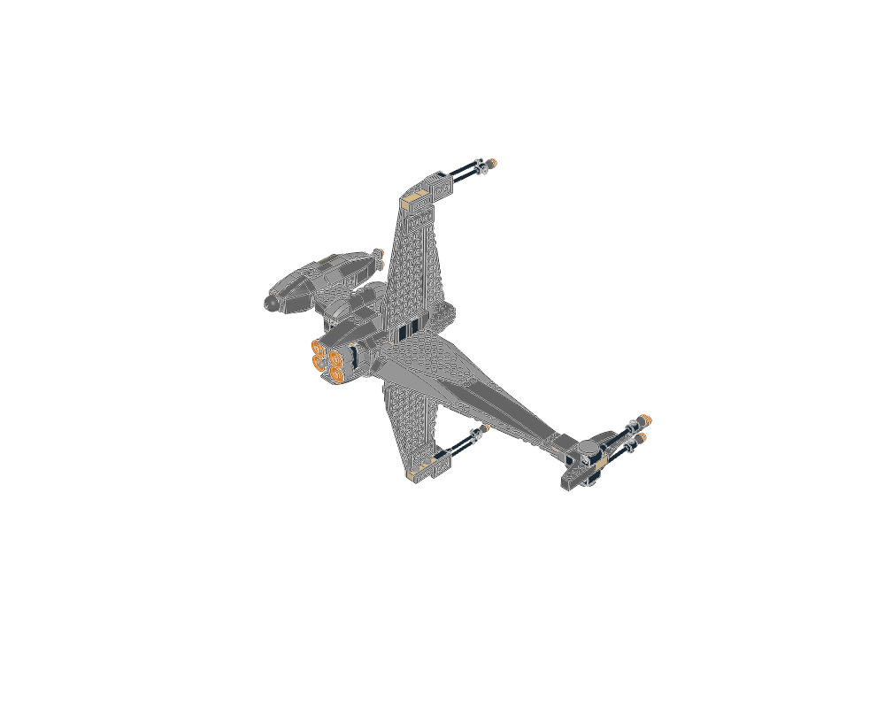
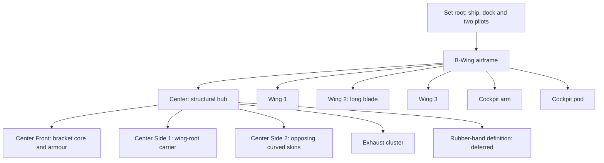
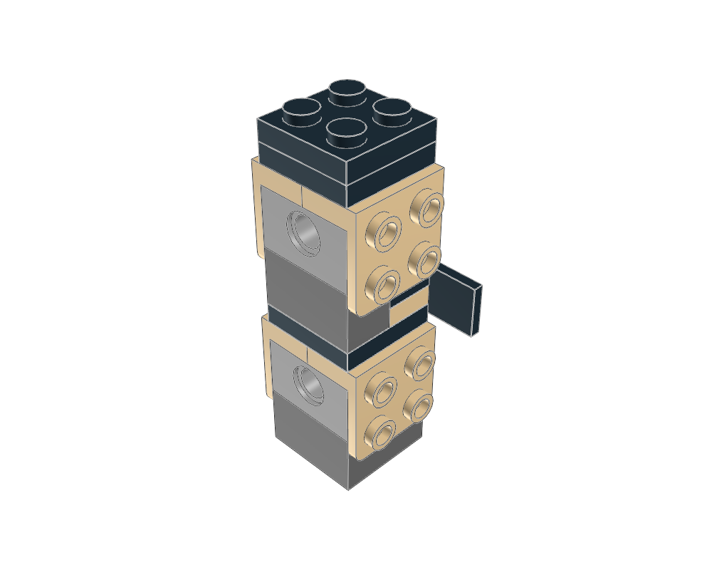
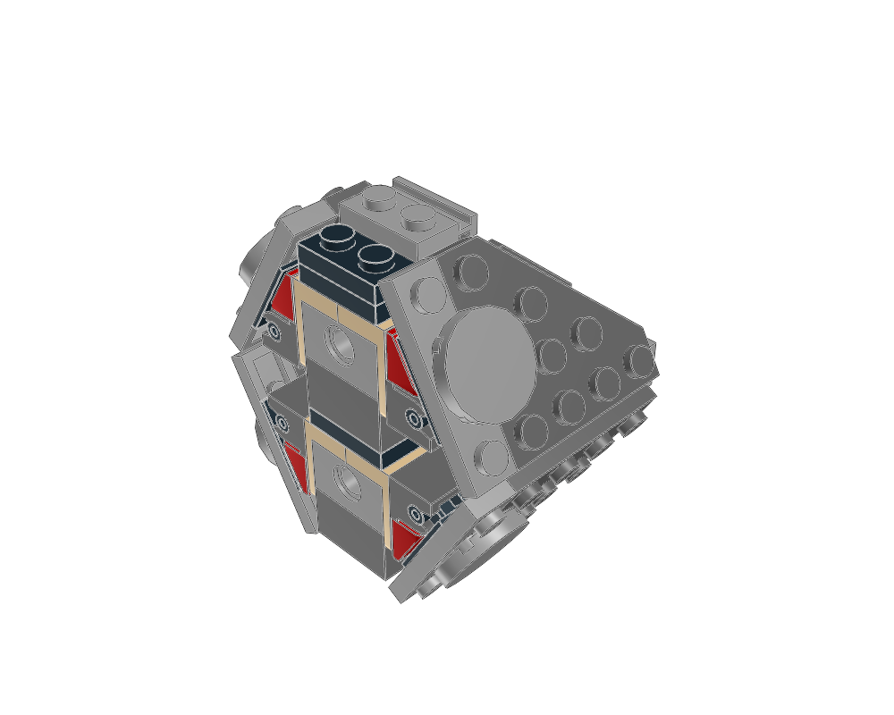
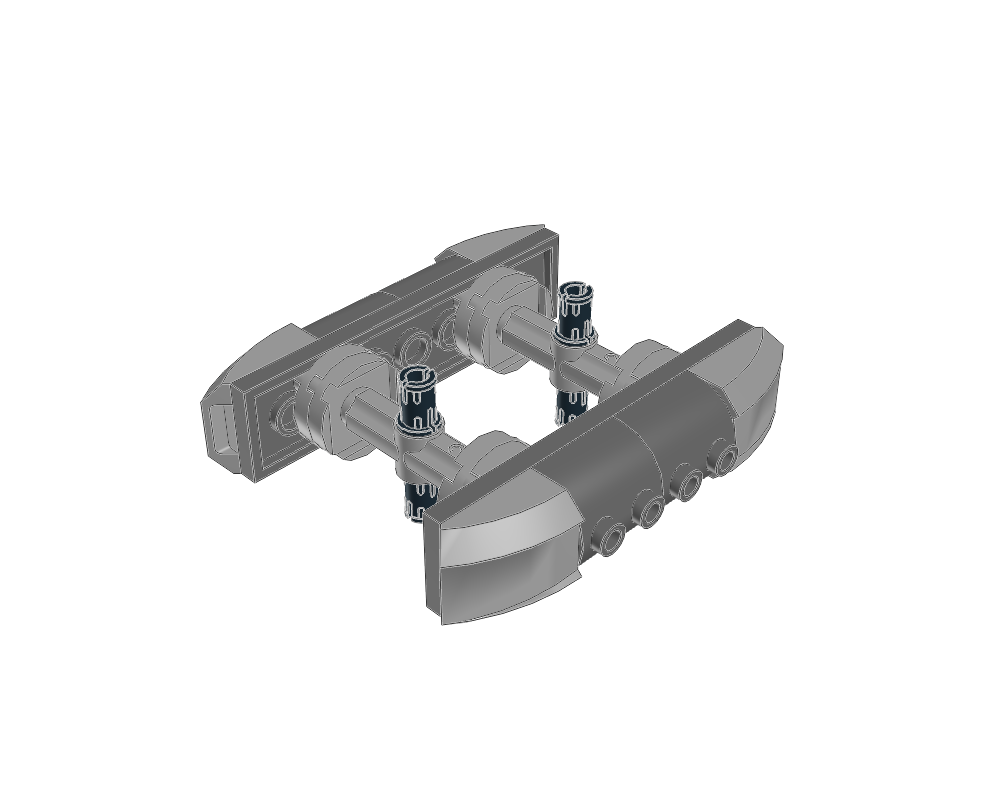
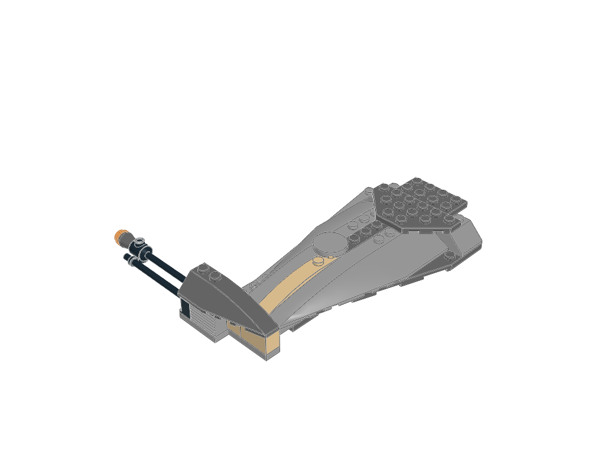
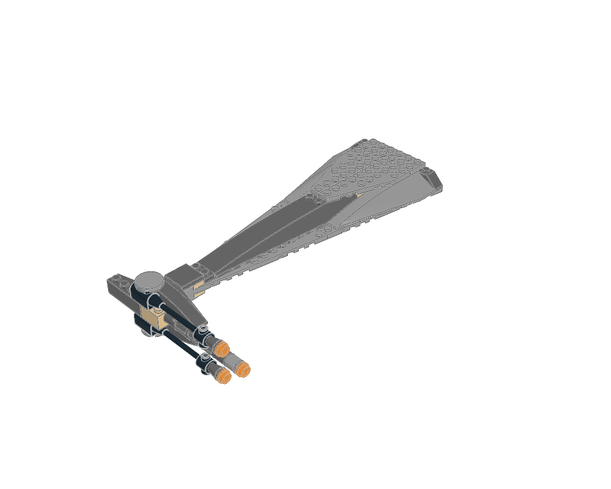
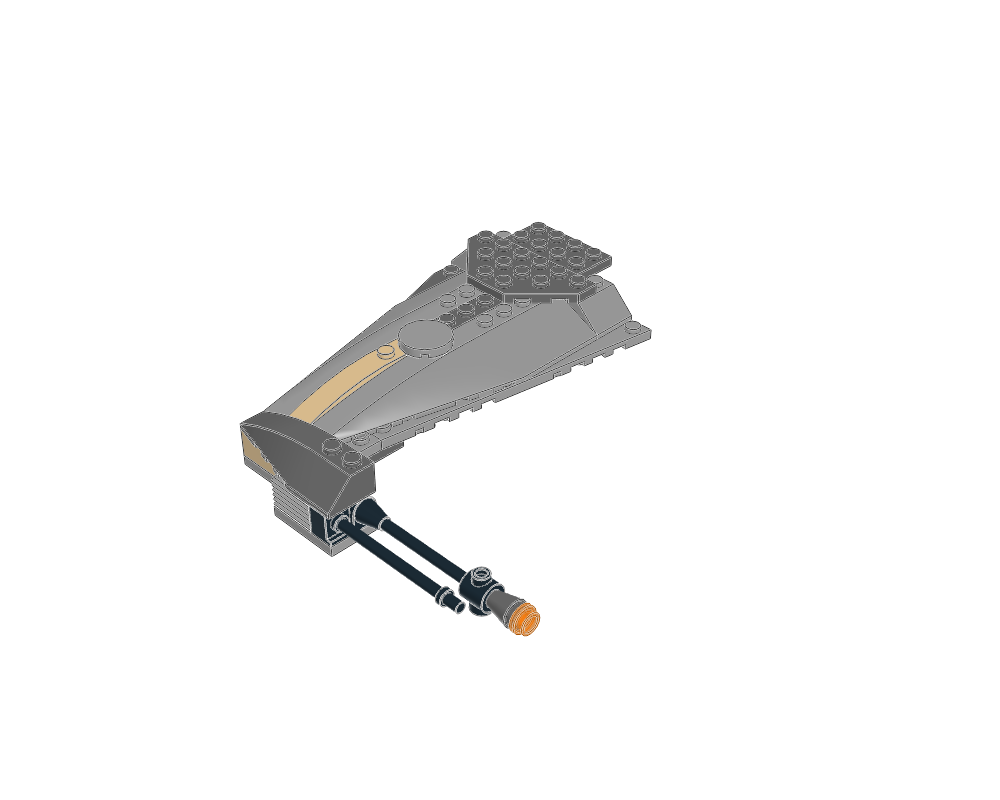

# Spaceship SNOT basics from the 6208 B-Wing

**Build small assemblies in convenient local stud grids, then attach them around a structural core.** This B-Wing combines bracket-mounted details, Technic-mounted skins, hinged armour and separately oriented wings. A spaceship does not need one global direction for every stud.

This is a construction-learning study of the supplied `6208-1.mpd`. Geometry repairs and verification, rubber-band handling and mechanism behavior are deferred as requested. The original model and its placements remain unchanged. This is a different source from the [75050 B-Wing](../../spaceship-atlas/b-wing/GUIDE.md) already in the atlas.

[](studies/airframe/source.mpd)

## 1. Separate silhouette from construction

The ship's identity comes from a compact hub, one long blade, two smaller wings and a cockpit on an offset arm. Decide these masses before adding surface details. The long blade and the cockpit balance one another across the hub; repeated wing-tip details and orange accents tie the different masses together.

The source supplies a useful hierarchy:



Use `6208 - B-Wing.ldr` for the airframe. The set root also includes the docking station and two pilots. Unlike the Ferrari reference, these child placements are actually declared by the source.

Every assembly section has **one nonempty construction state**. The following order is a suggested way to learn or design, not an original instruction sequence. The two cutaways select existing parts for visibility and introduce no new placements or STEP groups.

## 2. Build a core with useful attachment faces

The [central body](studies/center/renders/home.png) layers long plates and bricks around Technic bricks with holes. This gives the ship a hub to which several different modules can attach. Reserve these attachment areas before closing the exterior.

The 51-piece `Center Front` is the clearest small SNOT lesson. Its core has **four `44728` brackets**, arranged in two opposing pairs, and a `2436a` bracket facing another direction. Plates capture the bracket bases in the upright stack. The brackets expose new stud planes for the surrounding details.

| Exposed core: 16 selected source placements | Complete front assembly |
|---|---|
| [](studies/front-core/cutaway.mpd) | [](studies/front/source.mpd) |

A separate [nine-piece selection](studies/front-fins/renders/home.png) shows the next level: two `52107` side-stud bricks support a smooth tiled face and four `44661` fins. Several facing directions can emerge from a small ordinary stack. Choose the supporting stud faces first, then the visible tile, fin or slope.

The four `3937`/`6134` hinge pairs around this core carry the angled armour plates. **Perpendicular bracket faces and oblique hinged faces perform different jobs.** Preserve that distinction when designing a faceted nose: brackets establish the side attachments; hinges establish the sloped outer panels.

## 3. Use Technic fittings to carry System skins

[](studies/side-shell/source.mpd)

`Center Side 2` supplies a second way to change stud direction. It combines two `32034` angle connectors, `32062` axles, `6558` pins and eight `4032a` round plates with axleholes. Two `3034` plates carry the visible skin; `30165` curved-top bricks and `30602` curved slopes shape its exterior.

Read the construction from the inside outward: **Technic attachment → axlehole round plates → broad plate skin → curved surface.** The two skins face opposite directions in this module's local frame. Their curves cover a comparatively simple internal structure. This is useful for engine housings, rounded hull sections and pods whose surface grid differs from the main frame.

The source calls this a side panel, but the complete module is itself rotated in its parent. Names such as “side” and “top” are local descriptions; inspect the parent placement before deciding where a surface faces on the complete ship.

## 4. Give wings their own grid and root

The [17-piece wing-root carrier](studies/wing-root/renders/home.png) combines four `30540` locking hinge bricks, three `3700` Technic bricks, three `6558` pins and a narrow plate stack. Pins attach the carrier; hinge fingers provide the wing interfaces. The wings contain the corresponding `30389b` locking hinge bricks.

Build each wing as a relatively flat module. Use dedicated wing plates and wedges for the outline, place reinforcing layers near the root, and keep the outer blade thin. The parent assembly turns these local constructions into the ship's three-wing arrangement.

| Wing 1 | Long blade: Wing 2 | Wing 3 |
|---|---|---|
| [](studies/wing-1/source.mpd) | [](studies/wing-2/source.mpd) | [](studies/wing-3/source.mpd) |

The two smaller wings are separate 27-piece constructions. Their opposite-hand parts include `30355`/`30356`, `47398`/`47397` and `41747`/`41748`. Learn the paired construction and its actual handed pieces. The existing annotation's word “mirrored” describes their appearance, not a reflected part transform to copy.

## 5. Design the cockpit and engines as distinct modules

The [cockpit arm](studies/cockpit-arm/renders/home.png) is a plate-bonded Technic support with a shaped cover. The [cockpit pod](studies/cockpit/renders/home.png) supplies its own tub, axle core, controls and **`30384` transparent windscreen**. Its `44728` bracket turns the rear `30367b` dome sideways. Work around the canopy and attachment parts before covering the cabin with wedges.

In the airframe, the cockpit's local up direction becomes `-X`; its parent placement rotates the whole assembly. The model's display placement rotates it again. This illustrates why a submodel's ordinary upright stack can become SNOT relative to its parent. The source's native airframe nose points toward `+Z`; its camera labels are not vehicle-relative front/rear labels.

The [exhaust assembly](studies/exhaust/renders/home.png) has **four** repeated nozzle stacks: `43093` axle-pin support, `3941` round brick and `4740` translucent dish. Their origins form a two-by-two arrangement. Repeated small constructions provide visual rhythm and concentrate the bright orange colour at the rear. The central shaft and rubber-band mechanism are outside this lesson's scope.

The source prose is useful for finding sections but is not authoritative construction evidence: its whole-set description says “twin” exhausts, and its cockpit description confuses the brown slope with the canopy. The actual records and views establish four nozzles and a separate transparent windscreen.

## Apply the lessons to another spaceship

1. Sketch the few masses that make the ship recognizable, including its empty spaces.
2. Give the hub, wings, cockpit and engines separate local frames and attachment roles.
3. Choose how each surface changes direction: bracket, side-stud brick, Technic interface or hinge.
4. Build the support before its visible skin. Keep a cutaway view available while designing.
5. Use matched wedges, curved parts and a real canopy to shape the outline; concentrate small details around engines, roots and tips.
6. Place complete modules around the frame. Reuse the technique while designing the new attachment and proportions for the new ship.

## Source, images and reproduction

[original.mpd](original.mpd) is a byte-identical copy of the supplied file and of `data/models-annotated/6208-1.mpd`. Credit: **Merlijn Wissink [Legolijntje]**, with the original **CCAL version 2.0** licence statement retained. [study.json](study.json) pins the source hash and records the selected sections and lessons. Each study folder contains its attributed extraction, source inventory, actual parent transforms and image hashes. Cutaway metadata also lists its exact zero-based placement indices and original source line numbers.

[generate.py](generate.py) reuses the existing parser, extractor, serializer and LeoCAD renderer. It performs no rotation normalization, geometry repair, collision/connectivity checks or checked-model export. Bounds are used only for camera framing. The original rubber-band definition stays in the dependency-closed source. The [image review](visual-review.md) records **22 inspected views across 13 studies**, including the two cutaways.

```sh
.venv/bin/python examples/snot/b-wing-6208/generate.py
# Optional: regenerate just one view group.
.venv/bin/python examples/snot/b-wing-6208/generate.py --only front-core
```

Generated work goes to `output/b-wing-6208-study/`; the inspected snapshots are retained under `studies/` here. This study records construction knowledge, with geometry and physical verification explicitly deferred. It does not change the existing atlas's checked-export behavior.
