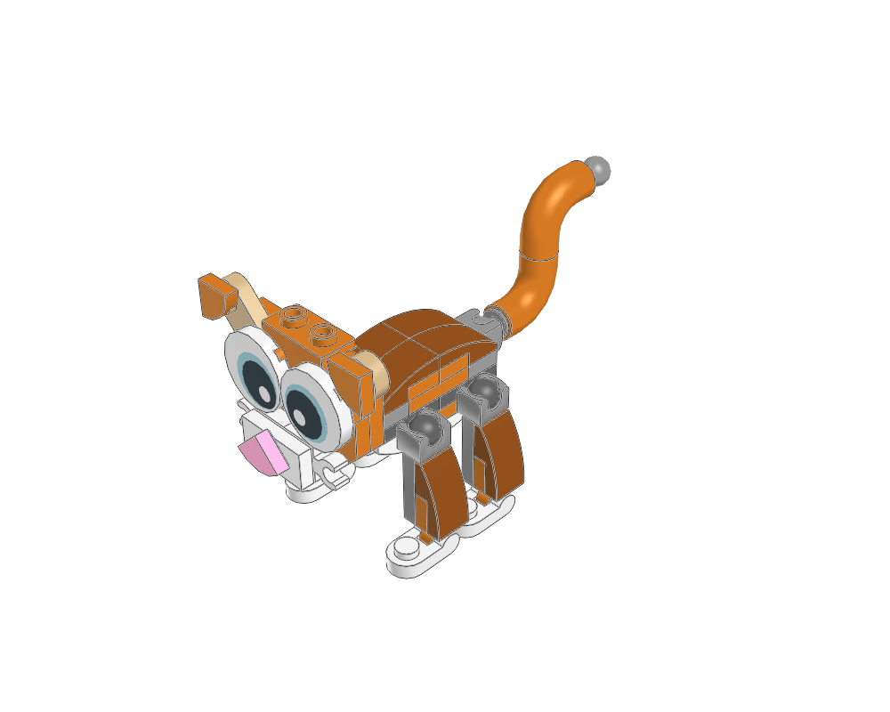
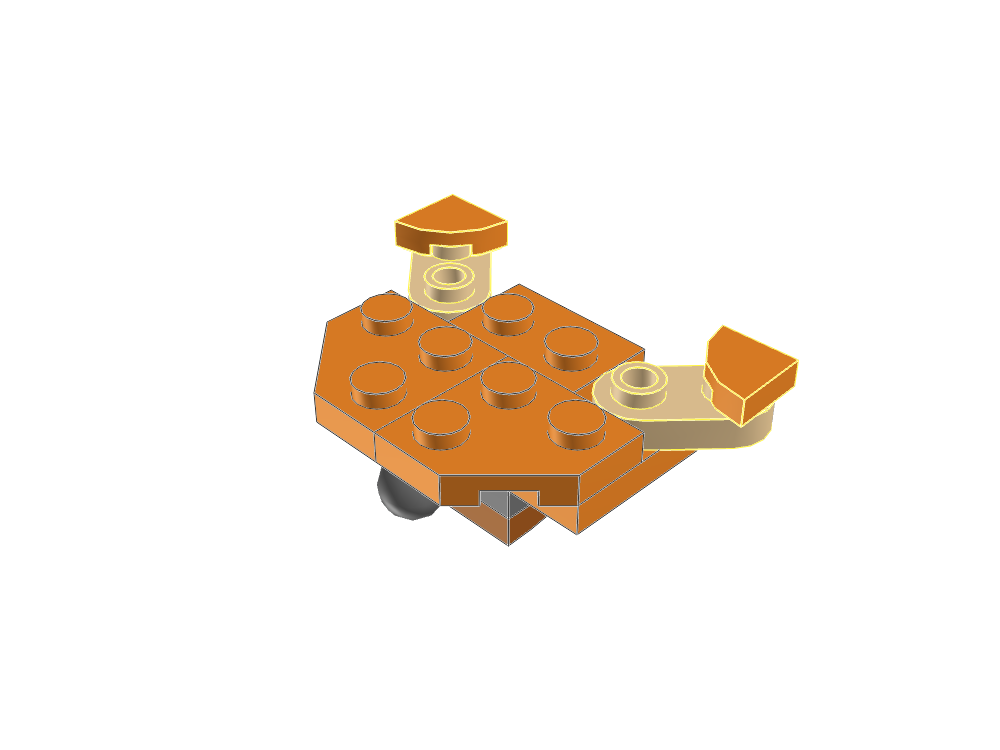
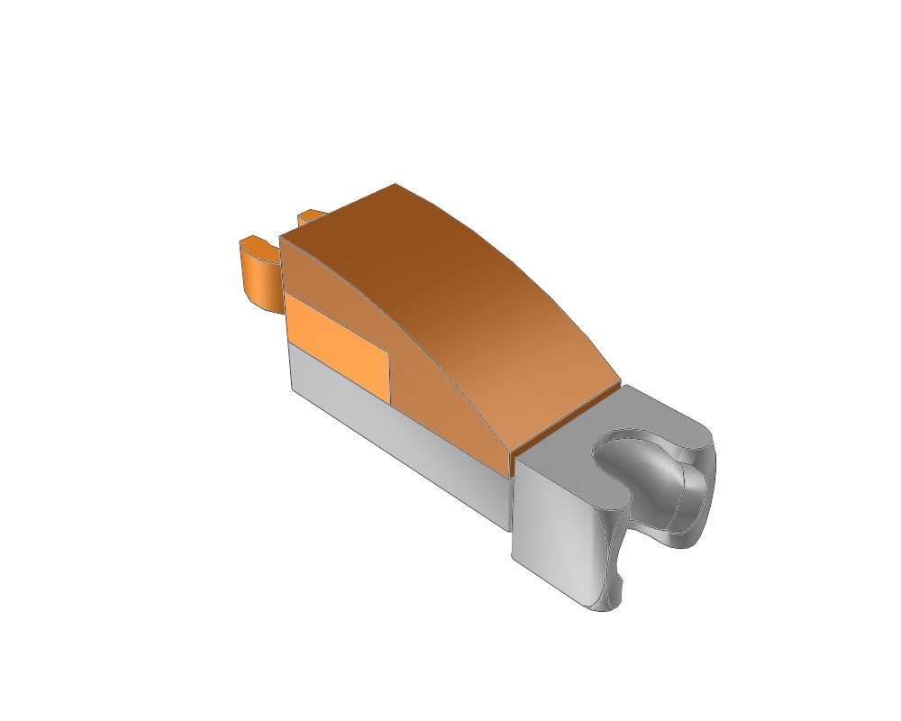

# Cat: diagonal details and compact joints

This reference adds **construction variety**: details angled around one stud, a layered face, and a three-piece leg reused four times. It complements the parrot's fixed SNOT core and the boombox's large panels. Its proportions are a separate design choice; use the connections without inheriting the whole appearance.



| Study | Pieces | Editable source | Ready MPD |
|---|---:|---|---|
| Face panel, eight stages | 16 | [head.plan.json](head.plan.json) | [head.mpd](head.mpd) |
| Leg with hip socket and ankle clip | 3 | [leg.plan.json](leg.plan.json) | [leg.mpd](leg.mpd) |
| Complete cat, including both studies | 55 | [cat.plan.json](cat.plan.json) | [cat.mpd](cat.mpd) |

```sh
./ldraw-agent review examples/snot/cat/head.plan.json --outdir output/snot-cat-head
./ldraw-agent review examples/snot/cat/leg.plan.json --outdir output/snot-cat-leg
./ldraw-agent review examples/snot/cat/cat.plan.json --outdir output/snot-cat-cat
```

Use `--force` to deliberately replace a previous review. These are ordinary builder plans, with explicit colours and no new authoring format. The full plan includes the head and leg plans.

## What transfers to another model

| Construction | Lesson | Possible use |
|---|---|---|
| `35480` round-ended plates, each attached at one end | Rotate around the engaged socket; the free end leaves the stud grid | Diagonal trim, eyebrows, small fins |
| `25269` quarter-round tiles | A single-stud tile can turn within its plane; check surrounding material clearance | Noses, markings, curved corners |
| `15573` jumper over two `60897` clip plates | Centre a detail between stud columns and layer it in front of neighbouring shapes | Muzzles, badges, compact controls |
| `14418` socket plate, `60897` clip and `11477` curve | Keep a repeatable limb rigid between two distinct joint interfaces | Small creatures and articulated figures |
| Two `25214` elbows around a `32062` axle | Form a curved tube from actual keyed parts | Tails and pipe details |

**The head's orientation comes from its neck ball joint.** It is built flat, then posed upright. The `99781` brow bracket exposes sideways studs but those studs do not support another part in this model. The ear and nose rotations happen within the face plane. These are useful companions to SNOT, not another example of a fixed perpendicular stud connection; start with the [parrot](../parrot/README.md) for that.

## Read the face before the eyes cover it



The face is authored flat: -Y points out of the face, +Z toward the ears, and the `3020` plate top is the origin. Its stages correspond to [LEGO's printed steps 11–18](https://www.lego.com/cdn/product-assets/product.bi.core.pdf/6310454.pdf).

| Stage | Construction |
|---|---|
| 1 | Rear inverted curve and neck ball plate |
| 2 | 2 × 4 face plate ties the rear pieces together |
| 3 | Brow bracket |
| 4 | Two corner-cut cheek plates |
| 5 | Round-ended ears and quarter-round tips |
| 6 | Printed eyes cover the ear attachments |
| 7 | Two clip plates suggest whiskers |
| 8 | Centred jumper muzzle and angled nose |

The left ear uses a 45° local Y rotation. Its engaged socket is local `[10,8,0]`; its support stud is `[-30,0,10]`. Thus its origin is `[-37.071067812,-8,17.071067812]`, obtained from `target - R*socket`. Its free stud is at `[-44.142135624,-8,24.142135624]`. These fractional coordinates are required by the diagonal: rounding them to integers would move the clutch off its stud. The right ear retains the source's slightly different angle.

The jumper top is `[0,-24,-30]`. The nose has `yaw: 45` and origin `[0,-32,-30]`, so its socket at local `[0,8,0]` lands exactly on that stud. The 8 LDU difference is tile thickness. A rotated shape still needs clearance from its neighbours; a single stud does not make every angle usable.

```sh
./ldraw-agent manual prepare examples/snot/cat/head.mpd \
  --section cat-head.ldr --outdir output/snot-cat-head-steps --views home bottom
```

Open `output/snot-cat-head-steps/index.html`. To reuse the face, include its plan and place `cat-head.ldr` as one module. Its `neck` anchor is the ball centre `[0,12,-30]`. In the full cat, a +90° X rotation faces the panel toward -Z and places that centre on the body's neck socket. An anchor aids placement; it does not validate the joint's movement range.

## Repeat the leg; pose the paw separately



`cat-leg.ldr` has its origin at the hip socket centre. Its ankle clip centre is `[-60,-8,0]`. The full model places four copies using proper rotations, then places each `26047` paw so its bar meets the ankle clip. The paws remain pointed toward -Z on both sides. Rotating a complete leg-and-paw copy by 180° would also turn the paw backward; keeping the paw at its own joint avoids that mistake. No part is mirrored.

The tail uses two elbows and an axle, plus a towball at each end. One ball meets the body socket; the other is the visible tip. This is a separate axle/ball construction, not a sideways-stud lesson.

## Preparation and evidence

[source.ldr](source.ldr) is the supplied file byte-for-byte. Its `Author` header names **LEGO Digital Designer 4.3**, which identifies software rather than a human author. No human attribution or licence was supplied; none is invented. The original root file remains unchanged. The prepared MPDs add proper FILE sections, headers, modules and construction steps.

[preparation.json](preparation.json) accounts for all 55 original placements, their source lines, resulting occurrences and transform changes. The source's ankle centres were about 0.19 LDU away from their paw bars. The prepared model seats these exactly while keeping the paws grounded; the body, head and tail move by about 0.185 LDU. Every translation correction is **less than 0.191 LDU**, before a common +30 LDU Z translation centres the body. Ear rotations are preserved and made orthonormal; their positions are solved from the engaged sockets. Six identity aliases `3023.dat` become `3023b.dat`. Part and colour quantities are otherwise unchanged.

All three reviews pass source/geometry error checks and match LeoCAD's BOM. The head and leg each form one automatic optimistic group. **The full cat still reports four groups**: recessed underside sockets and a tail axle crossing the reviewed Technic registry's coverage boundary. [Interface evidence](interface-evidence.json) explains those omissions without changing the checker or its tolerances. The [visual review](visual-review.md) records inspected images, aesthetic lessons and verification limits.
