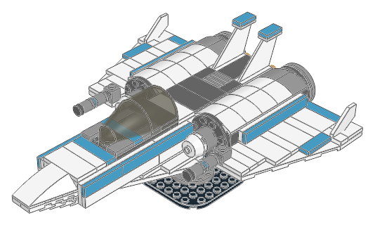
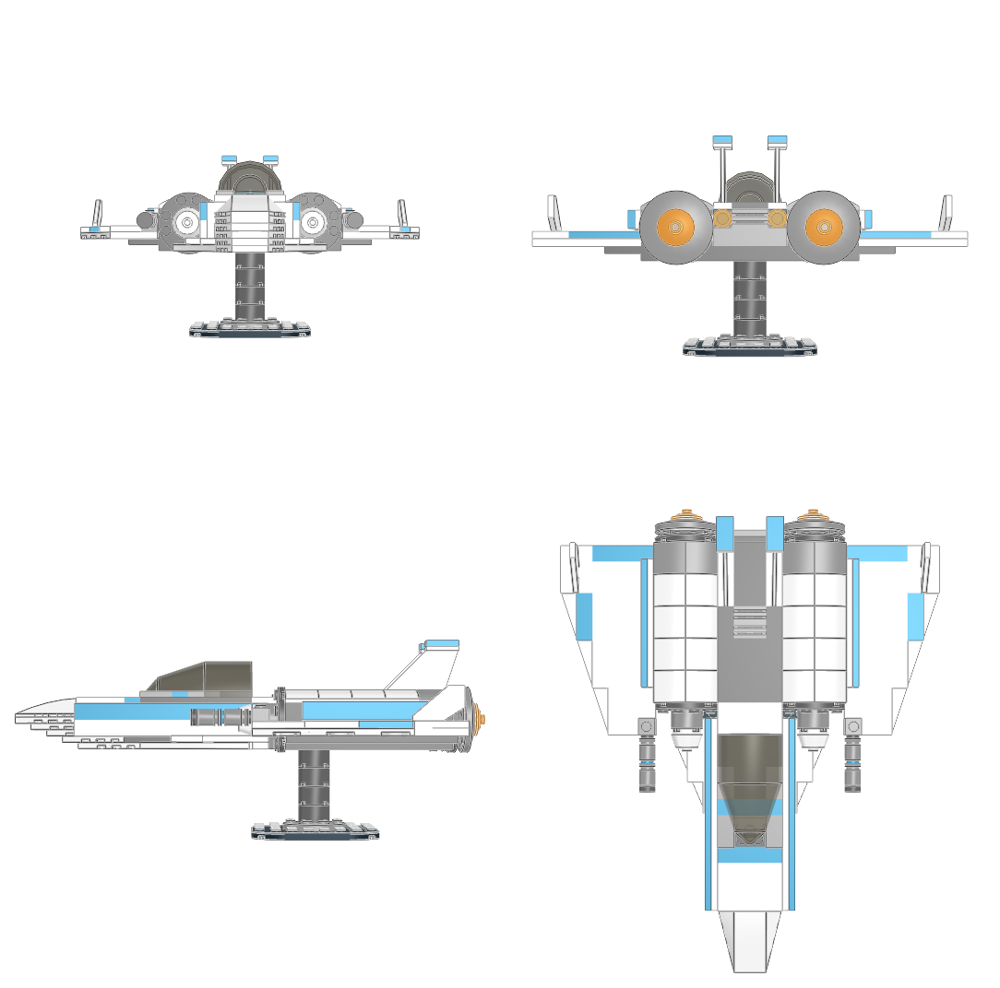
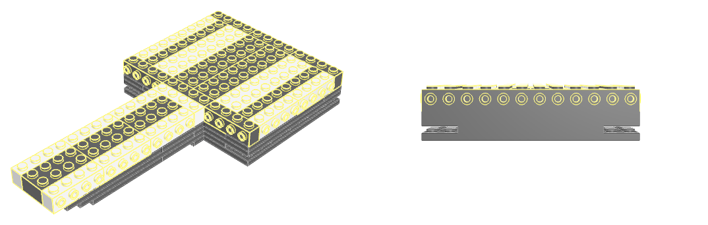
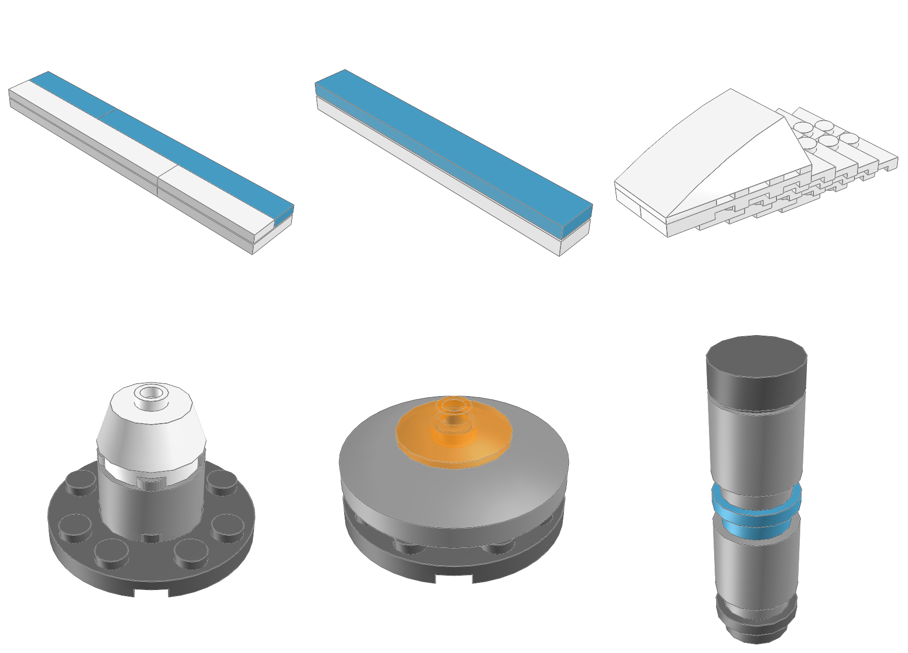
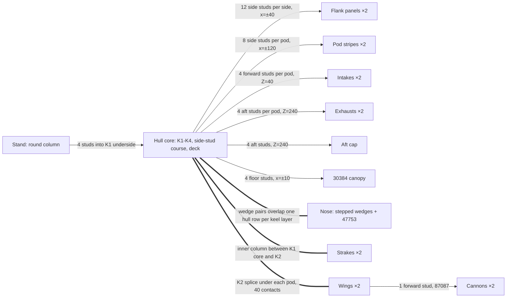

# Halcyon: an original SNOT interceptor

**This is the default model to follow for spaceship construction and visual quality. All new spaceships use SNOT by default.** Adapt its core-and-skin construction to the requested ship's silhouette and scale. Copy the editable design with `./ldraw-agent spaceship export halcyon --outdir output/my-ship`.

**A studs-up core supplies stud faces in five directions; the side, front and rear surfaces are modules built upright in their own frames and turned onto those faces.** The parrot, cat, F40 and B-Wing are prepared from existing models. The Halcyon is the first original design in this folder to use those lessons.



| Study | Pieces | Editable source | Ready MPD |
|---|---:|---|---|
| Complete ship, stand and 16 modules | 195 | [generate.py](generate.py) → [halcyon.plan.json](halcyon.plan.json) | [halcyon.mpd](halcyon.mpd) |

```sh
.venv/bin/python examples/snot/halcyon/generate.py
./ldraw-agent review examples/snot/halcyon/halcyon.plan.json --outdir output/snot-halcyon-review \
  --contacts all --views home front back left right top bottom
./ldraw-agent manual prepare output/snot-halcyon-review/model.mpd --section halcyon-hull.ldr \
  --outdir output/snot-halcyon-steps/halcyon-hull --views home back
```

The generator writes an ordinary plan for the existing builder; it adds no format or library code. Ship axes follow the [spaceship guide](../../../docs/agent/spaceships.md): X is width (starboard +X), -Z is forward, -Y is up. Y=0 is the keel underside. The ship measures 584 × 480 × 140 LDU (about 29 × 24 × 7 studs) without its stand.



## 1. Build the core first and expose its stud faces

The hull is a plain studs-up stack. Its one brick course uses fifteen `30414` bricks (1 × 4, side studs on one face), each yawed so its studs face the module it carries. Hull step 5 shows them before anything covers them:



| Layer | Top Y | Contents |
|---|---:|---|
| K1–K4 | -8, -16, -24, -32 | Keel plates. K1/K3 and K2/K4 use different seams; K2/K4 bridge the core/pod joint at x=±40 |
| K5 | -40 | Only under the nose cap |
| Side-stud course | -56 | `30414` side studs at Y=-46; plain bricks elsewhere |
| Deck | -64 | Tiles, cockpit floor plate, curved pod tops |

All side studs sit at Y=-46, 10 LDU below the course top. This one height lets the flank stripe and pod stripes line up. Unrotated, `30414` has its studs on the -Z face, so yaw selects the direction: 0° faces forward, 180° faces aft, -90° faces +X and 90° faces -X.

## 2. Build each skin upright, then turn it onto a face

Each sideways module is authored as an ordinary upright stack, so plates still sit on studs and tiles still cover them. The root then rotates the whole module so its local up (-Y) faces the stud face:



| Module | Local up becomes | Seated on | Contacts |
|---|---|---|---:|
| `halcyon-flank-s/p` | ±X | three `30414` per side, x=±40 | 12 each |
| `halcyon-pod-panel-s/p` | ±X | two `30414` per pod, x=±120 | 8 each |
| `halcyon-intake` (×2) | -Z | one `30414` per pod front, Z=40 | 4 each |
| `halcyon-exhaust` (×2) | +Z | one `30414` per pod rear, Z=240 | 4 each |
| `halcyon-aft-cap` | +Z | centre `30414`, Z=240 | 4 |
| `halcyon-cannon` (×2) | -Z | one `87087` on each wing root | 1 each |

The root computes each origin as `stud - R * socket`, as in the [SNOT guide](../../../docs/agent/snot.md#start-from-a-real-connection). For the starboard exhaust, `R = [[1,0,0],[0,0,1],[0,-1,0]]` sends local up to +Z. The ring's socket `[10,8,-10]` becomes `[10,-10,-8]`. Seated on the stud at `[90,-46,240]`, it gives the origin `[80,-36,248]`. The intake, exhaust and cannon are rotationally symmetric about their own axes, so each is one section placed twice by translation.

The port flank uses the same parts as the starboard one, but a different proper rotation. That rotation sends local Z to the opposite world direction, so the port section puts its accent row at local Z=-10 instead of +10. Nothing is mirrored.

## 3. Module topology



Solid arrows are sideways or upright stud faces carrying a separate module. Thick links are interleaved keel-layer bonds: the strakes, wing splices and nose wedges sit between hull plates. The root's steps add modules in reading order. A physical build would insert those interleaved parts between the K layers.

## 4. Shape without exposed studs

| Feature | Construction | Lesson |
|---|---|---|
| Nose | Handed `41769`/`41770` pairs on K1–K5, each 80 LDU long and ending one stud further forward than the layer below, under a `47753` triple-curved wedge | Overlap each wedge pair with the next layer's hull plates; the stagger also gives a rising chin |
| Strakes | Handed `3933`/`3934` 4 × 8 wing plates at K1, inner column under the narrowed hull core | They fill the gap between nose and wings, turning a T-shaped plan into an arrowhead |
| Pods | `15068` curved slopes back to back along each pod centreline, with a grey band at the rear | Two curved slopes back to back make a rounded nacelle top |
| Wings | Handed `30355`/`30356` 6 × 12 plates, fully tiled, with `44661` tip fins | Choose tile rectangles that reach every stud row; the diagonal edge stays a clean plate edge |
| Tails | Two `2340` on the spine edges, capped with tiles | A symmetric pair avoids a one-stud offset on a 4-wide spine |

A real canopy sets the cockpit width: `30384` is four studs wide and mounts on four floor studs. The tiled floor shows through the smoked glass.

## 5. Evidence and limits

The final review passes source and geometry checks with no errors. Python and LeoCAD BOMs both count 195 placements. The automatic contact graph is **one optimistic group** from 1,265 contacts, and each of the 16 module sections, checked alone, is also one group. The only warning is `coverage.collision_review`: curved and irregular parts have no rectangular body envelope. [visual-review.md](visual-review.md) lists the images opened, the five design iterations and the remaining limits.

[tests/test_halcyon.py](../../../tests/test_halcyon.py) checks five things:

- the generator reproduces the plan
- every rotation is proper
- the build is byte-identical to `halcyon.mpd` and forms one group
- each SNOT interface in section 2 has its exact contact count with zero residual
- a flank moved 1 LDU outboard is detected

`physical_validity` remains `not_proven`. Clutch strength, the stand's balance and real colour availability are not certified. [brief.json](brief.json) records the starfighter brief with the scale, palette and module decisions filled in.

## Reuse the approach

1. Choose one side-stud height for the whole hull, so stripes and skins line up.
2. Build the core and render it before the skins; every stud face should have a planned module.
3. Author each skin upright in its own section, then seat it with `stud - R * socket`.
4. Use real handed parts; let a port section differ in arrangement instead of mirroring.
5. Stagger seams inside a module so it holds together by itself, not only through its mounts.
