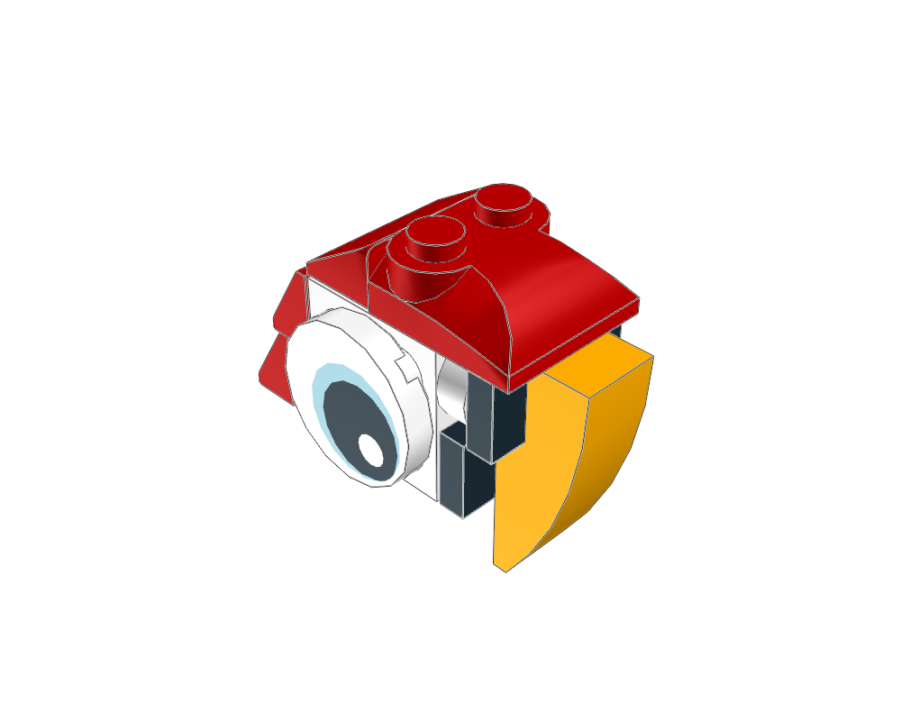
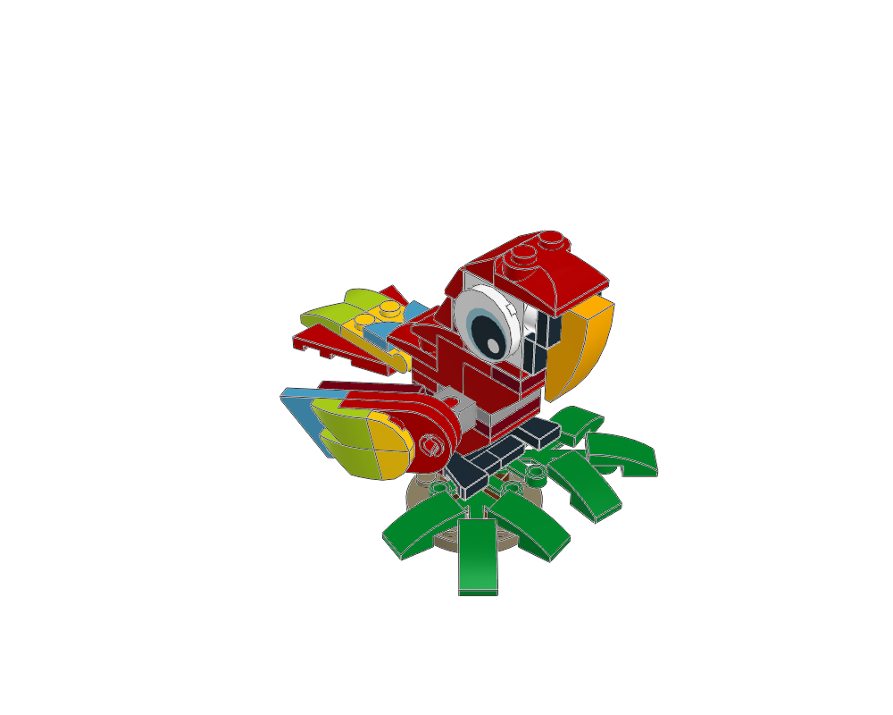

# Tropical Parrot: first SNOT reference

Start with the **14-piece head**, then inspect the **66-piece complete parrot**. The plans use the existing builder; there is no additional SNOT format or generator to learn.



| Reference | Editable source | Ready MPD |
|---|---|---|
| Head: seven stages, one connected group | [head.plan.json](head.plan.json) | [head.mpd](head.mpd) |
| Complete bird: body, head, wings, tail and perch | [parrot.plan.json](parrot.plan.json) | [parrot.mpd](parrot.mpd) |

```sh
./ldraw-agent review examples/snot/parrot/head.plan.json --outdir output/snot-head
./ldraw-agent review examples/snot/parrot/parrot.plan.json --outdir output/snot-parrot
```

Use `--force` to deliberately replace an existing review. Read the reports and open the previews. The full plan includes `head.plan.json`, so edits to the head feed both models.

## Read the head in seven stages

The turntable top is the origin; -Y is up, +X faces the beak and ±Z face the eyes. The `neck` anchor is an authored positioning frame for the turntable, not automatic joint validation.



| Stage | Added construction | Official instructions |
|---|---|---|
| 1 | Turntable top, `3679` | 11 (base belongs to the body) |
| 2 | Two opposing `67329` side-stud bricks | 12 |
| 3 | Rear plate and staggered beak supports | 13 |
| 4 | Two rear slopes | 14 |
| 5 | Eyes on opposite side faces | 15 |
| 6 | Crown and rear crown slope | 16 |
| 7 | Curved beak on the two jumper studs | 18 |

Official step 17 attaches the head to the body. This standalone study completes the beak before attaching the head; it is a teaching sequence, not a claim to reproduce every printed step boundary.

```sh
./ldraw-agent manual prepare output/snot-head/model.mpd \
  --section parrot-head.ldr --outdir output/snot-head-steps --views home back
```

Open `output/snot-head-steps/index.html`. The [SNOT guide](../../../docs/agent/snot.md) explains the socket alignment, half-stud offsets and rotations to reuse in another model. Add this head plan through `includes` and place `parrot-head.ldr` as one rigid module, preserving its author credit. Its palette is explicit; a parent colour does not recolour the internal parts.

## Complete bird and preparation



The body follows printed steps 1–11, including two tail subassemblies. Each wing has five local stages and an origin at its ball centre. The perch follows steps 21–24. The root assembles body, completed head, two wings and perch. Left and right wings use the correct handed moulds, not mirrored transforms.

[source.ldr](source.ldr) is the supplied file, byte-for-byte, credited to **marco9999**. [LEGO's official instructions](https://www.lego.com/cdn/product-assets/product.bi.core.pdf/6399229.pdf) establish the intended construction sequence. The source has no licence statement; preparation adds attribution without inventing a licence.

[preparation.json](preparation.json) records the source hash, original placement indices/lines, prepared section/occurrence, transforms and corrections. Coordinates were re-seated on the intended grids and pivots; arbitrary wing and foliage angles were preserved as proper rotations. The largest translation correction is **0.011462 LDU** before a common -80 LDU X translation centres the perch. Three identity aliases `3023.dat` were updated to their library target `3023b.dat`; the inventory is otherwise unchanged.

Both reviews pass source and geometry error checks and match LeoCAD's BOM. **The full bird still reports ten automatic connection groups.** The [visual review](visual-review.md) and [interface evidence](interface-evidence.json) explain the recessed connections behind those groups. Use the head as the focused SNOT example; keep the full model's limitations visible when adapting it.
