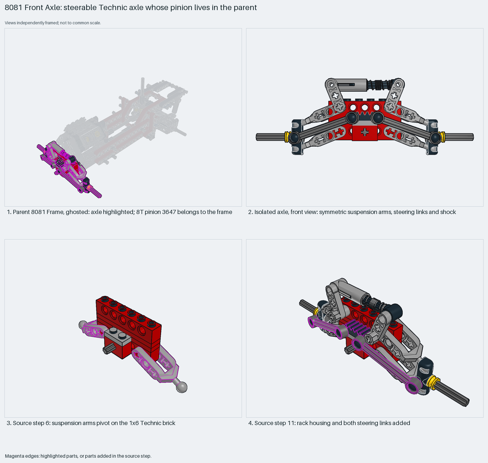

# Steerable Technic front axle; the pinion lives in the parent

A steerable, sprung Technic front axle carries the steering rack, but the 8T pinion that drives the rack is placed in the parent frame.

Reusable source construction: source checks pass and the Python and LeoCAD BOMs match.

Technic chassis · 29 parts · 13 source steps in 2 sections

[Build pages](index.html) · [Inspection board](board/mosaic.png) · [Source](source.mpd) · [Editable plan](scene.plan.json) · [Checks](source-checks.json) · [Board provenance](board/board.json)



## Read the construction

29 parts in 11 source steps. Step 6: suspension arms pivot on a 1×6 Technic brick, with towball ends. Step 9: the shock absorber. Step 10: two `8081 - Front Axle S10` hub children (steering arm, axle and bush). Step 11: the gear rack with towball and both 6L steering links.

The parent places the axle at `0 -10 -120` with an identity matrix, so axle axes are frame axes. In axle coordinates the rack's toothed face is at y = −22 and the parent's pinion sits at y = −30, which matches the 10 LDU pitch radius of an 8T gear.

## What the parent supplies

- `8081 - Frame.ldr` places it at `0 -10 -120`, matrix `1 0 0 / 0 1 0 / 0 0 1`.

The front axle of the 8081 chassis (`8081 - Frame.ldr`).

The **8T pinion `3647`**, placed in `8081 - Frame.ldr` on the line after the axle. The isolated submodel has a rack and no pinion, which is the gap seen in the Technic car trial.

## Description check

- **Database (accurate):** “Steerable front axle assembly with suspension arms, shock absorber, steering rack, and steering links.”
- **What it is:** A steerable, sprung front axle with a steering rack and links. It lacks the pinion, which the parent places.

## Read the board

Panel 1: the ghosted frame, with the axle highlighted. Panel 2: the isolated axle from the front, showing the symmetric arms, links and shock. Panels 3–4: source steps 6 (arms on the 1×6 brick) and 11 (rack and links). The isolated home view duplicates step 11, so the board leaves it out.

Magenta edges mark highlighted parts or the parts added in a source step. Pale grey, see-through parts are ghosted context. A neon-green rod (`#39FF14`) is a synthetic axis marker, not a part. Stud maps recolour each part by where its studs point: up lilac, +X rose, −X vermilion, +Z electric blue, −Z aqua, down lime, odd angle violet. These synthetic colours are ΔE ≥ 16 from every LDraw colour. LDraw −Y is up; LeoCAD `right` shows the model's right side, from −X.

Replay a board into `output/`:

    ./ldraw-xray board run examples/submodel-atlas/recipes/01-8081-front-axle.json --output output/boards/01-8081-front-axle

## Reuse it

Reuse it with its drive: copy the 8T pinion `3647` and its steering axle from the parent, or add an equivalent input. Without them the rack has nothing to move it. Keep the two hub children and the links together; they set the steering geometry.

```sh
./ldraw-agent manual export examples/submodel-atlas/01-8081-front-axle --outdir output/my-01-8081-front-axle
./ldraw-agent build output/my-01-8081-front-axle/scene.plan.json --output output/my-01-8081-front-axle/01-8081-front-axle.mpd
```

Export needs a current visual review. Build the copied plan, then inspect its interfaces in the new model.

The placement plan preserves source axes. `source_origin` is a positioning frame, not a physical connector.

## Limits

No view shows the teeth meshing; the mesh is a coordinate match only. Steering and suspension travel were not checked.

The source and renders teach a construction. They do not prove clutch, fit, clearance, travel or stability. Boards are rendered from synthetic inspection copies, and poses are rigid re-placements.

## Source and evidence

Source: `8081-1.mpd` / `8081 - Front Axle.ldr`, SHA-256 `3fef02705debc0930762955a5dd92465cb09a2fe4d1f1eccdf7e9d6b20b2699e`. Parent: `8081 - Frame.ldr`. Look it up with `./ldraw-agent discover show submodel-791f781795f6b497d640ae2e`.

Original authors and licences stay in [source.mpd](source.mpd); [extraction.json](extraction.json) records renamed sections and 2 bounded preparation changes. Python and LeoCAD BOMs match. The visual review is recorded separately, after opening the actual images.
