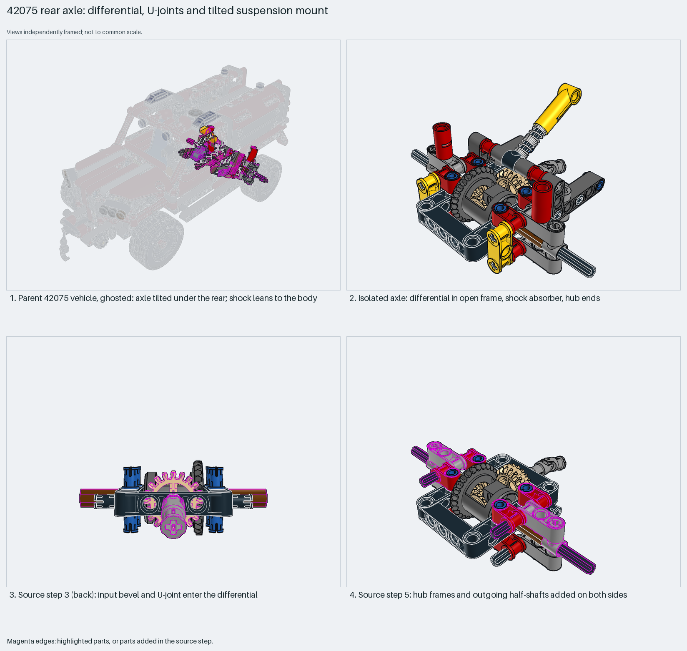

# Differential rear axle with U-joints, mounted tilted

A driven Technic rear axle: a differential in an open frame, U-joints and half-shafts. The parent's matrix sets its tilt.

Inspiration study: the source keeps errors (`coverage.raw_geometry` ×5801, `geometry.nonplanar` ×1920). Study the technique and rebuild it; `manual export` is blocked.

Technic chassis · 63 parts · 9 source steps in 2 sections

[Build pages](index.html) · [Inspection board](board/mosaic.png) · [Source](source.mpd) · [Editable plan](scene.plan.json) · [Checks](source-checks.json) · [Board provenance](board/board.json)

## Read the construction

63 parts in 8 evenly sized steps (6–12 placements each). Step 2: the differential with 12-tooth bevels. Step 3 (back view): the input double bevel and a U-joint enter the differential in its open 7×5 frame. Step 5: cross blocks and axles form the hub frames and outgoing half-shafts on both sides. Step 7: the shock absorber child.

The parent places it with matrix `-1 0 0 / 0 0.932 -0.363 / 0 -0.363 -0.932`: about 21° about X plus a half turn. The input U-joint takes the drive; the shock's top end anchors to the body.

## What the parent supplies

- `42075 - vehicle.ldr` places it at `0 76.289 193.183`, matrix `-1 0 0 / 0 0.932 -0.363 / 0 -0.363 -0.932`.

The rear axle of `42075 - vehicle.ldr`, tilted under the rear, with the shock leaning up to the body.

The tilted mount and the body anchor for the shock. The ghosted parent shows both.

## Description check

- **Database (accurate):** “Rear axle assembly featuring a differential with bevel gears, universal joints, and a multi-link suspension structure.”
- **What it is:** A rear axle with a bevel differential, universal joints and multi-link suspension.

## Read the board

Panel 1: the ghosted vehicle shows the tilt and the shock anchor. Panel 2: the isolated axle. Panel 3: source step 3 from the back, where the input bevel and U-joint enter the differential. Panel 4: step 5, hub frames and half-shafts.

Magenta edges mark highlighted parts or the parts added in a source step. Pale grey, see-through parts are ghosted context. A neon-green rod (`#39FF14`) is a synthetic axis marker, not a part. Stud maps recolour each part by where its studs point: up lilac, +X rose, −X vermilion, +Z electric blue, −Z aqua, down lime, odd angle violet. These synthetic colours are ΔE ≥ 16 from every LDraw colour. LDraw −Y is up; LeoCAD `right` shows the model's right side, from −X.

Replay a board into `output/`:

    ./ldraw-xray board run examples/submodel-atlas/recipes/02-42075-rear-axle.json --output output/boards/02-42075-rear-axle

## Reuse it

Keep the differential frame, U-joint input and half-shafts together. Derive the tilt for the new chassis instead of copying the matrix: the tilt sets the input shaft angle. Replace the generated spring mesh with a real shock absorber part before reuse.

Rebuild the technique with the new model's own parts and interfaces; the source errors above stay in this copy.

The placement plan preserves source axes. `source_origin` is a positioning frame, not a physical connector.

## Limits

Inspiration only: the shock child `42075 - shock-06_5L-hard-1.ldr` includes an LDCad-generated spring mesh made of raw polygons, which fails the source checks (`coverage.raw_geometry`). The Technic construction itself raised no errors. Suspension travel and U-joint angles were not checked.

The source and renders teach a construction. They do not prove clutch, fit, clearance, travel or stability. Boards are rendered from synthetic inspection copies, and poses are rigid re-placements.

## Source and evidence

Source: `42075-1.mpd` / `42075 - rearaxle.ldr`, SHA-256 `1b44ac7315a873ff5658ccfd75080273fa95d3ce3d541623a2d8feec2ed7bb2c`. Parent: `42075 - vehicle.ldr`. Look it up with `./ldraw-agent discover show submodel-a6ae0a0fca56420448522444`.

Original authors and licences stay in [source.mpd](source.mpd); [extraction.json](extraction.json) records renamed sections and 7 bounded preparation changes. Python and LeoCAD BOMs match. The visual review is recorded separately, after opening the actual images.
